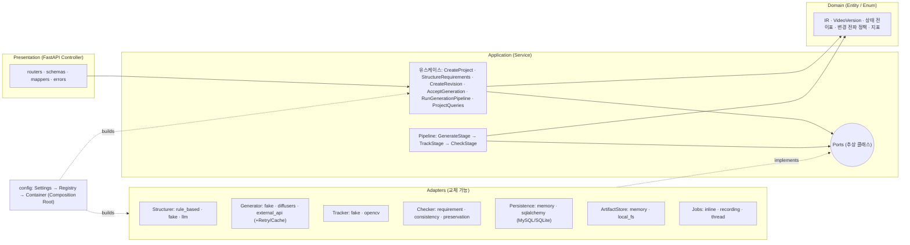
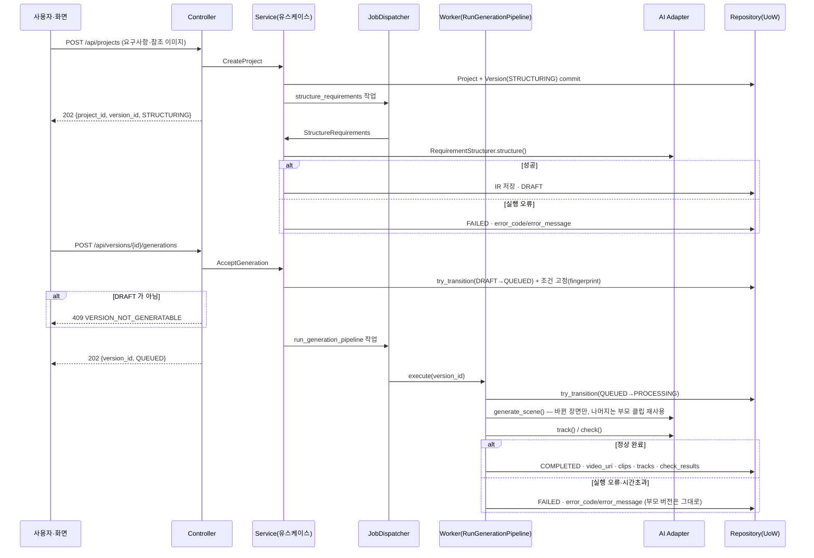
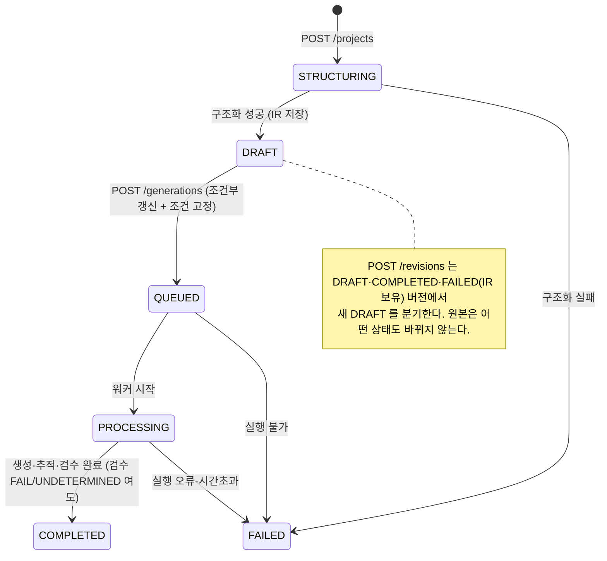

# FRAME 백엔드·파이프라인 아키텍처 제안 (TDD 기준)

> 프로젝트: 구조화된 중간 표현 기반의 숏폼 비디오 선택적 편집 및 일관성 제어 프레임워크 (01조, 종합설계2)
> 근거 자료: Drive 공유 폴더의 디자인개요서 · 문제점목록 · 아이디에이션 결과보고서 · 문제정의서 · Product Backlog ·
> Sprint 1 Planning/Backlog · 「시스템 구조 설계 및 개발 환경」과 그 안의 다이어그램 5종(논리 아키텍처, Core Flow 1·2 시퀀스, ERD, 컨셉 UI).

이 문서는 **제안서이자 동작하는 스켈레톤의 설명서**다. `src/frame` 과 `tests/` 가 이 문서의 모든 구조를 그대로 구현하고 있으며,
Fake 어댑터만으로 전체 흐름(접수 → 구조화 → 생성 접수 → 생성·추적·검수 → 수정 버전 → 전후 비교)이 테스트로 검증된다.

---

## 1. 한눈에 보기

| 항목 | 제안 |
|---|---|
| 아키텍처 | 과제 문서의 4계층(Presentation / Application / Persistence / Domain)을 그대로 유지하고, Application 의 바깥 경계를 **포트(인터페이스)** 로 고정한 **Ports & Adapters(헥사고날)** 구조 |
| 교체 가능 요소 | 구조화 모델 · 영상 생성 모델 · 클립 조립 · 객체 추적 모델 · 검수기 3종 · DB · 산출물 저장 · 비동기 실행기 · 변경 전파 규칙 — 전부 포트 + 설정 키로 교체 |
| 핵심 불변 요소 | **모델 비의존 중간표현(IR)**. 모델이 바뀌어도 IR·유스케이스·API 는 바뀌지 않는다 |
| 선택적 수정 전략 | **장면 단위 생성 + 생성 조건 fingerprint**. 수정 버전은 조건이 바뀐 장면만 재생성하고 나머지 장면 클립은 재사용(바이트 동일) → AC-01 비대상 보존의 1차 보장 |
| 상태·무결성 | 문서의 상태 enum(STRUCTURING→DRAFT→QUEUED→PROCESSING→COMPLETED/FAILED)과 무결성 규칙 5개를 도메인(상태 전이표·IR.validate)과 DB(조건부 UPDATE·UNIQUE·FK) 양쪽에서 강제 |
| TDD | 5단 테스트 피라미드(도메인 → 유스케이스(Fake) → 어댑터 계약 → 통합(SQLite) → API/인수). AC 번호를 `@pytest.mark.ac("AC-xx")` 로 추적 |
| 스택 | Python 3.11 · FastAPI 0.115.13 · SQLAlchemy 2.x(MySQL 8.4 운영, SQLite 테스트) · pytest · Docker (문서의 개발 환경 그대로) |

---

## 2. 입력 자료에서 추출한 설계 제약

| 출처 | 추출한 제약 | 설계 반영 |
|---|---|---|
| Product Backlog · Sprint 1 | US-06(구조화) → US-01(선택 수정·재생성) → US-03(추적·일관성) → US-04(대시보드) 순서, AC-01/02, AC-11~14, AC-31~34, AC-41~44 | 유스케이스 6개와 인수 테스트가 AC 단위로 대응 |
| 시스템 구조 설계 §2.1 | 4계층 책임/금지사항, AI 모델 연동은 Adapter 를 통해서만 | 계층별 import 규칙 + `application/ports` |
| §2.2 Core Flow 1·2 | 202 접수 → 비동기 구조화 → DRAFT; DRAFT→QUEUED 원자적 갱신·조건 고정; 실행 오류는 FAILED+원인, 검수 FAIL/UNDETERMINED 는 COMPLETED | `CreateProject`·`StructureRequirements`·`AcceptGeneration`·`RunGenerationPipeline` |
| §3.1 ERD + Enum | PROJECT/VIDEO_VERSION/SCENE/ENTITY/SCENE_ENTITY/REFERENCE_IMAGE/REQUIREMENT/CHECK_RESULT, VersionState·TrackingStatus·CheckType·Verdict | `domain/enums.py`, `domain/models.py`, SQLAlchemy 모델 |
| §3.1 무결성 규칙 1~5 | DRAFT 에서만 접수, 키 유일성, 같은 프로젝트/버전 참조 | §7 표 참조 |
| §3.2 Endpoint Catalog | 7개 API, 202/201/409 | `presentation/routers` |
| §1.3 성공 지표 | 수정 성공률 ≥80% · 비대상 변경률 ≤10% · 반영률 ≥80% · 고정 속성 유지율 ≥90% | `domain/metrics.py`, `evaluation/edit_metrics.py` |
| 문제정의서 §4.3 리스크 | GPU 부족·긴 생성 시간 / 구조화·매핑 오류 / 일관성 저하 | 재시도·캐시 Decorator, 장면 단위 재사용, 구조화 결과 사용자 확인(DRAFT 단계), UNDETERMINED 판정 |
| Won't 목록 | 픽셀 단위 편집·완전 자동 역추출·오디오 편집 제외 | 마스크는 추적 결과(박스)까지만 제공, 편집 단위는 장면 |

---

## 3. 권장 아키텍처

### 3.1 계층과 의존 규칙



의존 규칙 (import 로 강제):

| 계층 | import 가능 | import 금지 |
|---|---|---|
| `domain` | 표준 라이브러리 | 모든 외부 패키지, 다른 계층 |
| `application` | `domain`, 자기 `ports` | FastAPI, SQLAlchemy, torch, 어댑터 구현 |
| `adapters` | `application.ports`, `domain`, 외부 라이브러리 | `presentation`, 다른 어댑터(공용 common 제외) |
| `presentation` | `application`(DTO·유스케이스), `config.Container` 타입 | 어댑터 구현, DB |
| `config` | 전부 (유일한 조립 지점) | — |

### 3.2 요청 흐름 (Core Flow 1·2 대응)



수정 흐름(Core Flow 2)은 `POST /revisions` → `CreateRevision`(원본 IR 복제 + 변경 전파 → 새 DRAFT, `parent_version_id` 연결) 뒤에
위와 같은 생성 흐름을 탄다. 전후 비교는 두 버전을 각각 `GET /versions/{id}` 로 조회하면 된다.

### 3.3 버전 상태 기계



전이표는 `domain/state_machine.py` 한 곳에만 있고, `VideoVersion.transition_to()` 가 이를 강제한다.
동시 접수 경쟁은 `VersionRepository.try_transition()` (SQL: `UPDATE ... WHERE state='DRAFT'`) 로 하나만 성공한다.

### 3.4 생성 파이프라인과 선택적 재생성

```
RunGenerationPipeline
 ├─ GenerateStage   장면별 SceneGenerationRequest(fingerprint = 장면 조건 + 객체 정의 + 참조 이미지 + seed)
 │                  부모 버전에 같은 fingerprint 의 클립이 있으면 재사용, 없으면 VideoGenerator.generate_scene()
 │                  → VideoAssembler.assemble()  (최종 영상)
 ├─ TrackStage      장면별 ObjectTracker.track() → TrackRecord (SCENE_ENTITY.tracking_status / track_uri)
 └─ CheckStage      CheckSuite(REQUIREMENT · CONSISTENCY · PRESERVATION) → CheckOutcome → CHECK_RESULT
                    (무결성 규칙 5: 결과가 참조한 요구조건이 이 버전에 있는지 검증)
```

- 어느 단계에서든 `AdapterError`/`DomainError`/예외가 나면 `PipelineFailure(stage, error_code, message)` 로 정규화되어
  버전은 `FAILED` + `error_code` + `"[stage] message"` 로 기록된다. 후속 단계는 실행되지 않는다.
- 수정 버전은 부모의 `seed` 와 참조 이미지를 그대로 물려받으므로, 바뀌지 않은 장면은 fingerprint 가 같아 **재생성되지 않는다**.
  이것이 "비대상 객체/배경 90% 이상 유지"(AC-01)를 모델 품질과 무관하게 장면 단위에서 보장하는 장치다.
  재생성된 장면 내부의 보존은 `PreservationChecker` 가 점수로 판정한다.

### 3.5 조건 고정과 재현성

생성 조건 = `IR(fingerprint)` + `seed` + 참조 이미지 URI. 접수 시 `VideoVersion.frozen_fingerprint` 에 IR 해시를 저장하고,
이후 IR 은 바뀌지 않는다(바꾸려면 새 DRAFT). 클립마다 자신을 만든 조건의 fingerprint 를 갖고 있으므로 "어떤 조건으로 만든 결과인지" 항상 추적된다.

### 3.5a IR 스키마 규칙 (2차 검토 반영, ADR-0007)

| 규칙 | 내용 | 강제 위치 |
|---|---|---|
| 술어 어휘 | 술어는 `domain/vocabulary.py` 로 정규화된다 (`colour`·`색상` → `color`). 등록 술어는 값 종류(COLOR/TEXT/NUMBER/POSITION/ENTITY)와 관계 여부를 가진다. 미등록 술어도 정규화 후 허용 | `RequirementSpec.__post_init__`, `AttributeChange.__post_init__` |
| 관계 조건 | 관계 술어(holds, wears, near, looks_at, on)는 `related_entity_key` 필수, `expected_value` 는 상대 객체 키와 동일. 속성 술어는 상대 객체 금지 | `IR.validate()` |
| 요구조건 키 | `장면:객체:술어[:상대객체]`. 장면 안에서 유일 (SQL `requirement_id` 도 같은 키에서 파생) | `IR.validate()`, DB PK |
| 장면 수준 조건 | `entity_key=None` (분위기·조명·카메라). DSL: `scene.mood = calm @ a` | `RuleBasedStructurer` |
| 타임라인 | 장면은 0 ms 에서 시작, 겹침·빈 구간 없이 이어짐. 길이 합계는 목표 길이와 허용 오차(500 ms 또는 10%) 안 | `IR.validate()`, `StructureRequirements` |
| 관계 수정 | `POST /revisions` 로 관계 술어를 바꾸면 상대 객체가 바뀐다. 같은 술어 조건이 여럿이면 `current_value` 로 대상을 지정 | `DefaultPropagationPolicy` |
| schema_version | IR 문서에 `schema_version` 필드. 지원하지 않는 버전은 거부 | `IR.from_dict` |
| 값 정규화 (ADR-0008) | 값 종류별 정규화: COLOR/TEXT 소문자·공백 정리, LITERAL(`text`·`brand`) 철자 보존, NUMBER, POSITION 토큰, ENTITY 키 그대로 | `RequirementSpec.__post_init__`, `AttributeChange.__post_init__` |
| 객체 종류 | PERSON · ANIMAL · PROP · BACKGROUND · TEXT · OTHER. 관계의 주체·상대는 BACKGROUND 불가(장소는 `location` 장면 조건) | `IR.validate()`, 전파 정책, `light_repair` |

### 3.6 오류 모델

| 구분 | 표현 | 예 |
|---|---|---|
| 실행 오류 | `VersionState.FAILED` + `error_code` + `error_message` | `STRUCTURING_ERROR`, `GENERATION_ERROR`, `GENERATION_TIMEOUT`, `TRACKING_ERROR`, `VALIDATION_ERROR`, `UNEXPECTED_ERROR` |
| 검수 판정 | `CheckResult.verdict` = `PASS` / `FAIL` / `UNDETERMINED` (버전은 `COMPLETED`) | 추적 실패 구간의 요구조건은 `UNDETERMINED` |
| API 거부 | HTTP 상태 + `{error_code, error_message}` | 404 `NOT_FOUND`, 409 `VERSION_NOT_GENERATABLE`/`VERSION_NOT_REVISABLE`, 422 `VALIDATION_ERROR` |

`UNDETERMINED` 는 분모에 포함하되 통과로 세지 않는다(Sprint Backlog 평가 계획과 동일).

---

## 4. 모듈 구성안 (디렉터리)

```
FRAME/
├── pyproject.toml                  # 의존성·pytest·ruff 설정 (src 레이아웃)
├── docs/
│   ├── ARCHITECTURE.md             # 이 문서
│   ├── TDD_WORKFLOW.md             # 테스트 작성 순서·더블 정책·사이클 예시
│   └── adr/                        # 결정 기록 (왜 이렇게 했는가)
├── src/frame/
│   ├── domain/                     # [Domain] 외부 의존 0
│   │   ├── enums.py                #   VersionState · TrackingStatus · CheckType · Verdict · EntityKind · ChangeScope
│   │   ├── ir.py                   #   IntermediateRepresentation / SceneSpec / EntitySpec / RequirementSpec (불변, validate, fingerprint)
│   │   ├── models.py               #   Project · VideoVersion(상태 메서드) · ReferenceImage
│   │   ├── state_machine.py        #   전이표 TRANSITIONS, assert_transition
│   │   ├── tracking.py / checks.py #   TrackRecord · BoundingBox / CheckResult · WarningInterval
│   │   ├── metrics.py              #   반영률 · 일관성 · 보존율 집계 (UNDETERMINED 규칙)
│   │   ├── identifiers.py          #   파생 ID 규칙 (project_id:entity_key 등)
│   │   └── services/propagation.py #   AttributeChange · ChangePropagationPolicy(Strategy) · DefaultPropagationPolicy
│   ├── application/                # [Application] 유스케이스 + 포트
│   │   ├── ports/                  #   structurer · generator · tracker · checker · repositories · unit_of_work · jobs · artifact_store · common
│   │   ├── use_cases/              #   create_project · structure_requirements · create_revision · accept_generation · run_generation_pipeline · queries
│   │   ├── pipeline/               #   context · stage(Template Method+Observer) · stages · runner(PipelineFailure)
│   │   ├── checks.py               #   CheckSuite (Composite)
│   │   ├── dto.py / jobs.py / errors.py
│   ├── adapters/                   # [교체 가능 구현]
│   │   ├── structurer/             #   rule_based(DSL) · fake · llm_stub
│   │   ├── generator/              #   fake · decorators(Caching/Retrying) · stubs(diffusers/external_api/ffmpeg + compile_prompt)
│   │   ├── tracker/                #   fake · opencv_stub
│   │   ├── checker/                #   fake(요구사항/일관성/보존)
│   │   ├── persistence/            #   memory(깊은 복사) · sqlalchemy(models/repositories/uow/engine)
│   │   ├── storage/                #   memory · local_fs
│   │   ├── jobs/                   #   inline · recording · thread
│   │   └── common.py               #   UuidIdGenerator · SequentialIdGenerator · SystemClock · FixedClock
│   ├── presentation/               # [Presentation] FastAPI
│   │   ├── routers/projects.py · versions.py
│   │   ├── schemas.py · mappers.py · errors.py · dependencies.py
│   │   ├── app.py                  #   create_app(container)
│   │   └── main.py                 #   create_default_app() (uvicorn --factory)
│   ├── config/                     # [Composition Root]
│   │   ├── settings.py             #   FRAME_* 환경 변수 → Settings
│   │   ├── registry.py             #   AdapterRegistry: (포트, 키) → 팩토리
│   │   └── container.py            #   build_container(settings, overrides)
│   └── evaluation/edit_metrics.py  # 지표 1 평가 하네스 (20건 수정 실험 집계)
├── tests/
│   ├── support/factories.py        # 공용 컨테이너 팩토리, 예시 프롬프트, cafe_ir()
│   ├── unit/domain/                # 상태기계 · IR · 전파 · 지표
│   ├── unit/application/           # 유스케이스 (Fake + Recording 디스패처)
│   ├── contract/                   # 포트별 계약 (구현을 params 로 추가)
│   ├── integration/                # SQLAlchemy(SQLite) 정규화·FK·전체 흐름
│   ├── api/                        # TestClient 로 Endpoint Catalog 7개
│   └── acceptance/                 # US-06 / US-01 / US-03 AC 시나리오
├── docker/ Dockerfile · docker-compose.yml (api + MySQL 8.4)
└── .github/workflows/ci.yml       # ruff + pytest
```

---

## 5. 교체 가능 요소와 교체 절차

| 요소 | 포트 (application/ports) | 기본·테스트 구현 | 실제 구현 후보 | 설정 키 | 계약 테스트 |
|---|---|---|---|---|---|
| 요구사항 구조화 모델 | `RequirementStructurer` | `rule_based`(DSL) · `fake` | `llm`(OpenAI/Anthropic/vLLM, `LLMStructurer._complete` 구현) · VLM(참조 이미지 → 속성) | `FRAME_STRUCTURER` | `tests/contract/test_structurer_contract.py` |
| 영상 생성 모델 | `VideoGenerator` | `fake` | `diffusers`(CogVideoX/Wan 로컬) · `external_api`(Runway/Veo/Kling) | `FRAME_GENERATOR`, `FRAME_GENERATOR_RETRIES`, `FRAME_GENERATOR_CACHE` | `test_generator_contract.py` |
| 클립 조립 | `VideoAssembler` | `fake` | `ffmpeg` | `FRAME_ASSEMBLER` | 〃 |
| 객체 추적 모델 | `ObjectTracker` | `fake` | `opencv`(CSRT/KCF) · SAM2 · YOLO+ByteTrack | `FRAME_TRACKER` | `test_tracker_contract.py` |
| 검수기 | `Checker` (CheckType 별) | `fake_requirement` · `fake_consistency` · `fake_preservation` | CLIP/VLM 속성 판정 · 색상 히스토그램 시계열 · 프레임 차분/SSIM | `FRAME_CHECKERS` (쉼표 목록) | 인수 테스트 재사용 |
| DB | `UnitOfWork` + 5개 `Repository` | `memory` | `sqlalchemy` (MySQL 8.4 / SQLite) | `FRAME_PERSISTENCE`, `FRAME_DB_URL` | `test_repository_contract.py` |
| 산출물 저장 | `ArtifactStore` | `memory` | `local_fs` · Google Drive · S3 | `FRAME_ARTIFACT_STORE`, `FRAME_ARTIFACT_DIR` | generator 계약 내 `exists()` |
| 비동기 실행 | `JobDispatcher` | `inline` · `recording` | `thread` · Celery/RQ(Redis) | `FRAME_JOBS` | 유스케이스 테스트 |
| 변경 전파 규칙 | `ChangePropagationPolicy` | `DefaultPropagationPolicy` | 사용자 확인형 · 관계 기반 전파 | `build_container(overrides=...)` | `test_propagation.py` |

**새 어댑터를 붙이는 절차 (TDD 순서)**

1. `tests/contract/test_<port>_contract.py` 의 `params` 에 새 구현을 추가한다 (`@pytest.mark.slow`/`gpu`). → 빨강
2. `adapters/<port>/<name>.py` 에 포트를 구현한다. 어댑터 규약: 실패는 `AdapterError` 하위 예외, 판정 불가는 `UNDETERMINED`, 같은 입력에 같은 결과.
3. `config/registry.py` 의 `default_registry()` 에 `register(Port, "키", factory)` 한 줄을 추가한다.
4. `.env` 의 설정 키를 바꾼다. 유스케이스·파이프라인·API·테스트는 그대로다. → 초록

**어댑터 안에 가두는 것**: 모델별 프롬프트 변환(`compile_prompt`), 파라미터, 폴링·시간초과, 파일 형식. 어댑터 밖으로 나오는 것은 IR, `GeneratedClip`, `TrackRecord`, `CheckOutcome` 뿐이다.

---

## 6. 적용 디자인 패턴

| 패턴 | 적용 위치 | 이유 |
|---|---|---|
| Ports & Adapters (Hexagonal) | `application/ports` ↔ `adapters/` | 모델·DB·큐를 바꿔도 유스케이스·도메인이 불변 |
| Repository + Unit of Work | `ports/repositories.py`, `ports/unit_of_work.py`, `adapters/persistence` | 유스케이스 = 트랜잭션 경계; `try_transition` 으로 조건부 갱신 |
| Strategy | `RequirementStructurer` · `VideoGenerator` · `ObjectTracker` · `Checker` · `ChangePropagationPolicy` | 알고리즘(모델) 교체 |
| Abstract Factory + Registry | `config/registry.py` | 설정 키 → 구현 선택, 플러그인식 등록 |
| Composition Root / DI | `config/container.py` | 객체 그래프를 한 곳에서 조립, 테스트는 `overrides` 로 더블 주입 |
| Template Method | `pipeline/stage.py` | 단계 공통 절차(관찰자 통지·시간 측정)와 본문 분리 |
| Chain(순차 파이프라인) + Observer | `pipeline/runner.py`, `PipelineObserver` | 단계 순서·중단 규칙 고정, 진행 상황 관찰(로그·진행률) |
| Composite | `application/checks.py` `CheckSuite` | 검수기 N 개를 하나처럼 실행 |
| Decorator | `adapters/generator/decorators.py` | 재시도·결과 캐시를 어떤 생성기에도 덧씌움 (리스크 1 대응) |
| Command + Dispatcher | `ports/jobs.py`, `adapters/jobs/*` | 비동기 작업 추상화: 테스트는 Recording, 데모는 Inline/Thread, 운영은 Celery |
| State (명시적 전이표) | `domain/state_machine.py`, `VideoVersion.transition_to` | 무결성 규칙 1, 불법 전이 차단 |
| Prototype (복제 후 변경) | `CreateRevision` + 전파 정책 | 원본 버전 보존 |
| Value Object (불변 IR) | `domain/ir.py` | 조건 고정·해시·재사용 판단의 근거 |
| Data Mapper | `adapters/persistence/sqlalchemy/repositories.py` | 도메인 객체와 행 변환을 한 곳에 격리 |
| Fake Object (1급 어댑터) | `adapters/*/fake.py` | 결정적·실패 주입 가능한 테스트 더블이 곧 로컬 데모 구현 |
| Specification (규칙 객체화) | `IR.validate()`, `CheckStage` 의 규칙 5 검증 | 무결성 규칙을 한 곳에서 선언 |

---

## 7. 데이터 설계 매핑

| ERD | 도메인 객체 | SQL 테이블 (확장 컬럼) |
|---|---|---|
| PROJECT | `Project` | `projects` |
| VIDEO_VERSION | `VideoVersion` (+ `ir`, `clips`) | `video_versions` (+ `source_prompt`, `target_duration_ms`, `seed`, `ir_json`, `frozen_fingerprint`) |
| SCENE | `SceneSpec` (IR 안) | `scenes` (+ `description`, `clip_uri`, `clip_fingerprint`, `clip_duration_ms`) |
| ENTITY | `EntitySpec` (IR 안, 프로젝트 범위) | `entities` (+ `kind`, `description`) |
| SCENE_ENTITY | `TrackRecord` | `scene_entities` (+ `track_json`) |
| REFERENCE_IMAGE | `ReferenceImage` | `reference_images` (`entity_key` 문자열 보관) |
| REQUIREMENT | `RequirementSpec` (IR 안) | `requirements` (ID = `version_id:requirement.key`) |
| CHECK_RESULT | `CheckResult` | `check_results` (+ `entity_key`, `scene_key`, `warnings_json`, `detail_json`) |

IR 은 **문서(JSON) + 정규화 행** 으로 이중 저장한다(ADR-0004). 도메인 복원은 문서에서, 조회·제약·추적 결과 저장은 행에서 한다.
조건 고정 이후에는 IR 행을 다시 만들지 않고 클립·추적 컬럼만 갱신한다.

**무결성 규칙 적용 위치**

| # | 규칙 | Service / Domain | DB |
|---|---|---|---|
| 1 | DRAFT 에서만 생성 접수, 접수 시 조건 고정·QUEUED | `state_machine` + `AcceptGeneration.freeze_conditions()` | `try_transition` = `UPDATE video_versions SET state='QUEUED' WHERE version_id=? AND state='DRAFT'` |
| 2 | `entity_key` 프로젝트 내 유일, `scene_key` 버전 내 유일 | `IR.validate()` | `UNIQUE(project_id, entity_key)`, `UNIQUE(version_id, scene_key)` |
| 3 | SCENE_ENTITY 의 장면·객체는 같은 프로젝트 | `IR.validate()` (장면의 객체 ⊆ IR 객체), `TrackRepository.upsert` | `scene_entities` FK + 파생 ID `project_id:entity_key` |
| 4 | REQUIREMENT 대상·상대 객체는 그 장면에 연결 | `IR.validate()` | `requirements.entity_id / related_entity_id` FK |
| 5 | CHECK_RESULT 와 요구조건은 같은 버전 | `CheckStage` 검증, 메모리 저장소 검증 | `check_results.requirement_id` FK → `requirements`(버전 파생 ID) |

---

## 8. API ↔ 유스케이스 ↔ 상태 코드

| Method | Endpoint | 유스케이스 | 성공 | 거부 |
|---|---|---|---|---|
| POST | `/api/projects` | `CreateProject` | 202 `{project_id, version_id, STRUCTURING}` | 422 |
| GET | `/api/projects/{project_id}` | `ProjectQueries.get_project` | 200 버전 목록 | 404 |
| GET | `/api/versions/{version_id}` | `get_version` | 200 IR·상태·`video_url`/`clip_url`·미디어 형식 (FAILED 면 `error_code`/`error_message`) | 404 |
| GET | `/api/versions/{version_id}/video` | `get_video_uri` | 200 결과 영상 (파일 저장소는 Range 206) | 404 `NOT_FOUND` / `MEDIA_NOT_AVAILABLE` |
| GET | `/api/versions/{version_id}/scenes/{scene_key}/clip` | `get_clip_uri` | 200 장면 클립 | 404 `NOT_FOUND` / `MEDIA_NOT_AVAILABLE` |
| POST | `/api/versions/{version_id}/revisions` | `CreateRevision` | 201 `{version_id, parent_version_id, DRAFT, changed_scene_keys}`. `entity_key` 생략 시 장면 수준 조건 | 404 / 409 `VERSION_NOT_REVISABLE` / 422 / 429 |
| POST | `/api/versions/{version_id}/generations` | `AcceptGeneration` | 202 `{version_id, QUEUED}` | 404 / 409 `VERSION_NOT_GENERATABLE` / 429 |
| GET | `/api/versions/{version_id}/checks` | `get_checks` | 200 판정 목록 + 요약(반영률·일관성·보존율) | 404 |
| GET | `/api/versions/{version_id}/entities/{entity_id}/tracks` | `get_entity_tracks` | 200 등장 구간·박스·상태 (`entity_key` 또는 `project_id:entity_key`) | 404 |
| GET | `/api/vocabulary/predicates` | (어휘 조회) | 200 술어 이름·값 종류·관계 여부·별칭 (화면의 속성 블록용) | — |
| GET | `/health` | (상태 확인) | 200 버전·어댑터·`structuring_input`(dsl / natural_language)·LLM 공급자 | — |

모든 오류 응답은 `{error_code, error_message}` 이고, 요청 스키마 검증 오류(422)만 `details[{loc, message}]` 를 더한다 (ADR-0009).
명세 전문은 `docs/openapi.json` 이며 `tests/api/test_openapi_contract.py` 가 앱과의 필드 구조 일치를 검사한다.

---

## 9. TDD 전략 (요약 — 상세는 `docs/TDD_WORKFLOW.md`)

| 단계 | 위치 | 무엇을 검증 | 더블 |
|---|---|---|---|
| 1. 도메인 단위 | `tests/unit/domain` | 상태 전이표, IR 무결성·fingerprint, 변경 전파, 지표 식 | 없음 (순수) |
| 2. 유스케이스 단위 | `tests/unit/application` | 접수→구조화→DRAFT/FAILED, 수정 분기·원본 보존, 접수 409, 파이프라인 COMPLETED/FAILED, 선택적 재생성 | Fake 어댑터 · 메모리 UoW · Recording 디스패처 · Sequential ID · Fixed Clock |
| 3. 어댑터 계약 | `tests/contract` | 포트 규약(반환 형태·결정성·예외 종류). 구현을 `params` 로 추가 | 구현 자체 |
| 4. 통합 | `tests/integration` | SQLAlchemy 정규화 행·FK·조건부 갱신, SQL 저장소로 전체 흐름 | SQLite in-memory |
| 5. API / 인수 | `tests/api`, `tests/acceptance` | Endpoint Catalog 7개, AC-xx 시나리오 (`@pytest.mark.ac`) | TestClient + Fake |

- 실제 모델·외부 API 테스트는 `slow`/`gpu` 마커로 분리하고 CI 기본 실행에서 제외한다 (`-m "not slow and not gpu"`).
- Definition of Done 의 "정상·오류 입력 포함 단위/통합 테스트 통과" 는 1~4단계, "모든 AC 충족" 은 5단계 마커 리포트로 확인한다.
- 지표 1(수정 20건)은 `evaluation/edit_metrics.py` 하네스로 집계하며, 하네스 자체는 Fake 로 단위 테스트한다.

---

## 10. Sprint Task 매핑과 확장 포인트

| Task | 담당 모듈 | 스켈레톤 상태 |
|---|---|---|
| T1 중간표현·버전 저장 스키마 | `domain/models.py`, `adapters/persistence/sqlalchemy/models.py` | 제공 (SQLite 검증) |
| T2 자연어 구조화 파이프라인 | `ports/structurer.py`, `adapters/structurer/*` | `rule_based` 제공, `llm` 뼈대 |
| T3 접수·조회 API | `presentation/routers/*` | 제공 |
| T4 요구조건 블록 조회·수정 화면 | (프론트) ← `GET /versions`, `POST /revisions` | API 제공 |
| T5 반영 결과 저장·조회 형식 | `domain/checks.py`, `domain/metrics.py`, `GET /checks` | 제공 |
| T6 구조화·조건 반영 AC 테스트 | `tests/acceptance/test_us06_structuring.py` | 제공 (Fake 기준, 실제 모델로 재실행 가능) |
| T7 선택 재생성 도구 Spike | `adapters/generator/stubs.py` (`compile_prompt`) | 뼈대 |
| T8 생성 접수·상태 전이 API | `AcceptGeneration`, `try_transition`, 409 | 제공 |
| T9 원본 보존 버전 분기·전파 | `CreateRevision`, `DefaultPropagationPolicy` | 제공 |
| T10 생성 어댑터 연동 | `VideoGenerator` 실제 구현 | 뼈대 (`diffusers`/`external_api`) |
| T11 생성·재생성 결과 확인 화면 | (프론트) ← `GET /versions`, `GET /checks` | API 제공 |
| T12 선택 변경·비대상 보존 평가 | `evaluation/edit_metrics.py` | 제공 |
| T13 원본 보존·상태·오류 통합 테스트 | `tests/integration`, `tests/api` | 제공 |
| T14 README·시연 절차 | `README.md` | 제공 |

Sprint 2 확장 포인트: `opencv`/SAM2 추적 어댑터(US-03), 실제 검수기 3종, 마스크 산출물(`TrackRecord.boxes` → 마스크 URI), Celery 디스패처,
Alembic 마이그레이션, 대시보드용 집계 쿼리(프로젝트 단위 버전 비교) — 모두 **포트 추가 없이** 어댑터·유스케이스 추가로 끝난다.

---

## 11. 실행 방법

```bash
python -m venv .venv && .venv/Scripts/pip install -e ".[dev]"      # Windows (Linux/macOS: .venv/bin/pip)
.venv/Scripts/python -m pytest                                      # 전체 테스트 (Fake + SQLite)
.venv/Scripts/python -m uvicorn --factory frame.presentation.main:create_default_app --reload
```

환경 변수는 `.env.example` 참고. `FRAME_PERSISTENCE=sqlalchemy FRAME_DB_URL=mysql+pymysql://...` 로 MySQL 에 붙고,
`FRAME_GENERATOR=diffusers` 처럼 키만 바꾸면 어댑터가 교체된다. Docker: `docker compose -f docker/docker-compose.yml up`.

---

## 12. ADR 목록

| ADR | 결정 |
|---|---|
| [0001](adr/0001-layered-hexagonal.md) | 4계층 + Ports & Adapters |
| [0002](adr/0002-model-agnostic-ir.md) | 모델 비의존 IR 을 중심에 두고 프롬프트 변환은 어댑터 안에 |
| [0003](adr/0003-scene-level-selective-regeneration.md) | 장면 단위 생성 + fingerprint 기반 선택적 재생성 + seed 상속 |
| [0004](adr/0004-persistence-dual-write.md) | IR 문서 + ERD 정규화 행 이중 저장 |
| [0005](adr/0005-job-dispatcher.md) | 비동기 작업은 디스패처 포트로 추상화 (inline/thread → Celery) |
| [0006](adr/0006-error-model.md) | 실행 오류(FAILED) 와 검수 판정(FAIL/UNDETERMINED) 분리 |
| [0007](adr/0007-predicate-vocabulary-and-relations.md) | 술어 어휘 · 관계 조건 규칙 · 요구조건 키 · 장면 타임라인 검증 |
| [0008](adr/0008-value-normalization-and-relation-kinds.md) | 값 정규화 · ANIMAL 종류 · 관계의 배경 객체 금지 (실호출 결과 반영) |
| [0009](adr/0009-frontend-integration-contract.md) | 프론트 연동 계약: 오류 형식 통일 · 영상 조회 경로 · 상태 확인 정보 · CORS·같은 출처 서빙 · 요청 제한 |
