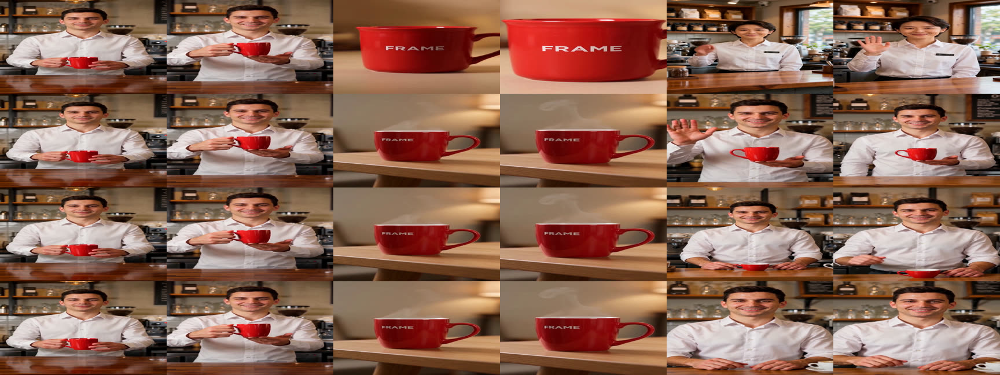
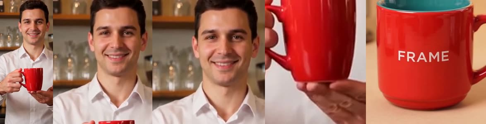
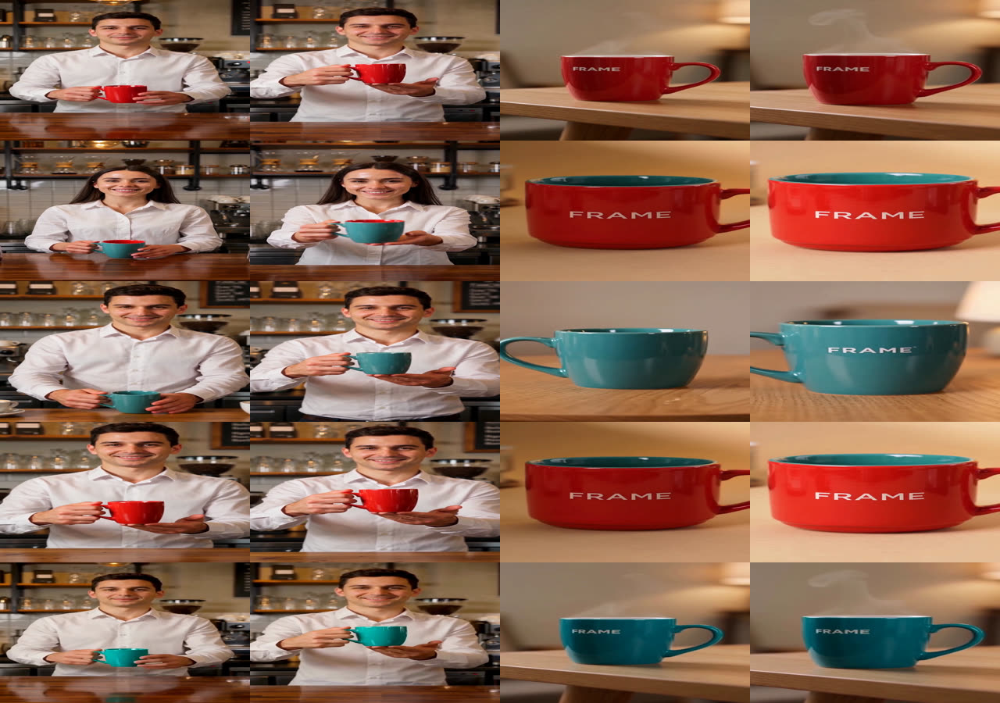

# 장면 사이 인물(객체) 일관성과 부모 클립 편집 — 조사·설계·실험 기록

- 작성: 2026-11-12, 브랜치 `feature-US03-character-consistency`
- 결정 기록: [ADR-0015](../adr/0015-identity-references-and-consistency-check.md) (정체성 기준 이미지·일관성 검수),
  [ADR-0016](../adr/0016-parent-clip-editing.md) (부모 클립 편집 포트·보존 검수)
- 대상 사용자 스토리: US-03 (객체 추적·일관성 검수, AC-31~34), US-01 (선택 수정, AC-01)

## 1. 문제

2026-11-11 실호출(ADR-0011 "검증")에서 두 가지가 확인됐다.

1. **장면 사이 객체 일관성**: 장면마다 따로 생성해, 같은 객체(바리스타)가 장면 1 과 장면 3 에서 서로 다른 인물로 나왔다.
   Fake 일관성 검수기는 클립을 보지 않아 1.0 을 줬다.
2. **다시 만든 장면 안의 비대상 요소**: 수정 버전에서 다시 만든 장면의 구도·배경은 seed 가 같아도 바뀐다.
   장면 단위 재생성의 한계다.

이 문서는 (1) 을 주 연구로, (2) 를 보조로 다룬다. 조사한 사실은 모두 출처를 달았고, 직접 확인하지 못한 것은 그렇게 적었다.

## 2. 과제 문서의 요구와 제약 (Drive 공유 폴더, 2026-11-12 내려받음)

| 문서 | 내용 | 설계에 준 영향 |
|---|---|---|
| 문제정의서 §2.4 · Product Backlog §1.2 · 시스템 구조 설계 §1.3 | 지표 3 "타임라인 내 객체 일관성 — 고정 속성 유지율 90% 이상". 측정 방법: **"객체가 보이는 표본 프레임 중 지정 색상·형상을 유지한 비율"** | 일관성 검수기의 점수 식을 이 정의 그대로 만들었다 (표본 프레임, 보이는 프레임만 분모) |
| Product Backlog US-03 | AC-31 장면 전환 뒤에도 객체 식별자·타임라인 연결 유지 / AC-32 고정 속성 유지율 90% 이상으로 측정 / AC-33 일관성이 깨진 구간에 경고 마커 / AC-34 국소 수정 영역 바운딩·마스크 | 기준 이미지(AC-31), 검수 점수(AC-32), 경고 구간(AC-33). AC-34 는 실제 추적기 뒤로 남김 |
| Product Backlog US-01 AC-01 | 지정한 객체의 속성만 바뀌고 비대상 객체·배경은 90% 이상 유지 | 보존 검수기의 임계값 0.9, 부모 클립 편집 포트 |
| 문제정의서 §4.3 리스크 3 | "요소 변화·객체 일관성 저하 → **마스크·참고 조건을 고정**하고 전후 비교 후 실패 결과 복원" | 참고 조건 고정 = 객체별 기준 이미지를 버전에 저장하고 물려준다 |
| 문제점목록 P-04 | 시간에 따라 같은 요소의 모습이 달라지는 문제. 근거로 VBench(CVPR 2024), T2V-CompBench(CVPR 2025) 인용 | 평가 지표 조사의 출발점 (§3.3) |
| 문제정의서 §1.2 · 문제점목록 §2.2 | 기존 솔루션: Veo 3.1 Ingredients(같은 인물·물체·배경 참고 이미지를 여러 장면에 반복 사용), Runway Product Swap, BlobGEN-Vid, Rewriting Video. 한계는 "요구사항 충족 여부 확인이 어렵다" | 참고 이미지 반복 사용은 이미 있는 기능이다. 이 과제의 몫은 **구조화된 조건과 묶어 자동으로 넘기고, 결과를 수치로 검수**하는 것 |
| Sprint Planning 리스크 | "검증 전 요구조건·표본 프레임·분모를 고정하고 판정 근거를 저장한다. 미판정은 통과로 집계하지 않는다" | 검수 결과의 detail 에 프레임별 판정을 저장, 판정 불가는 UNDETERMINED |
| Won't 목록 | 프레임·픽셀 단위 편집, 완전 자동 역추출, 오디오 편집 제외 | 편집 단위는 장면. 부모 클립 편집도 장면 클립 단위로만 한다 |
| 시스템 구조 설계 §4 | PyTorch 2.5.1·OpenCV·NumPy 가 개발 환경에 있으나, 지금 `.venv` 에는 없다 | 이번 구현은 ffmpeg 와 API 만 쓴다. 임베딩 지표는 후속 (§7) |

## 3. 선행 연구

### 3.1 참조 이미지로 정체성을 지키는 영상 생성 (reference-to-video, subject-to-video)

| 연구 | 핵심 | 이 과제에 주는 것 |
|---|---|---|
| VideoBooth (arXiv [2312.00777](https://arxiv.org/abs/2312.00777)) | 이미지 프롬프트를 거친 임베딩(이미지 인코더)과 세밀한 임베딩(프레임 간 주의 층에 주입)으로 넣는다 | 글만으로는 원하는 외형을 고정할 수 없다는 문제 제기 |
| ConsisID (arXiv [2411.17440](https://arxiv.org/abs/2411.17440)) | 튜닝 없는 인물 정체성 보존. 얼굴 특징을 저주파(전역)·고주파(고유) 신호로 나눠 DiT 에 준다 | 인물 정체성은 얼굴 중심의 신호가 핵심 |
| Concat-ID (arXiv [2503.14151](https://arxiv.org/abs/2503.14151)) | VAE 로 뽑은 이미지 특징을 영상 잠재 시퀀스에 이어 붙이고 3D 자기 주의만으로 반영 | 참조를 '같은 시퀀스의 토큰' 으로 다루는 흐름 |
| Phantom (arXiv [2502.11079](https://arxiv.org/abs/2502.11079)) | 단일·다중 주체 참조. 글과 이미지를 함께 정렬하고 **이미지 내용 누출·다중 주체 혼동**을 다룬다 | 참조 이미지의 구도가 결과에 새는 문제가 알려진 실패 유형 |
| VACE (arXiv [2503.07598](https://arxiv.org/abs/2503.07598), Wan2.1-VACE) | 참조 생성·영상 편집·마스크 편집을 한 입력 형식(Video Condition Unit)으로 통합 | 참조 생성과 영상 편집이 한 모델 계열에서 가능 → §3.4 의 Wan 계열 API |
| SkyReels-A2 (arXiv [2504.02436](https://arxiv.org/abs/2504.02436)) | 인물·물체·배경 요소를 각각의 참조 이미지로 조립 (elements-to-video) | 객체별 참조라는 구성이 이 과제의 IR(객체 목록)과 맞는다 |
| MAGREF (arXiv [2505.23742](https://arxiv.org/abs/2505.23742)) | 임의 개수 참조. 마스크 안내와 주체 분리로 정체성 불일치·주체 얽힘·복사-붙여넣기 흔적을 줄인다 | 여러 참조를 함께 줄 때 주체가 섞이는 문제 |
| Saber (arXiv [2512.06905](https://arxiv.org/abs/2512.06905)) | 참조-영상-글 삼중 데이터 없이 영상-글 쌍만으로 학습, 마스크 증강으로 복사-붙여넣기 완화 | 참조를 그대로 붙여 넣는 흔적이 계속 연구되는 문제 |
| MV-S2V (arXiv [2601.17756](https://arxiv.org/abs/2601.17756)) | 한 주체의 여러 시점 참조로 3D 수준 일관성. 단일 시점 참조는 "이미지 생성 + image-to-video" 로 환원된다고 지적 | 기준 이미지가 한 장이면 다른 각도에서는 추측에 맡겨진다 (한계 §7) |

OpenS2V-Nexus (arXiv [2505.20292](https://arxiv.org/abs/2505.20292)) 는 이런 모델 18종을 평가하고 두 가지를 보고한다 (본문 확인):
모델이 "참조 이미지의 자세·조명·윤곽을 그대로 영상에 옮기는" 복사-붙여넣기 경향이 있고, 사람의 정체성은 사람이 아닌 대상보다 지키기 어렵다.

### 3.2 여러 장면·스토리에서의 일관성

| 연구 | 핵심 | 이 과제에 주는 것 |
|---|---|---|
| StoryDiffusion (arXiv [2405.01434](https://arxiv.org/abs/2405.01434)) | 사전 학습 모델에 학습 없이 붙는 Consistent Self-Attention 으로 이미지 묶음의 주체를 맞추고, 이미지 사이를 영상으로 잇는다 | 묶음 안에서 주의를 공유 — API 로만 쓰는 모델에는 쓸 수 없다 |
| MovieDreamer (arXiv [2407.16655](https://arxiv.org/abs/2407.16655)) | 자기회귀로 전체 서사의 시각 토큰을 예측하고 확산으로 렌더. 인물 정보를 담은 다중모달 대본 | 계층 구조: 전역 계획 → 장면 렌더 |
| DreamRunner (arXiv [2411.16657](https://arxiv.org/abs/2411.16657)) | "LLM 이 장면으로 나누고 **장면을 따로 생성해 이어 붙이는**" 기존 방식의 한계를 지적하고, 객체 단위 배치 계획과 맞춤화를 더한다 | 지금 FRAME 의 구조가 바로 그 "따로 생성해 이어 붙이기" 다 |
| VideoGen-of-Thought (arXiv [2412.02259](https://arxiv.org/abs/2412.02259)) | 한 문장에서 여러 샷. 샷 사이 시각 불일치를 정체성 보존 표현의 전파로 다룬다 | 샷 사이로 정체성 표현을 넘긴다 |
| Long Context Tuning (arXiv [2503.10589](https://arxiv.org/abs/2503.10589)), HoloCine (arXiv [2510.20822](https://arxiv.org/abs/2510.20822)), MultiShotMaster (arXiv [2512.03041](https://arxiv.org/abs/2512.03041)) | 한 번에 여러 샷을 함께 생성하도록 모델을 학습·확장 | 모델 학습이 필요해 범위 밖 |
| Captain Cinema (arXiv [2507.18634](https://arxiv.org/abs/2507.18634)), STAGE (arXiv [2512.12372](https://arxiv.org/abs/2512.12372)) | 키프레임(스토리보드)을 먼저 만들고 영상을 채운다 | 키프레임 우선 방식 — 과제의 AS-IS 작업 흐름(이미지 → image-to-video)과 같다 |
| StoryMem (arXiv [2512.19539](https://arxiv.org/abs/2512.19539)) | 샷을 차례로 만들며 **앞 샷의 키프레임을 기억 은행**에 넣고 다음 샷의 조건으로 쓴다 | 첫 등장 클립에서 기준을 뽑아 다음 장면에 넘기는 이 과제의 방법과 같은 계열 |
| VideoMemory (arXiv [2601.03655](https://arxiv.org/abs/2601.03655)) | **객체 중심** 동적 기억 은행: 인물·소품·배경의 시각·의미 기술을 저장하고 샷마다 꺼내 쓰고 갱신 | 객체별 기억 + 장면이 끝날 때마다 갱신 |
| EntityBench / EntityMem (arXiv [2605.15199](https://arxiv.org/abs/2605.15199)) | 140 에피소드 벤치마크. 기존 방법은 다시 등장하는 간격이 멀수록 일관성이 크게 떨어진다. EntityMem 은 **검증된 객체별 참조**를 생성 전에 기억 은행에 넣어 인물 충실도가 가장 높았다 (초록) | 객체별 참조가 효과적이라는 직접 근거. 참조를 '검증' 한 뒤 넣는다는 점 |
| EM-Vid (arXiv [2605.23610](https://arxiv.org/abs/2605.23610)) | 화면 전체를 기억으로 쓰면 "객체 정보와 그 장면의 맥락이 얽혀 무관한 정보가 샌다". 객체 단위 패치만 기억한다 (초록) | 화면 전체 대신 **객체를 잘라** 넘기는 근거 (`vlm_crop`) |

EntityMem 의 참조 구축은 본문에서 확인했다: 글-이미지 모델로 인물 초상·장소 파노라마 후보를 만들고, SAM 2 로 전경을 오려 내고,
검증 에이전트가 잘못된 특징이나 분할 실패를 걸러 다시 만든다. 즉 참조를 **생성 전에 만들어 검증**한다.
이 과제는 이미지 생성 모델을 쓰지 않고 **첫 등장 클립에서 뽑는** 쪽을 골랐다 (이유는 §4.3).

### 3.3 일관성 평가 지표

| 지표 | 방법 | 출처 |
|---|---|---|
| VBench Subject Consistency | 프레임마다 DINO 특징을 뽑아 첫 프레임·직전 프레임과의 코사인 유사도 | VBench (arXiv [2311.17982](https://arxiv.org/abs/2311.17982)) 본문·부록 |
| VBench Background Consistency | 프레임마다 CLIP 이미지 특징으로 같은 계산 | 같은 문서 |
| NexusScore (주체 일관성) | YOLO-World 로 프레임에서 주체를 찾아 잘라 낸 뒤, GME 다중모달 검색 모델로 참조 이미지와 비교. 잘라 내지 않은 프레임 전체와 비교하는 방식을 대비해 비판 | OpenS2V-Nexus 본문 |
| FaceSim-Cur | 얼굴 인식 임베딩 유사도 (ConsisID 에서 가져옴) | 같은 문서 (구체 모델명은 이 문서에서 확인하지 못함) |
| NaturalScore | GPT-4o 가 프레임을 5점 척도로 채점 (사람 평가 대용) | 같은 문서 |
| EntityBench 교차 샷 일관성 | 인물·물체: DINOv2 임베딩의 객체별 중심과의 유사도. 인물·물체·장소: 다중모달 LLM(Gemini 2.5)이 기준 등장과 비교. **충실도 관문**: 샷 안에서 객체가 정확히 나온 (샷, 객체) 쌍만 교차 샷 계산에 넣는다 | EntityBench 본문 |
| T2V-CompBench | 속성 결합·관계 등 7 범주를 MLLM·검출·추적 기반 지표로 평가 | arXiv [2407.14505](https://arxiv.org/abs/2407.14505) 초록 |
| VBench-2.0 | 겉보기 충실도를 넘어 물리·상식·구성 등 '내재적 충실도' 를 평가 | arXiv [2503.21755](https://arxiv.org/abs/2503.21755) 초록 |
| MSAVBench | 다중 샷 오디오-영상 벤치마크. 주관 지표는 사례별 채점 기준, 복잡한 판정은 도구로 뽑은 근거에 기대는 혼합 평가. 사람 판단과 순위 상관 91.5% | arXiv [2605.20183](https://arxiv.org/abs/2605.20183) 초록 |

정리하면 지표는 두 갈래다. **임베딩 유사도**(DINO·CLIP·얼굴 인식)는 재현 가능하고 미세한 차이에 민감하지만 모델·가중치 설치가 필요하고,
객체를 먼저 잘라야 의미가 있다. **VLM 판정**은 설치가 없고 "무엇이 달라졌는지" 를 말로 남기지만, 같은 입력에도 흔들릴 수 있고
미세한 얼굴 차이에는 둔하다. 최근 벤치마크(EntityBench, MSAVBench)는 둘을 함께 쓴다.

### 3.4 OpenRouter 에서 쓸 수 있는 것 (2026-11-12, `GET /api/v1/videos/models` 32개와 모델 페이지 `/<model>/llms.txt` 전수 확인)

공식 요청 스키마 ([제출 API](https://openrouter.ai/docs/api/api-reference/video-generation/submit-a-video-generation-request.md)):
- `input_references`: "생성을 안내하는 참조 자산. 이미지·오디오·영상 참조를 받는다. 오디오·영상 참조는 지원하는 제공자만 따른다
  (BytePlus Seedance 2 세대 이상 포함). 나머지 제공자는 이미지 참조를 쓰고 나머지는 무시한다."
- `frame_images`: 첫·끝 프레임. 둘 다 보내면 `frame_images` 가 우선해 image-to-video 로 처리된다 ([가이드](https://openrouter.ai/docs/guides/overview/multimodal/video-generation.md)).
- `previous_job_id`: "편집하거나 연장할 완료된 영상 작업의 id. 새 작업은 이전 작업을 만든 **같은 모델·엔드포인트**에서 실행된다.
  **연속을 지원하는 모델만** 이 필드를 받는다." 형식 `gen-vid-<숫자>-<영숫자 20자>`.
- `duration: -1`: 제공자가 길이를 정한다 (입력 영상 길이를 따르는 경우 등), 지원 모델만.
- 참조 이미지 안내 ([쿡북](https://openrouter.ai/docs/cookbook/video-generation/reference-to-video.md)): "참조 이미지는 프롬프트가
  **무엇을 일관되게 유지해야 하는지** 설명할 때 가장 잘 동작한다." 모델 목록 API 는 참조 지원 여부를 구조화해 주지 않으므로 모델 설명·페이지로 확인하라고 한다.

| 기능 | 모델 (모델 페이지의 요청 필드·예시 기준) |
|---|---|
| 참조 이미지 (`input_references` image) | Wan 3.0 · Wan 2.7, HappyHorse 1.0 · 1.1, Seedance 2.0 · 2.0 Fast · 2.0 Mini · 2.5, FLUX 3 Video, Gemini Omni 1.2 Flash, HeyGen Video 1, Kling Video O1, Hailuo 3, Grok Imagine Video · 1.5, Runway Aleph 2.0 |
| 영상 참조 (`input_references` video_url, 예시 "Video to Video") | FLUX Video Edit (편집 전용, $0.03/초), Runway Aleph 2.0 ($0.28/초, 최소 $0.56), Seedance 2.0 · 2.0 Fast · 2.0 Mini, Hailuo 3, HeyGen Video 1, FLUX Video Upscale (업스케일) |
| `previous_job_id` | 요청 필드에 적은 모델 **없음** (모델 페이지: "목록에 없는 값은 거부된다") |

기본 모델 Wan 3.0 의 설명은 "text-to-video, image-to-video, **reference-guided** video generation" 이고 480p 초당 $0.05 다.
Seedance 2.0 의 설명은 "인물 일관성 보존에 특히 강하다" 지만 토큰 과금이고 480p 가격이 Wan 보다 높다.

Wan 계열 참조 이미지의 제약 (Alibaba [Wan 참조 영상 API 문서](https://www.alibabacloud.com/help/en/model-studio/wan-video-to-video-api-reference), wan2.7-r2v 기준.
Wan 3.0 문서는 찾지 못했다):
- 가로·세로 각각 240~8000 px, 화면비 1:8~8:1, 20 MB 이하, JPEG·PNG·BMP·WEBP. Base64 data URL 도 받는다.
- "주체가 들어 있으면 **인물은 한 명만**" 있어야 한다. 참조 이미지 + 참조 영상은 합쳐 5개 이하.
- 프롬프트에서는 `Image 1`, `Video 1` 로 가리킨다 (첫 글자 대문자, 낱말과 숫자 사이 한 칸, 배열 순서와 같은 번호).

## 4. 설계

### 4.1 선택한 방법: 객체별 정체성 기준 이미지 (ADR-0015)

```
원본 버전                                   수정 버전 (컵 색 변경)
 장면1 생성 (기준 없음)                        [생성 전] 재사용 장면·부모 클립에서 기준 확보
   └─ 클립에서 바리스타·컵 기준을 뽑아 저장      장면1 다시 생성: 바리스타 기준(부모 것) 전달, 컵 기준은 무효
 장면2 생성: 컵 기준 전달                         └─ 새 클립에서 새 컵 기준을 뽑아 저장
 장면3 생성: 바리스타 기준 전달                  장면2 다시 생성: 새 컵 기준 전달
                                              장면3: 조건이 같아 부모 클립 재사용
```

- 기준은 `ReferenceImage`(origin=DERIVED)로 버전에 저장되고 수정 버전이 물려받는다. 과제 문서의 "참고 조건을 고정" 에 해당한다.
- 유효성(외형 조건이 그대로일 때만)·충돌(대상 장면의 고정 속성과 어긋나면 제외)·자기 자신 제외 규칙은 ADR-0015 §2.
- 조건 fingerprint 는 건드리지 않는다. 기준 이미지는 생성 캐시·작업 원장 키(`generation_fingerprint`)에만 들어간다.
  그래서 "바뀌지 않은 장면은 부모 클립 재사용" 이 그대로 유지된다.

### 4.2 어디서 기준을 뽑는가: `vlm_crop`
- 클립 가운데 프레임을 VLM 에 보여 주고 객체별로 "보이는가, 박스, 외형 설명" 을 받는다. 박스를 12% 넓혀 ffmpeg 로 자른다.
- 화면 전체(`frame`)가 아니라 객체만 넘기는 이유: 화면 전체는 그 장면의 구도·배경·다른 객체까지 참조로 딸려 간다
  (EM-Vid 의 지적, OpenS2V 의 복사-붙여넣기 경향). Wan 은 참조 이미지 한 장에 인물 한 명만 허용한다.
- 인물은 머리·어깨까지만 자른다 (세로를 가로의 1.1배까지). 3회차에서 상반신 전체를 자르자 손에 든 컵이 함께 들어가
  다른 장면에 컵이 나왔다 (§6.3).
- VLM 이 짚는 박스는 호출마다 조금씩 다르다. 같은 클립·같은 객체의 기준은 한 번만 뽑아 색인에 적어 두고 다시 쓴다.
  다시 뽑으면 기준 이미지(=생성 캐시·원장 키)가 달라져 이미 만든 장면을 또 생성하게 된다.
- 안 보이는 객체는 다른 시각의 프레임을 한 번 더 보고, 그래도 없으면 건너뛴다 (EntityBench 의 충실도 관문, EntityMem 의 검증과 같은 취지).
- 같은 호출에서 그 장면의 고정 속성(색 등)을 지켰는지도 받아, 분명히 다르게 나온 객체는 기준으로 쓰지 않는다.
  실험 뒤에 넣은 것이라 실호출로는 확인하지 못했다 (§6.5 의 4번, §7).
- VLM 이 준 외형 설명("young adult male, short dark hair, …")은 기준과 함께 저장해 다음 장면 프롬프트에 `looks like: …` 로 넣는다.
  기준 이미지와 글로 같은 모습을 함께 고정한다 (프롬프트 외형 기술 강화).

### 4.3 고르지 않은 방법
| 방법 | 장점 | 고르지 않은 이유 |
|---|---|---|
| 이미지 생성 모델로 객체 시트를 먼저 생성 (EntityMem) | 첫 장면부터 같은 기준, 장면 병렬 생성 가능 | 이미지 생성 포트·모델·비용이 더 든다. 지금 구조에서 가장 작은 변경은 이미 만든 클립을 쓰는 것. 후속 후보 |
| 장면별 키프레임을 만든 뒤 image-to-video (Captain Cinema, STAGE, 과제의 AS-IS 흐름) | 가장 강한 일관성 | 파이프라인 단계가 하나 늘고 `frame_images` 를 쓰면 `input_references` 가 무시된다. 후속 |
| 프롬프트만 강화 | 비용 0 | 옷·머리 색 정도만 맞는다. 기준선이 바로 이 상태다 (객체 설명·seed 는 같았다) |
| 참조를 잘 따르는 모델로 교체 (Seedance 2.0 등) | 설정 한 줄 | 가격·검증 범위. 모델 교체는 어댑터 설정으로 언제든 가능하므로 방법과 독립 |
| 여러 샷을 한 번에 생성하는 모델 (HoloCine, LCT) | 근본 해법 | 장면 단위 선택 재생성(ADR-0003)과 맞지 않고 API 로 제공되지 않는다 |

### 4.4 측정: 실제 검수기 두 개
- `vlm_consistency`: 지표 3 의 정의 그대로. 객체가 나오는 장면마다 표본 프레임 3장, 객체 하나당 VLM 한 번.
  점수 = (기준과 같은 객체이고 고정 속성도 유지한 프레임) ÷ (객체가 보이고 판정된 프레임). 기준은 사용자 참조 이미지, 없으면 첫 가시 프레임.
  검수기는 생성 쪽 기준 이미지를 쓰지 않는다. 기준선과 개선 방법을 같은 절차로 잰다.
- `ssim_preservation`: 다시 만든 장면을 부모 클립과 프레임별 SSIM 으로 비교 (ffmpeg). 1 − SSIM 이 변경률의 상한.
- 임베딩 지표(DINO·얼굴 인식)를 쓰지 않은 이유: `.venv` 에 numpy·torch 가 없고, 설치(onnxruntime + numpy + 모델 약 100 MB 이상)는
  승인이 필요한 큰 설치다. 지시대로 가벼운 방법을 먼저 구현했다. 후속 제안은 §7.

### 4.5 부모 클립 편집 (ADR-0016)
- 요청에 부모 클립과 부모 쪽 장면 조건을 싣는다. 편집하는 생성기는 조건의 **차이만** 지시문으로 만들어 부모 클립을 고친다.
- OpenRouter 어댑터: `previous_job`(같은 모델의 이전 작업을 이어서) 또는 `video_reference`(부모 클립을 영상 참조로 편집 모델에).
  접수 전에 거절되면 새로 생성한다.

## 5. 구현 요약

| 계층 | 추가·변경 |
|---|---|
| domain | `ReferenceImage`(origin·기준 장면·해시·설명), 술어 `transient`, `services/identity.py` (고정 속성·유효성·충돌·선택) |
| application | `SceneGenerationRequest.identity_references` · `parent` · `generation_fingerprint`, `VideoGenerator.result_key`, `IdentityReferenceExtractor` 포트, `GenerateStage`(기준 추출·전달, 부모 클립 전달, 앞선 시도 클립 재사용), LLM 포트 이미지 입력, `CheckContext.references` |
| adapters | `identity/`(fake·frame·vlm_crop), `checker/`(vlm_consistency·ssim_preservation), `video_tools.py`(프레임 추출·SSIM), OpenRouter(기준 이미지 전송·`Image N` 프롬프트·편집 모드), SQL(reference_images 열, scenes.clip_metadata_json) |
| config | `FRAME_IDENTITY`·`FRAME_IDENTITY_KINDS`·`FRAME_IDENTITY_MAX_REFERENCES`·`FRAME_IDENTITY_VERIFY_ATTRIBUTES`·`FRAME_VLM_MODEL`·`FRAME_CONSISTENCY_*`·`FRAME_PRESERVATION_THRESHOLD`·`FRAME_VIDEO_EDIT_MODE`·`FRAME_VIDEO_EDIT_MODEL` |
| presentation | `reference_images[].origin/source_scene_key/description`, `/health` 의 `adapters.identity` |

## 6. 실험 (2026-11-12 실호출)

### 6.1 조건

- 입력: 2026-11-12 실호출(ADR-0011 "검증")에서 LLM 이 만든 IR 을 DSL 로 그대로 옮겨 고정했다 (IR fingerprint 일치 확인).
  LLM 구조화는 실행마다 IR 이 달라져 같은 조건으로 비교할 수 없기 때문이다.
  - 장면 3개, 각 4초: `show_cup`(바리스타가 카운터에서 빨간 머그컵을 들어 보인다) → `cup_closeup`(컵 클로즈업, 'FRAME' 문구) → `wave_hand`(바리스타가 손을 흔든다)
  - 객체: `barista`(인물, 흰 셔츠) — 장면 1·3, `cup`(소품, 빨강, 장면 2 에서만 문구 'FRAME') — 장면 1·2
- 생성: `alibaba/wan-3.0`, 480p, seed 20261112, 장면당 $0.2125. 기준선 클립 3개는 그 실호출의 결과를 생성 캐시에서 그대로 썼다 (새 호출 없음).
- 검수: `vlm_consistency`(VLM `gpt-4.1-2025-04-14`, 장면당 표본 프레임 3장, 임계 0.9) + `ssim_preservation`(임계 0.9). 요구 반영·추적은 Fake.
- 수정 요청: `cup.color` red → teal. `show_cup`·`cup_closeup` 을 다시 만들고 `wave_hand` 는 부모 클립을 재사용한다.
- 실호출은 5회로 제한됐다. **조건마다 1~2번씩만 돌렸으므로 아래 수치는 사례이지 통계가 아니다.**

### 6.2 실행 원장

| # | 설정 | 결과 | 영상 비용 |
|---|---|---|---|
| 1 | 기준선 (`FRAME_IDENTITY=off`) + 실제 검수기 | 통과. 클립 3개 모두 캐시 적중 | $0 |
| 2 | 개선 (`vlm_crop`) | **실패**. 잘라 낸 컵 이미지가 154×178 이라 제공자가 `Error validating image resolution` 으로 작업을 실패시켰다 (과금 없음) → 기준 이미지를 짧은 변 480 px 이상으로 키움 | $0 |
| 3 | 개선 (인물 기준 = 상반신 전체) + 수정(`video_reference`, FLUX Video Edit, 부모 클립을 data URI 로) | 원본 통과. 수정은 편집 요청 2건이 접수 전 400 `Only HTTPS URLs are allowed` → 설계대로 새로 생성해 통과 | 4 × $0.2125 = $0.85 |
| 4 | 개선 (인물 기준 세로 ≤ 가로 1.25배) + 수정(`video_reference`, 부모 작업 저장본의 서명 URL) | 원본 통과. **편집 2건 적용** (각 41~50초) | $0.2125 + 2 × $0.12 = $0.4525 |
| 5 | 개선 (세로 ≤ 1.1배) + 수정(`previous_job`) | 원본 통과. 편집 2건 접수 전 400 `alibaba/wan-3.0-20260824 does not support previous_job_id` → 새로 생성해 통과 | 2 × $0.2125 = $0.425 |

영상 합계 $1.7275. VLM(gpt-4.1)은 일관성 검수 14회(회당 입력 약 3,290·출력 약 330 토큰)와 기준 추출 9회(회당 입력 약 835·출력 50~100 토큰)로,
공개 단가($2 / $8 per 1M 토큰)로 계산하면 약 $0.15 다 (청구서로 확인한 값은 아니다).

### 6.3 장면 사이 일관성 (원본 생성)



위에서부터 1회차(기준선), 3회차, 4회차, 5회차. 열은 `show_cup` · `cup_closeup` · `wave_hand` 의 1초·3초 프레임.

| 실행 | 인물 기준 이미지 | 새로 만든 장면 | barista | cup | consistency_rate | 눈으로 본 `wave_hand` | 걸린 시간 |
|---|---|---|---|---|---|---|---|
| 1회차 기준선 | 없음 | 없음 (캐시) | **0.5 FAIL** | 0.5 FAIL | 0.50 | 다른 사람 (성별·얼굴·머리·체형이 다름) | 11초 |
| 3회차 | 상반신 전체 480×1126 | `cup_closeup`, `wave_hand` | **1.0 PASS** | 0.5 FAIL | 0.75 | 같은 사람. 그런데 빨간 컵을 든 채로 나온다 | 263초 |
| 4회차 | 머리·어깨 480×600 | `wave_hand` | **1.0 PASS** | 0.83 FAIL | 0.92 | 같은 사람. 카운터 위에 작은 빨간 컵이 남는다 | 116초 |
| 5회차 | 머리·옷깃 480×530 | `wave_hand` | **1.0 PASS** | 0.5 FAIL | 0.75 | 같은 사람. 빨간 컵 없음 (화면 끝에 흰 잔 하나) | 156초 |

같은 클립에 Fake 일관성 검수기는 매번 1.0 을 줬다.



왼쪽부터 인물 기준 3·4·5회차, 컵 기준(`show_cup` 에서), 5회차 수정에서 뽑힌 컵 기준(§6.5 의 4번).

읽는 법:
1. **기준 이미지는 인물을 지켰다.** 기준 없이 만든 바리스타 장면 2개(기준선의 `wave_hand`, 11-12 수정 실행의 `show_cup`)는 모두 다른 사람이
   됐고, 기준과 함께 만든 바리스타 장면 5개(3·4·5회차의 `wave_hand`, 3·5회차 수정의 `show_cup`)는 모두 같은 사람이었다
   (VLM 판정은 실행마다 6/6 프레임, 눈으로도 확인).
2. **기준 이미지에 든 것은 결과에 나온다 (참조 누출).** 인물 박스를 그대로 자른 3회차 기준에는 손에 든 컵이 들어 있었고, 컵이 없어야 할
   `wave_hand` 에 컵이 나왔다. 세로를 줄일수록(1.25배 → 1.1배) 컵이 작아지다 사라졌다. §3.1 의 복사-붙여넣기·내용 누출과 같은 현상이다.
   **이 누출은 지표에 잡히지 않는다** — 일관성 검수는 "그 객체가 같은가" 만 본다.
3. **컵의 FAIL 은 생성보다 조건의 문제다.** IR 에서 문구 'FRAME' 은 `cup_closeup` 장면에만 걸려 있어 `show_cup` 의 컵에는 문구가 없다.
   VLM 은 "클로즈업에만 글자가 있다" 며 다른 모습으로 판정했다. 컵 기준을 준 클로즈업(그림 2~4행)은 손에 든 컵과 모양이 더 비슷해 보이지만,
   이 차이 때문에 점수로는 드러나지 않았다.
4. **VLM 판정은 흔들린다.** 3·4·5회차의 컵은 **같은 두 클립**인데 점수가 0.5 → 0.83 → 0.5 였다 (글자 유무를 '다른 객체' 로 볼지가 갈렸다).

### 6.4 수정 버전: 새로 생성과 부모 클립 편집



위에서부터 ① 부모 버전, ② 기준 없이 새로 생성(11-12 실호출의 수정 버전), ③ 기준 + 새로 생성(3회차), ④ 기준 + 새로 생성(5회차, ③ 과 같은 요청),
⑤ 부모 클립 편집(4회차, FLUX Video Edit). 열은 `show_cup` · `cup_closeup` 의 1초·3초 프레임.

| 방식 | barista | cup | consistency_rate | SSIM `show_cup` | SSIM `cup_closeup` | preservation_rate | 눈으로 본 결과 | 시간 | 영상 비용 |
|---|---|---|---|---|---|---|---|---|---|
| ② 기준 없이 새로 생성 | (Fake 1.0) | (Fake 1.0) | — | 0.554 | 0.842 | — | 바리스타가 **다른 사람**이 됨. 클로즈업 컵은 겉이 빨강 그대로 | — | $0.425 |
| ③ 기준 + 새로 생성 | 1.0 | 0.83 | 0.92 | 0.541 | 0.780 | 0.774 | 같은 사람, 청록 컵. 자세·배경·구도는 바뀜 | 250초 | $0.425 |
| ④ 기준 + 새로 생성 (같은 요청) | 1.0 | **0.0** | 0.50 | 0.556 | 0.757 | 0.771 | 같은 사람인데 컵이 **빨강 그대로** | 121초 | $0.2125 |
| ⑤ 부모 클립 편집 | 1.0 | 1.0 | 1.00 | **0.745** | **0.900** | 0.882 | 같은 사람·자세·배경·구도에서 컵 색만 바뀜 | 110초 | $0.24 |

② 의 SSIM 은 저장된 클립으로 따로 잰 값이다 (그 실행에는 실제 검수기가 없었다). preservation_rate 는 재사용한 `wave_hand`(1.0)를 포함한 평균이고,
시간은 버전 전체를 처리한 시간이다 (③ 은 두 장면, ④ 는 한 장면을 새로 생성).
④ 의 `cup_closeup` 은 새로 만들지 않고 ② 의 결과를 원장에서 다시 썼다 (컵 기준을 얻지 못해 요청이 ② 와 같아졌다, §6.5 의 4번).

읽는 법:
1. **기준 이미지는 '누구' 는 지키지만 '어떻게 찍혔는가' 는 지키지 못한다.** 새로 생성한 `show_cup` 의 SSIM 은 기준이 있든 없든 0.54~0.56 이고,
   서로 다른 두 장면끼리 잰 값(0.50~0.60)과 같은 수준이다. AC-01(비대상 90% 유지)에는 부모 클립 편집이 필요하다.
2. **편집은 화면을 지켰다.** 같은 인물·자세·배경·구도에서 컵 색만 바뀌었고 SSIM 이 0.745·0.900 으로 올랐다. 그래도 `show_cup` 은 임계 0.9 에
   못 미친다. 편집 모델도 프레임 전체를 새로 출력하므로 바뀌지 않은 영역이 픽셀 단위로는 달라지는 것으로 보인다.
   새로 생성한 클립과의 차이는 해상도를 낮춰 잴수록 커진다 (아래 표). 변경 영역을 빼고 재는 지표가 있어야 0.9 기준을 공정하게 적용할 수 있다 (§7).
3. **새로 생성은 요구 반영이 불안정했다.** ③ 과 ④ 는 프롬프트·참조 이미지·seed 가 같은 요청인데 한 번은 청록 컵, 한 번은 빨간 컵이 나왔다.
   ② 의 클로즈업도 겉이 빨강이다. 원인을 가려내는 실험은 하지 못했지만 빨강을 가리키는 입력이 둘 남아 있었다. 프롬프트의 수정 전 표현
   (장면 설명 "빨간 머그컵을 들어 보인다", 객체 이름 "빨간 머그컵" 뒤에 `color: teal` 이 붙는다)과, ③·④ 의 인물 기준 이미지
   (3회차의 상반신 기준)에 함께 잘린 빨간 컵이다. 편집 지시문은 바뀐 것만 적으므로("cup: color changes from red to teal") 이런 충돌이 없다.
4. **실제 검수기가 이 미반영을 잡았다.** ④ 에서 `vlm_consistency` 는 6프레임 모두 `고정 속성 이탈: color: teal` 로 FAIL(0.0)을 줬고,
   Fake 요구 반영 검수는 13건 모두 PASS 였다.
5. **seed 는 결과를 고정하지 않는다.** 같은 요청의 재현은 생성 캐시와 작업 원장으로만 보장된다 (ADR-0013).
6. 편집이 더 싸고 빨랐다: 4초 클립 한 건이 $0.12·41~50초 (새로 생성은 $0.2125·100~145초).

SSIM 을 낮은 해상도에서 다시 잰 값 (가로 폭 기준, 부모 대비):

| 가로 폭 | `show_cup` 편집 | `show_cup` 새로 생성 | `cup_closeup` 편집 | `cup_closeup` 새로 생성 |
|---|---|---|---|---|
| 480 (검수기 기본) | 0.745 | 0.541 | 0.900 | 0.780 |
| 240 | 0.714 | 0.397 | 0.861 | 0.672 |
| 120 | 0.758 | 0.300 | 0.819 | 0.528 |
| 64 | 0.827 | 0.278 | 0.778 | 0.372 |

해상도를 낮추면 새로 생성한 클립은 값이 크게 떨어지고(구도가 다르다) 편집한 클립은 0.71~0.90 에 머문다. `show_cup` 에서 둘의 차이는
480 px 에서 0.20, 64 px 에서 0.55 다. 클로즈업은 색이 바뀐 컵이 화면의 큰 부분을 차지해 편집한 클립의 값도 함께 내려간다.

### 6.5 실호출로 확인한 것

1. 참조 이미지는 data URI 로 보낼 수 있다. 단 한 변이 240 px 보다 작으면 접수(202)된 뒤 제공자가 작업을 실패시킨다. 실패한 작업은 `usage` 가 없다 (과금 없음).
2. 영상 참조(`video_url`)는 HTTPS 주소만 받는다 (data URI 는 접수 전 400). 완료된 작업의 상태 응답이 주는 서명 URL(`urls[0]`)을 그대로 넘기면 된다.
   그 저장본은 작업 생성 약 24시간 뒤 만료된다(`expires_at`).
3. `previous_job_id` 는 Wan 3.0 이 접수 전에 거절한다 (400, 과금 없음). 문서 조사(§3.4)대로 지금은 이 필드를 받는 모델을 찾지 못했다.
4. 기준 이미지 추출이 요청한 속성과 다른 객체를 **항상 걸러 주지는 않는다**. 5회차 수정에서 새 `show_cup`(빨간 컵)에서는 VLM 이 "청록 컵" 을
   찾지 못해 기준을 만들지 않았지만(두 번 모두), `cup_closeup`(겉은 빨강, 안쪽만 청록)에서는 그 컵을 기준으로 저장했다.
   실험 뒤에, 추출할 때 고정 속성을 함께 확인해 분명히 다른 객체를 거르도록 고쳤다 (ADR-0015 §1). 이 절의 실행에는 반영되지 않았다.
5. 편집이 거절된 뒤 새로 만든 결과가 그 편집 설정의 키로만 원장에 남아, 편집 모드를 바꾼 5회차가 같은 장면을 또 생성했다($0.2125).
   조건 키로도 남기도록 고쳤다 (ADR-0016 §3).

## 7. 한계와 후속

**실험의 한계**
- 브리프 하나, 모델 하나(Wan 3.0), 조건마다 1~2회다. "기준 이미지가 인물을 지킨다" 는 7개 장면에서 본 것이고, 다른 모델·다른 종류의 객체·
  뒷모습이나 먼 거리 같은 장면은 보지 않았다. 기준 이미지 한 장은 한 시점만 준다 (MV-S2V 의 지적).
- 일관성 점수는 VLM 한 번의 판정이다. 같은 클립에 0.5 와 0.83 이 나왔다. 임계 0.9 근처의 판정은 한 번으로 믿기 어렵다.

**후속 제안** (우선순위 순)
1. **기준을 뽑을 때의 고정 속성 확인을 실호출로 확인한다.** 잘못 나온 객체가 기준이 되어 다음 장면으로 번지는 것(§6.5 의 4번)을 막으려고,
   추출 응답에 "고정 속성을 지켰는가" 를 함께 받아 분명히 다른 객체를 거르게 했다 (EntityMem 의 검증과 같은 취지).
   실호출 한도를 다 쓴 뒤라 재생 응답 테스트로만 확인했다. 실제 모델이 (a) 제대로 나온 객체를 잘못 거르지 않는지,
   (b) 5회차의 겉이 빨간 컵을 거르는지를 봐야 한다. 이미 만든 클립이 남아 있으면 영상 생성 없이 VLM 호출만으로
   (추출 한 번에 약 $0.002) 확인할 수 있다.
   더 나아가 검수를 통과한 클립의 기준만 다음 버전에 물려주는 방법도 있다.
2. **수정할 때 프롬프트에 남는 수정 전 표현을 정리한다.** 속성만 바뀌고 장면 설명·객체 이름의 "빨간 머그컵" 은 남는다.
   구조화 단계에서 표현을 함께 고치거나, 새로 생성하는 프롬프트에도 바뀐 것을 한 줄로 밝힌다 (부모 장면은 이제 요청에 실려 온다).
3. **장면 하나에만 걸린 고정 속성의 범위를 정한다.** 'FRAME' 문구처럼 한 장면에서만 말한 외형이 그 객체의 다른 장면에도 적용되는가.
   지금은 적용되지 않아 일관성 검수가 FAIL 을 준다 (전파 정책·구조화 프롬프트의 문제).
4. **임베딩 지표를 함께 쓴다.** VLM 판정의 흔들림과 미세한 얼굴 차이를 보완한다. 얼굴 인식(ArcFace 계열)·DINOv2 임베딩을 객체 크롭끼리 비교한다
   (§3.3 의 EntityBench·NexusScore 방식). onnxruntime + numpy + 모델 가중치가 필요해 설치 승인 뒤로 미뤘다. 그 전에는 VLM 판정을 여러 번 해 다수결로 쓸 수 있다.
5. **요청하지 않은 객체를 검수한다.** 참조 누출(컵이 없어야 할 장면의 컵)은 지금 어떤 검수에도 걸리지 않는다. 장면의 등장 객체 목록에 없는 객체가
   보이는지 묻는 검수가 필요하다.
6. **변경 영역을 뺀 보존 지표.** 바뀌어야 하는 객체의 영역(추적 박스·마스크, AC-34)을 빼고 SSIM 을 재야 "비대상 90% 유지" 를 공정하게 판정한다.
   실제 추적기가 선행돼야 한다. 낮은 해상도 SSIM 을 보조 지표로 함께 남기는 것은 지금도 가능하다.
7. **순서 의존.** 기준은 그 객체가 처음 나오는 장면이 끝나야 생긴다. 장면을 병렬로 제출하려면 객체가 처음 나오는 장면을 먼저 돌리는 단계 나누기가 필요하다.
   또 첫 등장 장면이 잘못 나오면 그 모습이 기준이 된다. 이미지 생성 모델로 객체 시트를 먼저 만드는 방법(§4.3)이 이 둘을 함께 푼다.
8. **편집 모드의 운영 조건.** `video_reference` 는 부모 작업의 저장본이 살아 있는 24시간 안에만 된다. 그 뒤에는 새로 생성한다.
   더 오래 쓰려면 클립을 HTTPS 로 내줄 저장소(S3 등)가 필요하다. 편집 결과를 부모로 다시 편집할 때의 화질 저하는 확인하지 못했다.
