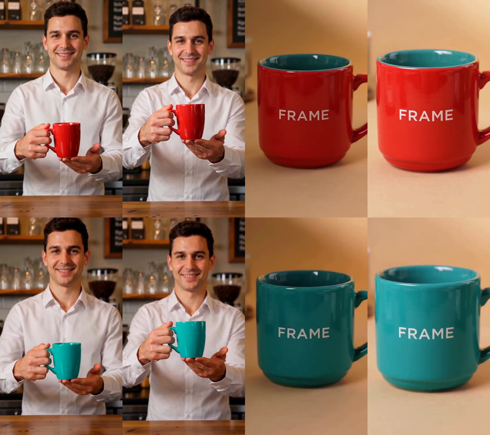
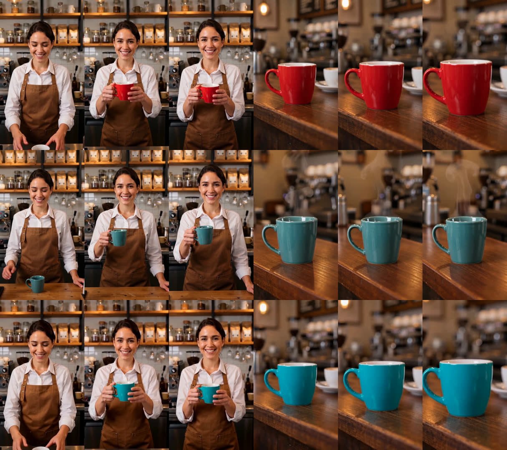
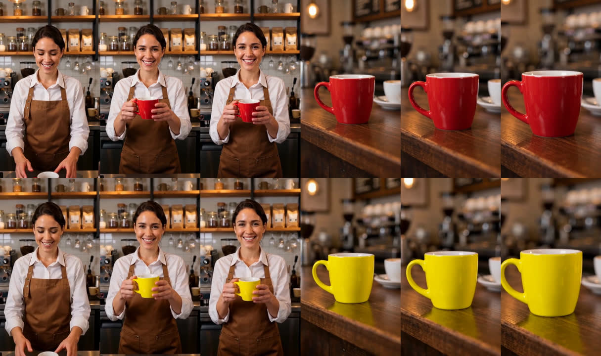

# 컨셉 화면 관점의 검토 — 장면 간 일관성과 구조화 요소가 컨셉의 UX 를 충족하는가

- 작성: 2026-11-12, 브랜치 `feature-US03-concept-ux`
- 대상: 문제정의서(11-09 수정본) '컨셉 이미지 · 스케치 · 스토리보드' 의 화면 1장
  "FRAME 영상 생성 파이프라인 — 컨셉 UI · 예시 데이터" (Drive, 1672×941)
- 결정 기록: [ADR-0017](../adr/0017-revision-intent-repair-and-keep.md) (다시 맞추기·유지할 요소),
  [ADR-0018](../adr/0018-requirement-and-keep-checkers.md) (실제 요구 반영·유지 요소 검수기),
  [ADR-0019](../adr/0019-revision-plan-and-change-request.md) (변경 계획 미리보기·변경 요청 해석),
  [ADR-0016](../adr/0016-parent-clip-editing.md) (부모 클립 편집 — 저장본 주소 재조회를 더했다),
  [ADR-0020](../adr/0020-production-preview-and-held-parent-url.md) (계획이 편집이 될지 미리 알려 준다 — 실험 뒤에 구현)
- 앞선 기록: [character-consistency.md](character-consistency.md) (1차: 정체성 기준 이미지·일관성 검수·부모 클립 편집)

## 1. 결론

컨셉 화면의 흐름은 **백엔드로는 된다.** 화면이 하듯 API 만으로 끝까지 다섯 번 돌려 확인했다 (§5).
자연어 브리프 → 구조화 → 생성 → "컵 색상 불일치" 감지 → 글로 쓴 변경 요청 → 변경 계획 → 유지할 요소와 함께 그 구간만 재생성 → 재검수 → 전후 비교.

검토를 시작할 때는 되지 않았다. 컨셉의 가운데에 있는 네 가지가 비어 있었고, 이번에 메웠다.

| 컨셉이 요구하는 것 | 검토 시작 시 | 지금 |
|---|---|---|
| 요구는 그대로 두고 틀린 구간만 다시 만들기 ("원문: 청록색 컵" 인데 빨간 컵) | 불가 (값이 같으면 422) | `kind=REPAIR` 수정 (ADR-0017) |
| 유지할 요소 (인물·동작 / 배경·조명 / 컵 형태) | API·도메인에 없음 | 요청에 `keep`, 편집 지시문에 반영, 재검수가 요소별로 판정 (ADR-0017·0018) |
| "컵 색상 불일치" 를 요구조건 단위로 알리기 | 요구 반영 검수가 Fake (항상 PASS) | `vlm_requirement` (ADR-0018) |
| 글로 쓴 변경 요청, 변경 계획 확인 | 구조화된 값만 받음, 미리보기 없음 | `POST /revision-plans` + 해석기 (ADR-0019) |

컨셉의 예시 데이터를 실제 모델로 처음부터 돌려 보니(3회차) 수정 단계에서 문제가 더 나왔다. 고친 뒤 다시 돌려 확인했다 (4·5회차).

| 돌려 보고 나온 문제 | 고친 것 | 확인 |
|---|---|---|
| 방금 만든 영상을 바로 수정했더니 편집되지 않고 새로 생성됐다 (부모 작업의 저장본 주소가 상태 응답에 없었다) | 주소가 없으면 10초 동안 다시 묻는다 (`FRAME_VIDEO_EDIT_PARENT_WAIT_S`) | 4회차: 두 번째 조회에서 받아 편집. 5회차: 여섯 번 묻고 새로 생성 |
| 편집 대신 새로 생성됐다는 사실을 API 로는 알 수 없었다 | 장면마다 `clip_production` (방식·모델·비용·시간·대체 사유) | 5회차 |
| 편집이 될지 새로 생성될지를 실행하기 전에는 알 수 없었다 | 계획이 장면마다 방식과 어림 비용을 알려 주고, 그때 받은 부모 주소로 편집한다 (ADR-0020) | 다섯 번의 실행 뒤에 구현하고, 추가로 승인받은 실행 한 번으로 확인: 계획의 어림 $0.24 = 실제 $0.24, 받아 둔 주소로 두 장면 편집 (§5.6) |
| 객체 키가 `red_mug` 라서, 색을 청록으로 바꾼 뒤 요구 반영 검수가 한 장면을 FAIL 로 오판했다 | 이 버전에서 바뀐 요구조건의 예전 값을 판정 모델에 알린다. 구조화 프롬프트에 키 규칙 | 4회차: 18/18. 5회차: 키가 `cup` |
| 새로 생성돼 자세·구도가 달라졌는데 유지 요소 검수는 8건 모두 '그대로' | 같은 시각의 프레임을 짝지어 다른 점을 먼저 적게 한다 | 5회차: 새로 생성 8건 중 4건 FAIL. 4회차: 편집 4건 모두 PASS |
| 수정 버전의 참조 이미지에 예전(빨간 컵) 기준과 새 기준이 함께 나와 화면이 가릴 수 없었다 | `reference_images[].is_current` | 5회차 |

한계로 남는 것이 하나 있다. **부모 클립 편집은 그 영상의 저장본 주소가 나온 뒤에만 된다.** Wan 3.0 으로 만든 장면은
주소가 끝난 뒤 2~18분 사이에 나왔다 (§6.3). 그 전에 수정하면 새로 생성되고, 그러면 느리고(두 장면 318초 대 99초)
비싸고($0.425 대 $0.24) 인물의 자세와 구도가 달라진다. 이것은 없앨 수 없어서 **실행하기 전에 알려 주게** 했다 (ADR-0020):
변경 계획이 장면마다 편집으로 만들어질지 새로 생성될지와 그 어림 비용을 알려 주고, 편집할 수 없으면 사유를 준다.
계획 때 받아 둔 주소로 편집하므로, 확인하는 사이 주소가 응답에서 빠져도 편집이 된다.
실행한 뒤에는 `clip_production` 과 유지 요소 판정이 실제로 어떻게 됐는지 알려 준다.

그 밖에 남은 것은 주로 화면 쪽 작업과, 백엔드에서는 장면 생성·검수의 병렬화, 객체 요약 읽기 모델, 실제 객체 추적이다 (§7).
화면(`frontend/`)은 이번에 고치지 않았다. 화면이 부를 순서와 필드는 §4 에 적었다.

## 2. 컨셉 화면에서 읽은 것

화면을 직접 보고 읽은 요소다.

- 위쪽: 프로젝트 선택("카페 신제품 숏폼"), "간단히 보기" · "모두 접기".
- 4단계 카드: **01 요구사항 → 02 생성 → 03 검수·수정 → 04 출력**. 단계마다 객체 칩 컵 01 · 인물 01 · 배경 01 과 "펼치기".
- **03 검수·수정** (펼친 상태)
  - 경고 배지 "⚠ 컵 색상 불일치".
  - "객체 연결": 객체마다 한 줄의 트랙. 컵 트랙이 선택돼 있고 마디 사이에 연결 고리가 있다.
  - "컵 01 — 전후 비교": 수정 전(빨간색 컵) → 수정 후(청록색 컵). 같은 인물·같은 배경이고, 수정 후 이미지에 인물·배경 표시가 붙어 있다.
  - 두 패널을 잇는 "부분 재생성 ↔ 재검수".
- "컵 01 등장 구간": 0~16초 타임라인, 00:04–00:08 과 00:08 조금 뒤–00:12 두 구간, 재생 위치 00:06.
- **"컵 01 수정" 패널**, 옆에 **"원문 : 청록색 컵"**
  - ① 적용 범위: "모든 등장 구간", 아래에 "장면 02 · 03"
  - ② 변경 요청: "컵 색상만 청록색으로 동일해줘. 인물과 배경은 유지해줘." (25 / 500), 추천 칩 "색상 변경" · "질감 변경"
  - ③ 유지할 요소: 인물 · 동작 / 배경 · 조명 / 컵 형태, 각각 "현재 그대로 유지"
  - ④ 실행: "변경 계획 확인" → "해당 구간 재생성" → "완료 후 재검수"

읽는 법이 하나 중요하다. "원문 : 청록색 컵", 경고 "컵 색상 불일치", 요청 문장의 "동일해줘" 를 함께 보면,
이 화면은 **요구를 바꾸는 장면이 아니라 요구와 어긋난 구간을 다시 맞추는 장면**이다.
1차 실호출 5회차에서 실제로 같은 일이 있었다 (요구는 청록, 다시 만든 장면의 컵은 빨강, 그때는 고칠 방법이 없었다).

## 3. 요소별 검토

"지금" 은 이 브랜치 기준이다. 근거의 실측은 §5, 1차 실측은 [character-consistency.md](character-consistency.md) §6.

### 3.0 한눈에 — 검토 대상별 판단

| 검토 대상 | 컨셉의 어디에 쓰이나 | 충족하는가 | 근거 |
|---|---|---|---|
| 장면 간 일관성: 정체성 기준 이미지 (ADR-0015) | 객체 연결, 같은 인물 | **충족** | 4장면에서 바리스타가 같은 사람, 일관성 1.0·1.0 (3회차). 1차: 기준 없이 0.5 → 기준과 함께 1.0 |
| 장면 간 일관성: `vlm_consistency` | 객체 연결 트랙의 상태, 경고 | **충족** (재료는 있다) | 장면별 프레임 판정이 `detail.frames[]` 에 있다. 장면 쌍으로 묶은 응답은 없다 (§7 B4) |
| 장면 간 일관성: 부모 클립 편집 (ADR-0016) | 전후 비교의 '그것만 바뀐' 결과, 유지할 요소 | **충족, 조건이 있다** | 편집되면 컨셉의 그림 그대로다 (2·4회차). 방금 만든 영상은 저장본 주소가 없어 새로 생성될 수 있다 (§6.3). 계획이 그것을 미리 알려 준다 (ADR-0020) |
| 장면 간 일관성: `ssim_preservation` | 유지 표시 | **보조 지표로만** | 진짜 편집도 0.66~0.90 이라 임계 0.9 로는 대부분 FAIL 이다. 같은 장면끼리 견주면 편집이 늘 높지만(들어 보이는 장면 0.66~0.75 대 0.49~0.56, 클로즈업 0.83~0.90 대 0.68~0.78) 장면이 다르면 범위가 겹쳐 임계값 하나로 가르기 어렵다. 유지 표시는 `vlm_preservation` 으로 한다 |
| 구조화: 객체·속성 | 객체 칩, 수정 패널의 대상 | **충족** | 글에서 객체 2~3, 속성은 요구조건으로. 키에 색이 들어가던 것은 고쳤다 (`red_mug` → `cup`) |
| 구조화: 장면·타임라인 | 등장 구간, 적용 범위 '장면 02 · 03' | **충족** (장면 단위) | 브리프의 4초 × 4장면이 그대로 나왔다. 장면 안의 실제 등장 구간은 추적기가 Fake 라 모른다 |
| 구조화: 요구조건 | 불일치 경고, 반영률 | **충족** | 4장면에 17~18건. 실제 검수로 요구조건마다 판정한다 (오경보 없음, 불일치 2건 감지) |
| 구조화: 수정 요청 | 변경 요청 글, 변경 계획 | **충족** (이번) | 글을 1.2~2.5초에 (객체, 속성, 값) + 유지할 요소로 읽는다. 한 문장에 변경 하나 |

### 3.1 단계 카드와 객체 칩 (01~04, 컵 01·인물 01·배경 01)

| 필요한 데이터·API | 지금 | 빈칸 | 제안 |
|---|---|---|---|
| 객체 목록과 종류(아이콘) | **있음.** `GET /versions/{id}` 의 `ir.entities[]` (`entity_key`·`kind`·`description`). LLM 구조화가 자연어에서 뽑는다 (§5: barista·cup). 키에 색 같은 속성이 들어가지 않게 프롬프트를 고쳤다 (3회차 `red_mug` → 5회차 `cup`) | "컵 01" 같은 표시 이름은 없다 | 화면이 종류별 순번으로 만든다. 사용자가 이름을 고치게 하려면 `display_name` 이 필요 (낮음) |
| 단계의 진행 (생성 중 몇 번째 장면) | **있음.** `progress.stages[]` (`stage`·`status`·`done`/`total`·`current`·`elapsed_ms`), 처리 중에도 폴링으로 갱신 (ADR-0012) | 01 요구사항(구조화) 단계의 진행은 버전 상태 `STRUCTURING` 뿐 | 지금으로 충분 |
| 단계별 객체 상태 (칩의 색·경고) | **조합 가능.** 요구조건 수는 `ir`, 검수는 `GET /checks` 결과의 `entity_key` 로 묶는다 | 객체 단위로 묶은 응답은 없다 (화면이 조합) | 객체 요약 읽기 모델 (§7, 중간) |
| 객체 썸네일 | **있음(이번).** `reference_images[].image_url` — 객체의 정체성 기준 이미지 (`origin=DERIVED`). 수정으로 모습이 바뀐 객체는 예전 기준과 새 기준이 함께 남으므로 `is_current=true` 인 것을 쓴다 | 기준이 없는 객체(배경, 요구와 달라 걸러진 객체)는 이미지가 없다 | 화면은 없으면 아이콘으로 |

### 3.2 불일치 경고 ("컵 색상 불일치")

| 필요한 데이터·API | 지금 | 빈칸 | 제안 |
|---|---|---|---|
| 요구조건마다 반영 여부 | **있음(이번).** `vlm_requirement`: `GET /checks` 의 `REQUIREMENT` 결과에 `requirement_key`·`entity_key`·`scene_key`·`verdict`·`score` | 기본 검수기는 여전히 Fake (설정으로 켠다) | 시연 설정에 실제 검수기를 넣는다 (§7) |
| 배지 문구 | **있음(이번).** `detail.predicate`("color")·`expected_value`·`observed`("red ceramic mug"), 술어의 한국어 별칭은 `GET /vocabulary/predicates` ("색상") | — | "{객체} {술어 별칭} 불일치" 로 조합 |
| 경고 구간 (타임라인 마커) | **있음.** `warnings[]` (`scene_key`·`start_ms`·`end_ms`·`message`) | — | — |
| 수치 (얼마나 반영됐나) | **있음.** `summary.requirement_reflection_rate`·`consistency_rate`·`preservation_rate` | Fake 검수기의 수치는 뜻이 없다 | 화면에 "Fake 검수" 표시 (개편 브랜치에 이미 있다) |

실측: 요구가 청록인데 빨간 컵이 나온 영상에서 컵 색 요구조건 2건이 FAIL(0.0), 메시지 `cup color: 요구 'teal', 화면: red ceramic mug`, 반영률 11/13 (§5.1).
요구대로 나온 4장면 영상(3·5회차의 원본)에서는 17건·18건이 모두 PASS 였다 (오경보 없음).
색을 바꾼 뒤 한 장면을 FAIL 로 본 오판 1건은 원인(객체 이름에 남은 예전 색)을 고쳐 다시 확인했다 (§5.3·§5.4).

### 3.3 객체 연결 (객체별 트랙과 연결 표시)

| 필요한 데이터·API | 지금 | 빈칸 | 제안 |
|---|---|---|---|
| 객체가 나오는 장면 | **있음.** `ir.scenes[].entity_keys`, `GET /versions/{id}/entities/{entity_id}/tracks` (`records[].segments`) | 추적기는 Fake 다 (장면 전체 구간, 가짜 박스) | 실제 추적기 (§7) |
| 장면 사이에 같은 객체로 이어지는가 (연결 고리) | **조합 가능.** `CONSISTENCY` 결과의 `detail.frames[]` (`scene_key`·`same_subject`·`dropped_attributes`)와 `warnings[]` | 장면 쌍마다의 연결 상태를 주는 응답은 없다 | 객체 요약 읽기 모델에 `links[]` (§7, 중간) |
| 무엇으로 이어 주는가 | **있음(1차).** 정체성 기준 이미지를 그 객체가 나오는 다른 장면 생성에 넘긴다 (ADR-0015) | — | — |

1차 실측: 기준 이미지 없이 만든 바리스타 장면 2개는 모두 다른 사람, 기준과 함께 만든 5개는 모두 같은 사람. 이번 3회차에서 4장면으로 다시 봤다 (§5.3).

### 3.4 객체별 전후 비교와 유지 표시

| 필요한 데이터·API | 지금 | 빈칸 | 제안 |
|---|---|---|---|
| 수정 전·후 클립 | **있음.** `GET /versions/{id}/comparison` 의 `scenes[].before/after.clip_url`, 장면 상태 `REUSED`/`REGENERATED` | — | 두 클립을 나란히 재생 |
| "같은 화면에서 그것만 바뀐" 결과 | **있음(1차).** 부모 클립 편집 (ADR-0016, FLUX Video Edit) | 방금 만든 영상은 저장본 주소가 늦게 나와 편집 대신 새로 생성될 수 있다 (§6.3). 새로 생성하면 자세·구도가 바뀐다 (SSIM 0.49~0.68) | 수정에는 편집 모드. 편집이 될지는 계획의 `scenes[].production` 이 미리 알려 준다 (ADR-0020) |
| 편집으로 만들었는지, 새로 생성됐는지 | **있음(이번).** `ir.scenes[].clip_production` (`method`·`model`·`cost_usd`·`seconds`·`edit_fallback_reason`) | — | 새로 생성으로 바뀌었으면 사유를 보여 준다 |
| 인물·배경 유지 표시 | **있음(이번).** `vlm_preservation`: `PRESERVATION` 결과가 요소마다 하나 (`scene_key`·`entity_key`·`detail.aspect`·`verdict`·`detail.difference`) | — | 수정 후 이미지에 요소별 배지 |
| 요구조건의 전후 판정 (FAIL → PASS) | **있음.** `comparison.scenes[].requirements[]` 의 `before_verdict`/`after_verdict` | — | — |
| 무엇을 하려던 수정인가 | **있음(이번).** `before/after.revision`, `VersionOut.revision` (`kind`·대상·`keep`·`request_text`) | — | "원문 : 청록색 컵" 은 `revision.value`·`request_text` 로 |
| 객체만 잘라 낸 전후 이미지 | **있음(이번).** 수정 버전의 기준 이미지에서 `is_current=false` 가 수정 전, `true` 가 수정 후 (4회차: 'red ceramic mug' · 'teal ceramic mug') | 요구와 달라 걸러진 객체는 기준이 없다 (다시 맞추기에서는 수정 전 쪽이 빈다) | 없으면 두 클립의 같은 시각 프레임을 쓴다. 서버가 프레임을 내주는 경로는 후속 (낮음) |

실측: 실제 FLUX 편집에서 같은 인물·자세·배경·구도에 컵만 청록으로 바뀌었고, 유지 요소 8건이 모두 PASS 였다 (§5.2).
같은 원본에서 새로 생성한 결과는 판정을 고친 뒤 8건 가운데 4건이 FAIL 이다 (§5.4·§5.5).

### 3.5 부분 재생성 ↔ 재검수

| 필요한 데이터·API | 지금 | 빈칸 | 제안 |
|---|---|---|---|
| 그 구간만 다시 만든다 | **있음.** 조건이 바뀐 장면만 다시 만들고 나머지는 부모 클립 재사용 (ADR-0003). 요구가 그대로면 `REPAIR` (이번) | — | — |
| 다시 만든 뒤 자동 재검수 | **있음.** 생성 → 추적 → 검수가 한 번의 접수로 이어진다 | — | — |
| 다시 만들지 않은 장면의 판정이 그대로인가 | **있음(이번).** 요구 반영 판정은 부모 것을 물려받는다 (`detail.inherited_from`) | 일관성 판정은 객체 단위라 매번 다시 판정한다 | 후속 (낮음) |
| 여러 번 되풀이 | **있음.** 수정 버전의 수정 버전. 다시 만든 장면은 다음 버전에서 재사용된다 | 같은 부모에서 같은 REPAIR 는 같은 결과다 (ADR-0017 한계) | 화면은 직전 버전에서 이어 가게 한다 |

### 3.6 등장 구간 타임라인

| 필요한 데이터·API | 지금 | 빈칸 | 제안 |
|---|---|---|---|
| 전체 길이와 장면 경계 | **있음.** `ir.scenes[].planned_start_ms/end_ms` | — | — |
| 객체가 나오는 구간 | **있음(장면 단위).** 트랙 `segments[].start_ms/end_ms` | 장면 안에서 실제로 보이는 구간은 모른다 (Fake 추적기) | 컨셉의 예시(00:04–00:08, 00:08–00:12)는 장면 단위로 충분. 실제 추적기는 후속 |
| 경고 마커 | **있음.** 검수 결과의 `warnings[]` | — | — |

### 3.7 수정 패널

| 단계 | 필요한 데이터·API | 지금 | 빈칸 | 제안 |
|---|---|---|---|---|
| ① 적용 범위 | 범위와 대상 장면 | **있음.** `scope`(`ALL_APPEARANCES`/`SCENES`)·`scene_keys`. 계획이 `target_scene_keys` 로 "장면 02 · 03" 을 돌려준다 (이번) | "판정이 FAIL 인 장면만" 범위는 없다 | 화면이 계획의 `scenes[].verdict` 로 골라 `SCENES` 로 보낸다 |
| ② 변경 요청 | 글 → 구조화된 변경 | **있음(이번).** `POST /revision-plans` 의 `request_text` (해석기 `llm`) | 한 문장에 변경 둘 이상은 읽지 못한다 | 화면에 안내 문구 |
| ② 추천 칩 | 그 객체에 쓸 수 있는 속성 | **조합 가능.** `GET /vocabulary/predicates` + 그 객체의 요구조건 | 추천 목록 자체는 없다 | 화면이 종류별로 고른다 (낮음) |
| ③ 유지할 요소 | 유지 요소의 전달과 판정 | **있음(이번).** `keep[]` → 편집 지시문 → `vlm_preservation` | 새로 생성하는 경로에서는 인물의 모습만 지킨다 (기준 이미지) | 수정에는 편집 모드 |
| ④ 변경 계획 확인 | 대상 장면·어림 비용·시간, 편집이 될지 | **있음(이번).** 계획의 `scenes[]`·`estimate`. 다시 만들 장면마다 `production` 이 편집으로 만들어질지 새로 생성될지와 그 방식의 어림 비용을 알려 준다 (ADR-0020). 실제 원본으로 물으니 두 장면 `EDIT`·합계 $0.24 로, 4회차의 실제 비용과 같았다 | 편집 시간의 어림은 그 모델로 만든 기록이 있을 때만 있다. 주소가 아직 없으면 새로 생성된다 (미리 알려 줄 뿐이다) | 화면은 `edit_unavailable_reason` 을 보여 주고 다시 확인하게 한다 |
| ④ 해당 구간 재생성 | 실행 | **있음.** `revision_request` → `POST /revisions` → `POST /generations` | — | — |
| ④ 완료 후 재검수 | 자동 재검수 | **있음.** | — | — |

### 3.8 04 출력

| 필요한 데이터·API | 지금 | 빈칸 | 제안 |
|---|---|---|---|
| 결과 영상 | **있음.** `video_url` (Range 지원) | — | — |
| 버전 이력 | **있음.** `GET /projects/{id}/dashboard` (버전 트리·버전별 검수 요약), 이번에 `revision` 추가 | — | 버전마다 "REPAIR cup.color=teal" 처럼 표시 |
| 내보내기 | **있음(내려받기).** `video_url` 을 그대로 내려받는다 | 별도의 내보내기 형식은 없다 | 범위 밖 |

## 4. 화면이 부르는 순서 (API 계약)

모든 경로는 `/api` 아래다. 응답 필드의 정의는 `docs/openapi.json`.

1. **요구사항**: `POST /projects` (`title`·`prompt`·`target_duration_ms`) → `version_id`. `GET /versions/{id}` 를 폴링해 `state=DRAFT` 가 되면
   `ir.entities`·`ir.scenes` 로 객체 칩과 장면을 그린다.
2. **생성**: `POST /versions/{id}/generations` → `GET /versions/{id}` 폴링. `progress.stages` 로 단계와 장면 진행을 보여 준다.
   끝난 장면은 처리 중에도 `ir.scenes[].clip_url` 이 채워지므로 먼저 재생할 수 있다.
   객체 칩의 썸네일은 `reference_images[]` 에서 그 객체의 `is_current=true` 인 `image_url` 이다.
3. **검수**: `GET /versions/{id}/checks`.
   - 배지: `check_type=REQUIREMENT` 이고 `verdict=FAIL` 인 결과. 문구는 `entity_key` + `detail.predicate` 의 별칭 + "불일치".
   - 타임라인 마커: 모든 결과의 `warnings[]`.
   - 객체 연결: `check_type=CONSISTENCY` 결과의 `detail.frames[]` 를 장면별로 묶는다.
4. **수정 패널**
   - 계획: `POST /versions/{id}/revision-plans` 에 `{"request_text": "...", "entity_key": "<고른 객체>"}`.
     화면에서 범위나 유지 요소를 골랐으면 `scope`·`scene_keys`·`keep` 을 함께 보낸다 (그 값이 우선한다).
     응답의 `kind`·`notes`·`scenes[]`·`estimate` 를 "변경 계획 확인" 에 보여 준다.
     다시 만들 장면의 `production` (`method`=`EDIT`|`GENERATE`, `model`·`cost_usd`·`seconds`)이 그 구간이 어떻게 만들어질지다.
     `edit_unavailable_reason` 이 있으면 지금은 편집하지 못해 새로 생성된다는 뜻이다. 사유를 보여 주고, 응답의 `revision_request` 를
     그대로 다시 보내 계획을 다시 확인할 수 있다 (LLM 을 다시 부르지 않는다). `EDIT` 를 본 뒤 30분 안에 실행하면 그대로 편집된다.
   - 유지할 요소의 체크 → `keep`:

     | 체크 | `keep` |
     |---|---|
     | 인물 · 동작 | `{aspect: APPEARANCE, entity_key: <인물>}`, `{aspect: ACTION, entity_key: <인물>}` |
     | 배경 · 조명 | `{aspect: BACKGROUND, entity_key: null}`, `{aspect: LIGHTING, entity_key: null}` |
     | 컵 형태 | `{aspect: SHAPE, entity_key: <컵>}` |

   - 실행: 응답의 `revision_request` 를 그대로 `POST /versions/{id}/revisions` → 새 `version_id` → `POST /versions/{새 id}/generations`.
5. **재검수·전후 비교**: `GET /versions/{새 id}/checks`, `GET /versions/{새 id}/comparison`.
   - 유지 표시: `check_type=PRESERVATION` 이고 `detail.method=vlm_keep` 인 결과 (`entity_key`·`detail.aspect`·`verdict`).
   - 요구조건의 전후: `comparison.scenes[].requirements[].before_verdict/after_verdict`.
   - 어떻게 만들어졌는지: `GET /versions/{새 id}` 의 `ir.scenes[].clip_production` (`method`=`EDITED`|`GENERATED`, `model`·`cost_usd`·`seconds`).
     편집하려던 장면이 새로 생성됐으면 `edit_fallback_reason` 에 사유가 있다.
   - 객체별 전후 이미지: 새 버전의 `reference_images[]` 에서 그 객체의 `is_current=false`(전)와 `true`(후).
6. **출력**: `GET /versions/{id}` 의 `video_url`, `GET /projects/{id}/dashboard`.

오류 코드: 읽지 못한 요청 422 `CHANGE_REQUEST_NOT_UNDERSTOOD`, 값이 같은 CHANGE·값이 다른 REPAIR·모순된 유지 요소 422 `VALIDATION_ERROR`,
없는 객체 404, 처리 중인 버전 409 `VERSION_NOT_REVISABLE`, 해석 중 LLM 실패 503/502 (`LLM_*`).
`GET /health` 의 `adapters.change_interpreter` 가 `rule_based` 면 자연어는 읽지 못한다 (`cup.color = teal` 형식만).

## 5. 실험 — 화면이 하듯 API 로 돌려 본 다섯 번

서버를 띄우고 §4 의 순서대로 API 만 불렀다. 480p·9:16, 4초 장면, 생성 Wan 3.0, 편집 FLUX Video Edit, 구조화·요청 해석 gpt-4.1-mini,
검수·기준 이미지 추출 gpt-4.1. 검수기는 `vlm_requirement,vlm_consistency,vlm_preservation,ssim_preservation` 을 함께 켰다.
변경 요청은 컨셉 화면의 문장 그대로다: "컵 색상만 청록색으로 동일해줘. 인물과 배경은 유지해줘."

| # | 영상 API | 무엇을 봤나 | 결과 | 비용 (영상 + LLM·VLM) |
|---|---|---|---|---|
| 1 | 가짜 (1차의 실제 클립을 돌려줌) | 요구는 청록인데 빨간 컵이 나온 영상 → 감지 → 다시 맞추기 | 반영률 11/13 으로 감지 → REPAIR → 13/13 | $0 + 약 $0.10 |
| 2 | 실제 | 1차에서 실제로 생긴 불일치 버전을 FLUX 편집으로 다시 맞추기 | 편집 적용, 컵만 청록, 유지 요소 8/8 | $0.24 + 약 $0.04 |
| 3 | 실제 | 컨셉 예시(16초·4장면)를 처음부터: 구조화 → 생성 → 검수 → 색 변경 | 원본은 17/17. 수정은 편집되지 않고 새로 생성, 오판 1건 | $1.275 + 약 $0.10 |
| 4 | 실제 | 3회차의 문제를 고친 뒤, 같은 원본에 같은 요청 | 편집 적용, 18/18, 유지 요소 4/4 | $0.24 + 약 $0.06 |
| 5 | 가짜 (3회차의 실제 클립을 돌려줌) | 고친 코드로 처음부터, 그리고 '방금 만든 영상을 바로 수정' | 키 `cup`, 여섯 번 묻고 새로 생성, 유지 요소가 그것을 가려냄 | $0 + 약 $0.10 |

다섯 번의 합계는 영상 $1.755, LLM·VLM 약 $0.40 이다. 그 뒤 추가로 승인받은 한 번(§5.6)이 영상 $0.24, LLM·VLM 약 $0.05 다.
가짜 영상 API 는 실제 호출에서 받아 둔 클립을 장면에 맞춰 돌려주는 시험 서버로,
그 위의 구조화·해석·검수는 모두 실제 모델이다.

### 5.1 1회차 — 불일치를 잡고 다시 맞춘다 (가짜 영상 API)
- 브리프는 청록 컵인데 영상 API 가 빨간 컵 클립을 돌려주게 했다 (1차 5회차에서 실제로 나온 클립).
- 구조화 9.3초: 객체 barista · cup(teal) · white_shirt, 장면 3.
- 검수 14~15초: 컵 색 요구조건 2건 FAIL, `화면: red ceramic mug`, 경고 구간이 두 장면에. 반영률 11/13.
  기준 이미지 추출도 요구와 다른 빨간 컵을 기준으로 삼지 않았다 (1차의 고정 속성 확인).
- 글 요청 → 계획 1.2초: (cup, color, teal) 로 읽고, 요구가 이미 청록이라 **REPAIR 로 스스로 정했다.** 장면별 판정 FAIL·FAIL 이 함께 나왔다.
- 화면의 체크 세 개(유지 요소 5개)와 함께 실행 → 두 장면만 다시 만들고 반영률 13/13, 유지 요소 8건 PASS.
  전후 비교의 요구조건 판정이 FAIL → PASS 로 나왔다.
- 이 실행에서 "배경은 유지" 가 객체 없는 '모습' 으로 해석돼 빠지는 것을 찾아 고쳤다 (`c0adb07`).

### 5.2 2회차 — 실제 FLUX 편집으로 다시 맞춘다

- 1차 5회차의 실제 불일치 버전(요구는 청록, 영상은 빨간 컵)을 부모로 썼다.
- 계획 2.3초, 편집 2건(장면당 약 45초, 생성 단계 91.8초), 재검수 14.3초.
- 눈으로 확인: 같은 인물·자세·배경·구도에서 컵만 청록이다. 컨셉 화면의 전후 비교와 같은 그림이다.
- 컵 색 요구조건 2건 PASS, 일관성 1.0·1.0, 유지 요소 8건 PASS. 같은 장면의 SSIM 은 0.709·0.880 이다.
- 새로 드러난 것: 클로즈업 장면의 `mood: warm lighting` 이 FAIL(0.33)이었다. Fake 검수로는 보이지 않던 장면 조건의 어긋남이다.

### 5.3 3회차 — 컨셉 예시를 처음부터 실제 모델로
- 브리프: 16초·4장면. 바리스타가 미소 → 빨간 머그컵을 들어 보임 → 컵 클로즈업 → 손을 흔듦. 컵은 장면 2·3 에 나온다 (컨셉의 "장면 02 · 03").
- 구조화 5.7초: 객체 barista · `red_mug`, 장면 4, 요구조건 17.
- 생성 613초 (장면당 103·164·164·163초, 차례로). 장면 2~4 는 앞 장면에서 뽑은 기준 이미지와 함께 만들었다.
- 검수 15.6초: 요구 반영 17/17, 일관성 1.0·1.0. 네 장면의 바리스타가 같은 사람이고 오경보가 없었다.
- 글 요청 → 계획 2.2초: CHANGE (red_mug, color, teal), 대상 장면 2·3. 유지 요소 5개로 실행했다.
- **여기서 문제가 나왔다.**
  1. 두 장면 모두 편집되지 않고 Wan 3.0 으로 새로 생성됐다 (생성 단계 318초). 부모 작업의 상태 응답에 저장본 주소가 없었다.
     두 작업은 끝난 지 6분쯤 된 것이었다.
  2. 요구 반영 17/18: `scene_2:red_mug:color` 가 FAIL 이었다. 화면의 컵은 청록인데 판정 모델이 "teal, not red" 라고 답했다.
     객체 키와 설명, 다른 요구조건("shows red mug to camera")에 예전 색이 남아 있었다.
  3. 유지 요소 8건이 모두 PASS 였다. 눈으로 보면 두 손이 한 손이 됐고 구도·선반·컵 모양이 달라졌다 (SSIM 0.490·0.680).
- 고친 것: 저장본 주소 재조회(`7e0ed73`), 바뀐 요구조건 표시(`2bb50f3`)와 구조화 키 규칙(`f593446`), 유지 요소 판정(`df1d05f`).
  돌려 보며 함께 드러난 응답의 빈칸도 메웠다: 참조 이미지의 `is_current`(`55c7529`), 장면의 `clip_production`(`fa88ccc`).

### 5.4 4회차 — 고친 뒤 같은 원본에 같은 요청 (실제 FLUX 편집)

위에서부터 원본(빨간 컵), 3회차의 새로 생성, 4회차의 편집이다. 왼쪽 세 칸이 들어 보이는 장면, 오른쪽 세 칸이 클로즈업이다.

- 유지 요소는 글에서 읽은 대로 뒀다 (인물의 모습·동작, 배경). 화면에서 체크하지 않아도 요청 문장만으로 된다.
- 들어 보이는 장면의 부모 주소는 **두 번째 조회에서** 받았다 (`parent_url_lookups=2`). 고치기 전이었다면 여기서 새로 생성으로 빠졌다.
- 편집 2건(각 41초), 생성 단계 98.7초, 재검수 15.4초. 실행부터 재검수까지 115초.
- 요구 반영 18/18 (3회차의 오판 없음), 일관성 1.0·1.0, 유지 요소 4건 PASS.
- 같은 실행에서 고친 구조화 프롬프트로 브리프를 한 번 구조화했다 (생성 없음): 객체 키 barista · `cup`,
  `barista.action = shows cup to camera`, `cup.color = red` 가 컵이 나오는 두 장면 모두에 들어갔다.

같은 원본에서 만든 두 결과를 견주면 이렇다.

| | 새로 생성 (3회차) | 편집 (4회차) |
|---|---|---|
| 생성 단계 | 318초 (장면당 144·164초) | 99초 (장면당 41·41초) |
| 영상 비용 | $0.425 | $0.24 |
| 컵 색 | 청록 | 청록 |
| 눈으로 본 것 | 같은 인물. 두 손 → 한 손, 구도·선반·컵 모양이 다르고 김이 생겼다 | 같은 자세·구도·배경, 컵 색만 다르다 |
| SSIM (부모 대비) | 0.490 · 0.680 | 0.664 · 0.828 |
| 유지 요소 판정 | 8건 중 4건 FAIL (§5.5, 같은 클립) | 4건 모두 PASS |
| 일관성 (인물 · 컵) | 1.0 · 1.0 | 1.0 · 1.0 |

### 5.5 5회차 — 고친 코드로 처음부터, 방금 만든 영상을 바로 수정 (가짜 영상 API)
- 영상 API 는 3회차의 실제 클립을 돌려주고, 끝난 작업의 상태 응답에 저장본 주소를 싣지 않는다 (실제 API 가 생성 직후에 그랬다).
- 구조화 7.2초: 객체 barista · `cup`, 장면 smile · show_cup · cup_closeup · wave, 요구조건 18. 검수 15.9초: 18/18, 일관성 1.0·1.0.
- 글 요청 → 계획 1.4초 → 유지 요소 5개로 실행. 두 장면 모두 부모 작업을 **여섯 번 조회(10초)한 뒤 새로 생성으로 넘어갔다.**
  `clip_production` 은 `method=GENERATED`, `edit_fallback_reason="부모 작업의 저장본 주소를 얻지 못함 (6회 조회: …)"`.
- 재검수 15.6초: 요구 반영 18/18. **유지 요소 8건 중 4건 FAIL** — 3회차에서는 같은 클립에 8건 모두 PASS 였다.
  - 들어 보이는 장면: 인물의 동작 FAIL ("looking down and setting cup down … vs looking up and holding cup").
  - 클로즈업: 배경·조명·컵 형태 FAIL ("background blur and objects differ", "cup shape and handle position differ").
- 참조 이미지: 빨간 컵의 기준은 `is_current=false`, 청록 컵의 기준은 `true`.

### 5.6 다섯 번의 실행 뒤에 — 계획이 편집이 될지 미리 알려 준다 (과금 없는 확인과 추가 실행 한 번)
실행 횟수를 다 쓴 뒤에 구현했다 (ADR-0020). 먼저 유료 호출 없이 확인했고, 사용자가 추가로 승인한 실행 한 번으로 실제 편집까지 봤다.
- 루프백 가짜 OpenRouter 로 API 전체 흐름 (저장소의 통합 테스트): 주소가 없을 때 계획이 `GENERATE` 와 사유를 알려 주고,
  주소가 나온 뒤 다시 확인하면 `EDIT` 로 바뀌며, 그 뒤 주소가 응답에서 빠져도 받아 둔 주소로 두 장면이 편집된다.
- 실제 OpenRouter 에 과금 없는 조회만: 3·4회차가 남긴 버전에 구조화된 값으로 계획을 요청했다 (LLM·생성 호출 없음).

  | 부모 버전 | 계획이 알려 준 것 | 응답 시간 |
  |---|---|---|
  | 3회차의 원본 (Wan 3.0) | 두 장면 `EDIT`·FLUX·$0.12, 합계 $0.24. 4회차의 실제 비용과 같다 | 3.8초, 다시 물으면 0.01초 |
  | 4회차의 수정본 (FLUX 편집) | 두 장면 `EDIT`·$0.12, 41.4초·41.0초, 합계 82.3초 | 1.3초, 다시 물으면 0.00초 |
  | 3회차의 수정본 (Wan 3.0 으로 새로 생성) | 두 장면 `EDIT`·$0.12, 시간은 없음 | 1.0초 |

- 서명 주소는 조회할 때마다 새로 서명돼 오고 그 작업이 만료될 때까지(약 24시간) 유효했다. 그래서 받아 둔 주소를 메모리에 30분 들고 있다가 써도 된다.
- **추가 실행 한 번 (실제 OpenRouter·OpenAI)**: 3회차의 원본에 화면이 하듯 글 요청 "컵 색상만 노란색으로 바꿔줘. 인물과 배경은 유지해줘." 로
  계획을 받고, 60초 뒤(계획을 읽는 시간) 받은 `revision_request` 그대로 실행했다.

  

  | | 계획이 알려 준 것 | 실제 |
  |---|---|---|
  | 방식 | 두 장면 `EDIT` (FLUX Video Edit) | 두 장면 `EDITED`. 들고 있던 주소로 접수됨 (`edit.parent_url_held=true`, 실행 때 조회 없음) |
  | 비용 | $0.24 | $0.24 |
  | 시간 | 어림 없음 (그 서버에서 처음 하는 편집) | 편집 각 41.0초, 생성 단계 93.1초, 재검수 17.2초 |

  재검수는 요구 반영 18/18 (컵 색 yellow 두 장면 PASS), 일관성 1.0·1.0, 유지 요소 4건 PASS, SSIM 0.688·0.813 이었다.
  계획 응답은 9.6초였다 (글 해석과, 응답에서 빠진 부모 주소를 다시 묻는 시간이 들어 있다).
  대체 생성으로 비용이 늘지 않게 이 실행에서는 생성 모델을 없는 이름으로 두었고, 그 경로는 타지 않았다.
- 확인하지 못한 것: 실제 API 에서 주소가 없는 순간의 계획 응답 (3회차에서 겪은 상태지만 과금 없이 다시 만들 수 없다),
  주소를 30분 가까이 들고 있다가 쓰는 경우.

## 6. 사용자가 체감하는 지연과 비용

### 6.1 단계별 (컨셉 예시: 16초·4장면, 480p)

| 화면의 단계 | 걸린 시간 | 비용 | 비고 |
|---|---|---|---|
| 01 요구사항 (구조화) | 5.7~9.3초 | $0.001 미만 | 글 → 객체 2~3, 장면 3~4, 요구조건 13~18 |
| 02 생성 | **613초** (장면당 103·164·164·163초) | $0.85 ($0.2125 × 4) | 장면을 차례로 만든다. 기준 이미지 추출(객체당 약 2초)이 들어 있다 |
| 03 검수 | 14~16초 | 약 $0.04~0.05 | VLM 6~7회를 차례로 부른다 |
| 수정: 변경 계획 (글 해석) | 1.2~2.5초 | $0.001 미만 | |
| 수정: 해당 구간 재생성 — 편집 | 92~99초 (장면당 41~45초) | $0.24 ($0.12 × 2) | |
| 수정: 해당 구간 재생성 — 새로 생성 | 318초 (장면당 144·164초) | $0.425 | 편집하지 못했을 때 |
| 수정: 재검수 | 15~16초 | 약 $0.04~0.05 | 다시 만들지 않은 장면의 요구 반영은 물려받는다 |

처음 결과를 보기까지 약 10분 35초·$0.90 이다. 수정 한 번은 편집이면 약 2분·$0.29, 새로 생성이면 약 5분 35초·$0.47 이다.

### 6.2 기다리는 동안 화면이 쓸 수 있는 것
- **진행 표시**: `progress.stages[]` 가 단계와 `done`/`total`/`current`(지금 만드는 장면)/`elapsed_ms` 를 준다. 생성 10분은 "2/4 (scene_2)" 로 보인다.
- **끝난 장면부터 보여 주기**: 처리 중에도 끝난 장면은 `ir.scenes[].clip_url` 이 채워진다. 마지막 장면까지 기다리지 않아도 된다.
- **수정 전에 어떻게 만들어지고 얼마가 들지**: 계획의 `scenes[].production` 과 `estimate`. 편집으로 만들어질지 새로 생성될지,
  그 방식의 어림 비용이다. 편집하지 못하면 사유가 온다 (ADR-0020).
- **수정 뒤에 어떻게 만들어졌는지**: `clip_production` 의 방식·시간·비용·대체 사유.

### 6.3 편집은 부모 영상의 저장본 주소가 나온 뒤에만 된다
영상 참조는 HTTPS 주소만 받는다 (1차). 그래서 부모 클립을 만든 작업의 상태를 조회해 제공자 저장본의 서명 주소를 받아 넘긴다.
이번에 그 주소가 늦게, 그리고 들쭉날쭉하게 나온다는 것을 봤다 (과금 없는 상태 조회로 쟀다).

| 관측 | 값 |
|---|---|
| Wan 3.0 작업 6건: 끝난 뒤 주소가 처음 보인 때 | 2분 안 1건 · 5~11분 사이 3건 · 14~18분 사이 2건. 3회차에서 편집하려던 두 작업은 끝난 지 6분쯤이었고 둘 다 주소가 없었다 |
| FLUX 편집 작업 2건: 끝난 뒤 주소가 처음 보인 때 | 1분 안팎 (한 건은 30초에 없고 60초에 있음, 다른 건은 75초에 있음) |
| 주소가 보인 뒤에도 응답에서 빠진다 | Wan 3건을 1.5초 간격으로 10번씩: 2~3번 빠짐. FLUX 2건을 30초 간격으로 끝난 뒤 약 22분까지: 주소가 처음 보인 뒤 41번 중 12번, 40번 중 13번 빠졌고, 길게는 7번 연속(약 3.5분)이었다 |

- 응답 한두 번에서 빠지는 것은 다시 묻는 것으로 넘겼다: 기본 10초 동안 여섯 번 묻는다 (4회차에서 실제로 두 번째 조회에 받았다).
- 몇 분씩 이어서 빠지는 것은 계획 때 받아 둔 주소로 넘긴다 (ADR-0020): 변경 계획을 볼 때 주소가 보이면 메모리에 30분 들고 있다가
  실행할 때 그것으로 편집한다. 주소가 아직 한 번도 보이지 않았으면 계획이 그 사실과 사유를 알려 준다.
- 늦게 나오는 것은 기다리는 수밖에 없다. 계획을 다시 확인하거나, `FRAME_VIDEO_EDIT_PARENT_WAIT_S` 를 늘려 실행 때 그만큼 기다리게 한다
  (기다리는 동안 그 장면의 생성 단계는 멈춰 있다).
- 화면에서 보면: 생성이 끝나고 결과를 살펴보는 몇 분 사이에 수정하면 새로 생성될 수 있다. 수정 결과를 다시 고칠 때(부모가 FLUX 편집 결과)는
  1분쯤이면 주소가 나오지만, 그 뒤에도 빠지는 때가 있다.
- 주소를 못 받아 새로 생성한 결과는 그 편집 요청의 키에도 남는다. 같은 부모에서 같은 수정을 다시 요청하면 그 결과를 다시 쓴다 (ADR-0016 한계).
- 제공자의 주소에 기대지 않으려면 클립을 FRAME 이 HTTPS 로 내줘야 한다 (공개 주소가 있는 배포에서만 된다). 지금의 로컬 시연 구성으로는 할 수 없다.

## 7. 남은 빈칸과 제안

우선순위는 컨셉 화면의 흐름에 얼마나 직접 걸리는가로 매겼다. GitHub 이슈는 만들지 않았다 (초안).

### 백엔드

| # | 빈칸 | 제안 | 우선순위 |
|---|---|---|---|
| B1 | **구현함 (ADR-0020).** 계획이 장면마다 편집으로 만들어질지 새로 생성될지와 그 어림 비용을 알려 주고, 그때 받은 부모 주소로 편집한다 | 실제 호출 한 번으로 확인했다 (§5.6). 남은 것: 생성 작업을 다른 프로세스에서 돌리면 주소를 나눠 쓰지 못한다. 편집 시간의 어림은 그 모델로 만든 기록이 있어야 나온다. B10 의 어긋남 | 끝 |
| B2 | 장면을 차례로 만든다 (4장면 613초) | 기준 이미지가 필요한 순서만 지키고 나머지는 함께 만든다. 이 예시는 장면 1 → (장면 2·4) → 장면 3 으로 약 430초가 된다 | 높음 |
| B3 | 검수가 VLM 을 차례로 부른다 (15초) | 장면·객체별 호출은 서로 독립이다. 함께 부르면 가장 긴 호출 하나의 시간(약 3~4초)이 된다 | 중간 |
| B4 | 객체 단위로 묶은 응답이 없다 (화면이 버전·검수·트랙 세 응답을 조합) | `GET /versions/{id}/entities`: 객체마다 등장 장면·구간, 장면 사이 연결 상태, 걸린 경고, 썸네일(`is_current`) | 중간 |
| B5 | 한 번의 수정은 요구조건 하나다 | "색과 질감을 함께" 를 한 수정 버전으로. 해석기가 여러 변경을 돌려주게 하고 계획이 묶는다 | 중간 |
| B6 | 값을 바꾼 뒤 다른 문구에 예전 표현이 남는다 (객체 설명 "빨간 머그컵", 장면 설명) | 판정 모델에는 알리게 했다. 설명 자체를 고치려면 계획 단계에서 함께 고칠 문구를 제안받아 확인하게 한다 | 중간 |
| B7 | `preservation_rate` 에 요소 판정(0/1)과 SSIM 이 섞인다 | 요약에 방법별 값을 따로 둔다 (`vlm_keep` · `ssim`) | 중간 |
| B8 | 객체 추적이 Fake 다 (등장 구간·박스가 장면 단위) | 실제 추적기 (AC-31·34). 보존 지표에서 바꾼 대상의 영역을 빼는 데도 쓴다 | 중간 (컨셉의 예시는 장면 단위로 충분) |
| B9 | 일관성 판정은 매번 다시 한다 (요구 반영은 부모 판정을 물려받는다) | 다시 만들지 않은 장면의 프레임 판정을 물려받거나 여러 번 물어 다수결 | 낮음 |
| B10 | 주소를 못 받아 새로 생성한 결과가 편집 요청의 키에 남는다 (생성 캐시·작업 원장). 그 뒤 같은 부모·같은 요청은 계획이 `EDIT` 라고 답해도 그 결과를 다시 쓴다 | 일시적인 사유(주소 없음)로 만든 결과는 조건 키로만 남기고, 생성 캐시도 생성기가 알려 준 키로 저장한다. 앞선 시도가 접수해 둔 새로 생성 작업이 있으면 편집 전에 이어 받아 두 번 내지 않게 한다. 과금과 맞닿은 원장을 고치는 일이라 실제 호출로 확인하고 싶다 | 중간 (계획이 편집을 알려 주게 되면서 드러나는 어긋남이다) |
| B11 | 시연 설정이 Fake 검수기다 | 시연 프리셋에 실제 검수기와 편집 모드를 넣는다 (검수 한 번에 약 $0.05) | 낮음 (설정) |

### 화면 (`frontend/`, 이번에 고치지 않았다)

| # | 할 일 | 쓰는 API |
|---|---|---|
| F1 | 수정 패널을 계획 → 확인 → 실행으로. 확인 화면에 장면마다 '편집' / '새로 생성' 과 어림 비용, 편집하지 못하는 사유와 '다시 확인' | `POST /revision-plans` 의 `scenes[].production`·`estimate` → `revision_request` 를 그대로 `POST /revisions` → `POST /generations` |
| F2 | 유지할 요소 체크를 켠다 | `keep[]` (§4 의 표) |
| F3 | 불일치 배지와 타임라인 마커 | `GET /checks` 의 REQUIREMENT FAIL, 모든 결과의 `warnings[]`, 술어 별칭은 `GET /vocabulary/predicates` |
| F4 | 전후 비교를 장면 단위로 | `GET /comparison` 의 장면별 클립, 요구조건의 전후 판정, 유지 요소 배지(`detail.method=vlm_keep`) |
| F5 | 객체 칩 썸네일과 객체 연결 트랙 | `reference_images[]` (`is_current`), CONSISTENCY 결과의 `detail.frames[]` |
| F6 | 버전 이력에 수정 의도 | `GET /dashboard` 의 `versions[].revision` |
| F7 | 수정 결과가 어떻게 만들어졌는지 | `ir.scenes[].clip_production` — 새로 생성으로 바뀌었으면 `edit_fallback_reason` 을 보여 준다 |
| F8 | 생성 중에 끝난 장면부터 재생 | 폴링 중 `ir.scenes[].clip_url`, `progress.stages[]` |
| F9 | 자연어를 못 읽는 설정일 때의 안내 | `GET /health` 의 `adapters.change_interpreter` 가 `rule_based` |

### 결정이 필요한 것
1. **생성 직후의 수정을 어떻게 다룰까.** 계획이 편집하지 못한다는 것과 사유를 미리 알려 준다 (B1 구현). 그때 화면이 그대로 실행하게 둘지
   (새로 생성), 기다렸다 다시 확인하게 할지, 서버가 기다리게 할지(`FRAME_VIDEO_EDIT_PARENT_WAIT_S`)는 정해야 한다.
   시연에서는 원본을 미리 만들어 두고 계획을 먼저 보면 편집이 된다 (추가 실행에서 그대로 됐다).
2. **유지 요소 판정의 엄격함.** 고친 판정은 새로 생성된 장면의 절반을 FAIL 로 본다. 지표 1 ("지정하지 않은 대상의 변경률 10% 이하")을
   이 판정으로 잴지, SSIM 으로 잴지, 둘을 따로 보일지 (B7).
3. **구조화 프롬프트를 바꿨다** (PROMPT_VERSION 2026-11-12.1). 컨셉 브리프 두 번은 확인했지만 다른 브리프 묶음으로는 재지 않았다.

