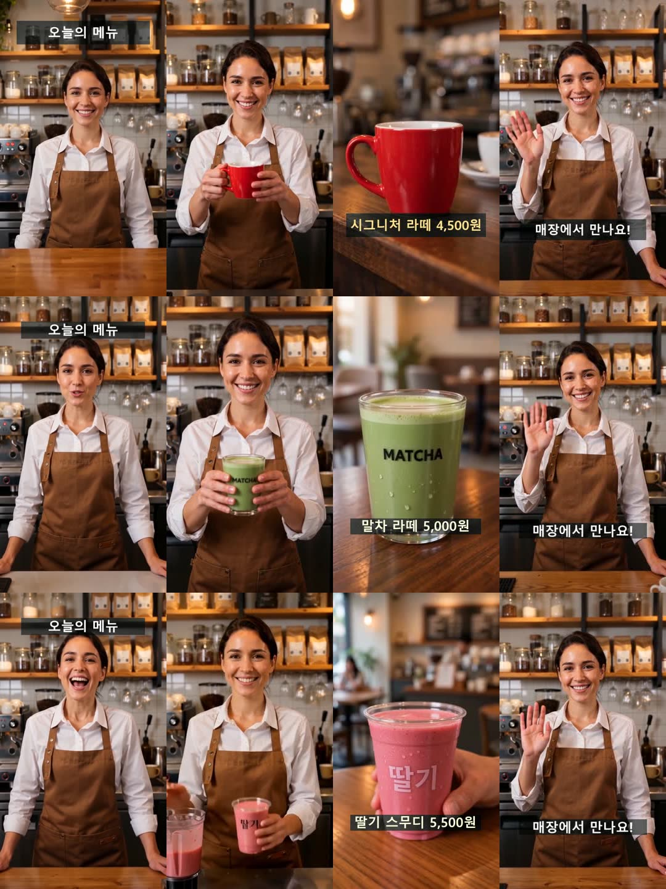
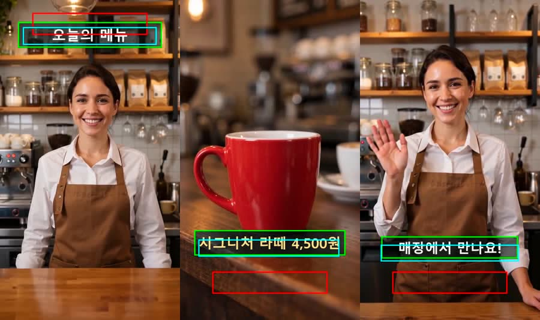
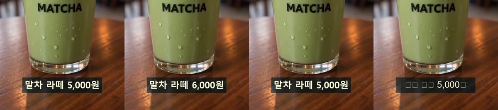
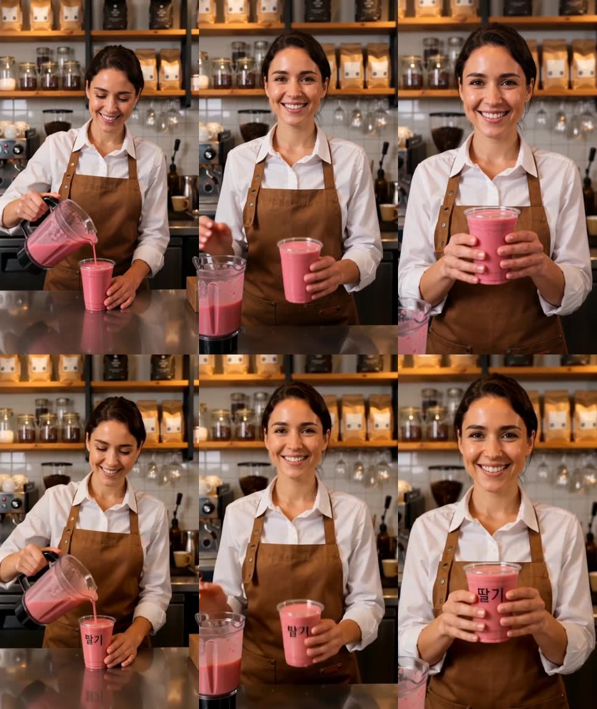

# 숏폼 한 편 → 테마 → 같은 테마의 시리즈 · 녹음 붙이기 · 화면 정보의 국소 수정

- 작성: 2026-11-14, 브랜치 `feature-US06-theme-series` (기준 `feature-US03-concept-ux` 2dd3f2e, 미푸시)
- 결정 기록: [ADR-0025](../adr/0025-theme-representation-and-extraction.md) (테마 표현·추출·외부 영상 보관),
  [ADR-0026](../adr/0026-series-episodes-identity-and-recorded-narration.md) (편 만들기·편 사이 정체성·사람이 녹음한 내레이션),
  [ADR-0027](../adr/0027-post-production-layer-and-local-correction.md) (후반 합성 층·화면 정보의 국소 수정),
  [ADR-0028](../adr/0028-script-extraction-and-evidence.md) (대본 추출·구조화의 근거),
  [ADR-0029](../adr/0029-script-only-correction.md) (대본만 고치기) — 뒤의 둘은 §8
- 앞선 기록: [character-consistency.md](character-consistency.md) (정체성 기준·일관성 검수·부모 클립 편집),
  [concept-ux-review.md](concept-ux-review.md) (다시 맞추기·유지할 요소·요구 반영 검수)
- 지출: OpenRouter **$1.82** / $4.00, OpenAI **$1.06** / $2.00 (§5.1 까지 $0.47, §8.3·8.4 의 대본 실험 $0.26, §8.7 의 실제 말소리 검증 $0.33)

## 1. 결론

요청은 세 가지다. 외부 숏폼에서 테마를 구조화해 뽑기, 그 테마로 시리즈 편을 만들고 녹음 붙이기, 화면 정보가 틀린 곳만 고치기.

| 목표 | 만든 것 | 실제 모델로 확인한 것 | 아직 확인하지 못한 것 |
|---|---|---|---|
| ① 테마 추출 | 숏폼 규격 판정, 컷·말소리 분석 포트, 프레임 기반 추출기, 테마 표현 | 대조군(FRAME 이 만든 4장면 16초)에서 객체 2/2, 장면 4/4 (경계 오차 0 ms), 요구조건 재현율 13~15/17, 화면 문구 3/3 (글자 오류 0), 문구 영역 IoU 0.57~0.66. 한 번에 $0.03~0.05 | **외부 숏폼** (후보를 찾았고 내려받기 승인을 기다린다, §5.7) |
| ② 시리즈 생성 · 녹음 | 편 계획(고정 요소는 코드가 넣는다), 편 사이 정체성(테마의 기준 이미지), 녹음 붙이기(인식 → 줄 맞추기 → 장면에 놓기) | 테마 하나로 편 둘 (편당 $0.85). 요구조건 36건 모두 통과, 그중 27건이 테마가 넣은 것. 고정 인물은 두 편 모두 테마 기준 이미지와 9/9 프레임 일치. 형식 4자리 × 4초 그대로 | **실제 말소리로 한 녹음 붙이기** (Fake·ffmpeg 계약 테스트까지. 말소리 파일이 없다, §5.6) |
| ③ 국소 수정 | 화면 검수(요구조건·일관성·문구·녹음) → 어긋남의 종류마다 가장 좁은 방법 | 얹은 가격을 틀리게 → 찾음 → 그 장면만 다시 합성 (나머지 3장면 바이트 그대로, 생성 호출 0). 자연 발생한 컵 불일치 → 그 장면만 편집 ($0.12, 41초) → 글자·일관성 통과, 나머지 3장면 재사용 | 움직이는 화면 속 글자를 가리고 다시 쓰기, 틀린 줄만 다시 녹음 (테스트로만 확인) |

- 테스트: 982 → **1652** 통과 (+670. §7 까지 1412, 대본 추출·연계·수정이 +108, 실제 말소리 검증으로 +132). 새 모듈이 대부분이고, 고친 공용 파일은 `config/container.py` (+15 −1) 와
  `presentation/main.py` (+4 −1) 둘이다.
- 실험 뒤에 백엔드 감사(24항목)를 반영했다 (§4.5): 돈이 드는 동작은 기본이 아니게, 같은 입력에는 한 번만 과금,
  수정 버전은 끝난 뒤에만 편의 기준 버전, 코드는 개념 단위 패키지로. §5 의 수치는 그 전에 잰 것이고 다시 재지 않았다.
- 실호출이 설계를 여러 번 바꿨다. 모델이 낸 것을 그대로 쓰면 안 되는 곳이 열 군데 넘게 나왔고 모두 코드와 테스트로 막았다 (§4.4).
  실험 중에 찾은 우리 쪽 결함도 넷이다: 합성 캐시 키에 글꼴이 빠짐, 가린 글자를 검수가 다시 지적함, 일관성 실패를 화면 검수가 놓침,
  기획이 물건의 글자를 한 장면에만 걺.



*위: 원본(대조군, 얹은 문구 포함). 가운데: 같은 테마의 첫 편(말차 라떼). 아래: 둘째 편(딸기 스무디). 자리마다 가운데 프레임.
인물·옷·장소·자리 구성·문구의 위치는 같고, 물건·가격·컵의 글자는 편마다 다르다. 둘째 편의 둘째 장면은 그 장면만 편집해 고친 뒤의 모습이다 (§5.5).*

## 2. 요청과 해석

요청 원문: "외부 동영상(기준 내 숏폼을 우선 검증)에 대하여 테마에 대한 구조화된 정보 추출 + 추출한 정보 바탕으로 동일 테마를 지닌
시리즈 숏폼 생성/녹음 및 화면 정보가 잘못된 경우에 대한 국소 수정을 지원하는 것이 목적임."

뜻이 갈릴 수 있는 세 곳은 시작할 때 사용자에게 물어 정했다.

| 낱말 | 정한 뜻 | 설계에 미친 것 |
|---|---|---|
| 기준 내 숏폼 | **플랫폼의 숏폼 규격** (YouTube Shorts · Instagram Reels) | 추출의 첫 단계가 규격 판정이다. 기준 밖이면 모델을 부르기 전에 거절한다 |
| 녹음 | **사용자가 녹음한 음성을 붙인다. TTS 는 쓰지 않는다** | TTS 포트가 없다. 길이는 대본을 쓸 때 맞추고, 받은 녹음은 자르지 않는다 |
| 외부 영상의 출처 | **무료 라이선스에서 후보를 제안** (내려받기 전에 파일마다 확인) | 후보 조사를 하고 승인을 기다린다. 대조군으로 먼저 검증했다 |

확인한 규격 (공식 문서, 2026-11-14)
- YouTube Shorts: 정사각 또는 세로, 3분 이하 (support.google.com/youtube/answer/15424877).
- Instagram Reels: 3분을 넘으면 새 시청자에게 추천되지 않는다 (about.instagram.com/features/reels).
  게시 API 규격은 3초 이상, 9:16 권장, 23~60fps, 가로 1920 이하, 300MB 이하 (developers.facebook.com 의 ig-user/media).
- 판정은 두 단계다. `REQUIRED` 를 어기면 숏폼이 아니고, `RECOMMENDED` 를 어기면 경고만 한다 (`domain/series/shortform.py`).

## 3. 선행 연구와 구현

조사는 세 갈래로 했다 (학술 논문, 오픈소스·상용 제품, 쓸 수 있는 API). 원자료는 저장소 밖에 있다.
**인용 확인**: 아래 표의 arXiv 논문 36편은 arXiv API 로 번호·제목·제1저자·게시일을 하나씩 대조했고, 본문에 옮긴 수치는 초록에서 다시 찾았다.
학회는 arXiv 기록(코멘트·저널 참조)에 적힌 것만 적었다. arXiv 에 없는 한 편은 Crossref 의 DOI 기록으로 확인했다.
"우리에게 주는 것" 은 논문의 주장이 아니라 이 과제의 해석이다.

### 3.1 과제 문서와의 연결

| 과제 문서의 생각 | 이번 작업에서의 자리 |
|---|---|
| 중간표현(IR)으로 조건을 구조화한다 (US-06) | 테마는 IR 의 어휘(객체 종류·술어·값)를 그대로 쓴다. 추출 결과에 원본 영상의 IR 이 함께 나와 정답 IR 과 견줄 수 있다 |
| 조건이 달라진 장면만 다시 만든다 (US-01, ADR-0003) | 같은 원칙을 후반 작업에 넓혔다: 문구를 고치면 그 장면의 합성만 다시 한다. 편의 조건을 고치면 그 장면의 클립만 다시 만든다 |
| 객체의 일관성을 타임라인에서 본다 (US-03, 지표 3 "고정 속성 유지율 90% 이상") | 한 편 안의 일관성을 편 사이로 넓혔다: 테마의 기준 이미지가 모든 편의 기준이다. 검수는 지금의 `vlm_consistency` 그대로다 |
| 요구 반영을 요구조건 단위로 알린다 (지표 2 "반영률 80% 이상") | 편의 요구조건을 '테마가 넣은 것' 과 '이 편의 것' 으로 나눠 센다. 테마가 넣은 것의 통과율이 시리즈의 약속이 지켜진 정도다 |
| 지정하지 않은 대상은 바뀌지 않는다 (지표 1 "비대상 변경률 10% 이하") | 문구 수정은 장면 파일의 바이트로, 클립 수정은 유지 요소 검수(`vlm_keep`)와 재사용된 클립 수로 본다 |

### 3.2 영상에서 구조를 되찾기 (추출)

| 인용 | 핵심 | 우리에게 주는 것 |
|---|---|---|
| Ge et al., 2025 · arXiv 2507.20939 · *ARC-Hunyuan-Video-7B: Structured Video Comprehension of Real-World Shorts* | 실제 숏폼은 시각·음성·문구의 정보 밀도가 높고 전개가 빨라 기존 모델이 약하다고 보고, 타임스탬프가 붙은 구조화 이해를 따로 다룬다 | 숏폼의 구조화가 별도 과제라는 근거. 프레임에 시각을 함께 준다 |
| He et al., 2026 · arXiv 2603.20354 · *Leum-VL Technical Report* | 숏폼을 6 차원(주체·미학·카메라 언어·편집·서사·확산)으로 나누고 각 라벨을 타임라인의 근거에 묶는다 | 테마를 차원으로 나누고(출연·형식·스타일·문구·말소리), 자리마다 시간에 묶는다 |
| Pu et al., 2026 · arXiv 2604.11102 · *OmniScript* | 영상을 시간에 근거한 계층적 대본으로 옮기는 과제와 평가 틀 | 추출 = 영상 → 구조화 대본. 평가는 시간 위치 + 필드별 정확도 |
| Xie et al., 2026 · arXiv 2609.08079 · *VI-Bench: Benchmarking Prompt Inversion from AIGC Videos* | 영상에서 다시 만들 수 있는 프롬프트를 되찾는 능력을 5 차원으로 잰다. VLM 18종 중 최고가 0.632 이고 샷이 늘수록 떨어진다 | 한 번에 통째로 묻지 말고 샷(자리) 단위로 나눈다. 추출한 것으로 다시 만들어 본다 (§5.4) |
| Zhu et al., 2023 · CVPR 2023 · arXiv 2304.06116 · *AutoShot* | 숏폼 853편·샷 주석 11,606개. 숏폼에서는 일반 검출기보다 F1 이 4.2% 높다 | 숏폼의 컷은 따로 검증해야 한다. 우리는 ffmpeg 의 장면 점수를 쓰고 임계의 여유를 쟀다 (§5.2) |
| Shi et al., 2025 · NeurIPS 2025 · arXiv 2505.21333 · *MME-VideoOCR* | 영상 속 글자 읽기에서 가장 좋은 모델도 73.7% 다. 프레임을 넘는 통합과 언어 사전 지식에 끌리는 편향에 약하다 | 모델이 틀린 글자를 맞게 읽어 줄 수 있다. 읽은 그대로 받아 적게 하고, 글자는 그대로 견준다 (§5.5) |
| Bain et al., 2023 · INTERSPEECH 2023 · arXiv 2303.00747 · *WhisperX* | Whisper 에 음성 구간 검출과 강제 정렬을 붙여 낱말 시각을 얻는다 | 말소리는 낱말 시각과 함께 받아 자리에 배정한다 |
| Liu et al., 2025 · NeurIPS 2025 · arXiv 2506.21356 · *ShotBench* | 촬영 문법 8 차원에서 VLM 24종 중 최고가 평균 60% 미만이다 | 카메라·구도는 모델의 추정이다. 스타일에 두지 않고 자리의 조건으로만 둔다 |

### 3.3 계획으로 여러 장면·여러 편을 만들기 (시리즈)

| 인용 | 핵심 | 우리에게 주는 것 |
|---|---|---|
| Lin et al., 2023 · COLM 2024 · arXiv 2309.15091 · *VideoDirectorGPT* | LLM 이 장면 설명·개체·일관성 묶음으로 된 계획을 쓰고 생성기가 그 계획으로 일관성을 지킨다 | 계획이 먼저다. 다만 우리는 고정 요소를 LLM 이 아니라 코드가 넣는다 |
| Song et al., 2026 · arXiv 2605.17423 · *Soap2Soap* | 영상 → 장면 인식 JSON 각본 → 참조 앵커 → 검증 뒤 선택 재생성 | 흐름이 같다 (참조 영상 → 구조 → 앵커 → 검증 → 일부만 다시). 방향은 반대다: 그쪽은 내용을 두고 겉모습을 바꾼다 |
| Liu et al., 2026 · arXiv 2608.22725 · *SEAM* | 샷마다 상태를 뽑아 기억에 넣고 프롬프트를 다시 쓴다. 편 사이 연속성 재현율 0.700 → 0.946. 생성 이미지 층의 향상은 아직 유의하지 않다고 적는다 | 글로만 잇는 것의 한계. 우리는 글 조건에 기준 이미지를 더하고, 화면에 반영됐는지는 따로 잰다 |
| Wei et al., 2026 · arXiv 2609.37407 · *Complementary Retrieval-Augmented Prompting…* | 대본을 시각 요소 레지스트리로 풀고 샷이 요구하는 요소를 덮는 참조만 고른다 | 편에 필요한 요소만 테마에서 꺼낸다 (자리에 나오는 출연의 고정 속성만 건다) |
| Shi et al., 2026 · arXiv 2609.00646 · *DramaChain Bench* | 숏드라마 제작 사슬의 단계마다, 그리고 편으로 묶은 뒤에 평가한다. 상류의 결함이 하류로 전파된다 | 단계마다 검수한다. 기획의 결함(글자를 한 장면에만 걺)이 영상의 결함이 됐다 (§5.4) |
| Bian et al., 2025 · arXiv 2510.20888 · *Video-As-Prompt* | 참조 영상을 그대로 의미 프롬프트로 쓴다 | 쓰지 않았다. 외부 영상을 생성 입력에 넣으려면 공개 주소가 필요하고 원본의 문구·얼굴이 따라온다 |
| Huang et al., 2025 · arXiv 2506.18899 · *FilMaster* | 컷 리듬은 생성 뒤의 편집으로 맞춘다 | 자리의 길이는 조건으로 주고, 남는 부분은 정규화에서 잘라 낸다 |
| Xu et al., 2025 · arXiv 2503.05242 · *MM-StoryAgent* | 글·이미지·오디오를 묶어 내레이션 있는 영상을 만드는 공개 틀 | 대본 → 음성 → 합성의 참조 구현. 우리는 음성을 합성하지 않는다 |

### 3.4 내레이션과 길이 맞추기

| 인용 | 핵심 | 우리에게 주는 것 |
|---|---|---|
| Yang et al., 2024 · ACL 2024 · arXiv 2405.14040 · *Synchronized Video Storytelling* | 클립 길이에 맞는 분량의 내레이션을 쓰는 과제를 정의한다 (전자상거래 광고 데이터) | 우리 ②와 거의 같은 과제. 자리 길이 → 글자 수 상한 → 지켰는가 |
| Wu et al., 2022 · AAAI 2023 · arXiv 2211.16934 · *VideoDubber* | 글자 수를 맞추는 것으로는 발화 길이가 맞지 않는다. 문장을 쓸 때 발화 길이를 제어한다 | 길이는 대본을 쓸 때 맞춘다. 기획에 자리별 발화 시간 예산을 준다 |
| McAuliffe et al., 2026 · Interspeech 2026 · doi:10.21437/Interspeech.2026-2734 · *Montreal Forced Aligner and the state of speech-to-text alignment in 2026* | 한국어를 포함해 정렬기를 비교한다 | 낱말 경계가 더 정확해야 하면 전용 정렬기가 있다 (큰 설치라 쓰지 않았다) |
| Peng et al., 2024 · ACL 2024 · arXiv 2403.16973 · *VoiceCraft* / Zheng et al., 2025 · EMNLP 2025 · arXiv 2511.12347 · *VoiceCraft-X* | 틀린 구간만 다시 합성하는 음성 편집. 뒤의 것은 한국어를 포함한다 | 쓰지 않았다 (음성 복제다). 우리의 소리 국소 수정은 그 줄만 사람이 다시 녹음하는 것이다 |
| Asaria et al., 2026 · arXiv 2606.18323 · *Reliable Neural-Codec Text-to-Speech by ASR Self-Verification…* | 합성한 음성을 인식해 되돌려 재면 실패를 걸러 낼 수 있다 | 같은 고리를 사람의 녹음에 쓴다: 녹음 → 인식 → 대본과 견주기 → 틀린 줄만 다시 |

### 3.5 틀린 곳만 찾아 고치기

| 인용 | 핵심 | 우리에게 주는 것 |
|---|---|---|
| Lee et al., 2024 · ACL 2026 Findings · arXiv 2411.15115 · *Self-Correcting Text-to-Video Generation… (VideoRepair)* | 틀린 영상에도 맞게 나온 영역이 있고 그것은 지켜야 한다. 불일치를 찾고 맞는 것을 보존하면서 문제 영역만 다시 만든다 | ③의 직접 선례. 무엇을 고칠지보다 무엇을 지킬지를 먼저 정한다 (유지할 요소) |
| Agarwaal et al., 2026 · WACV 2027 워크숍(WVAQ) · arXiv 2611.13178 · *Multimodal Judges Flag, Humans Decide* | 제품 숏폼 광고를 장면별 6 질문으로 검수하고, 확인된 문제마다 맞는 편집 도구를 연다. 사진과 함께 보는 제품 판정은 AUC 0.84 인데 일반 품질 점수는 우연 수준이다 | 같은 구조의 운영 사례. 문제의 종류 → 고치는 방법을 표로 잇는다 (ADR-0027) |
| Kumar B G et al., 2021 · ICCV 2021 · arXiv 2109.02762 · *STRIVE: Scene Text Replacement In Videos* | 글자를 정면으로 펴고, 한 프레임에서 바꾸고, 나머지 프레임에 옮긴다 | 움직이는 화면 속 글자를 고치는 길. 우리의 '가리고 다시 쓰기' 는 움직이지 않는 영역까지다 |
| Chen et al., 2026 · NeurIPS 2026 (E&D) · arXiv 2609.40356 · *ViTeX-Bench* | 실영상 387편으로 영상 속 글자 편집을 세 축(글자 정확성·품질·국소성) 13 지표로 잰다 | 글자 수정은 세 축으로 따로 잰다: 글자가 맞는가, 고친 곳 밖이 그대로인가 |
| Huang et al., 2026 · arXiv 2610.01499 · *VTR-Bench* | 11개 영상 생성 모델 중 가장 좋은 것도 글자의 낱말 오류율이 0.250 이다 | 얹는 문구를 생성 모델에 맡기지 않는다 |
| Zhang et al., 2026 · arXiv 2609.36598 · *Beyond Legibility… (VidScribe)* | 이미지→영상이 글자를 가장 잘 지키고, 영상→영상 국소 편집이 주된 병목이다 | 편집으로 글자를 고치는 것은 믿기 어렵다고 보고 시작했다. 한 번은 됐다 (§5.5, 표본 1) |
| Ku et al., 2024 · TMLR 2024 · arXiv 2403.14468 · *AnyV2V* | 첫 프레임을 고치고 그 편집을 영상 전체에 옮긴다 | 한 장을 정확히 고친 뒤 전파하는 길 (다음 단계) |
| Wu et al., 2024 · CVPR 2025 · arXiv 2411.10332 · *Number it (NumPro)* | 프레임마다 번호를 그려 넣으면 시간 위치를 번호로 읽는다 | 같은 생각을 공간에 써 봤다 (눈금자를 그려 글자 위치를 읽게 하기). **낫지 않았다** (§5.3) |

### 3.6 평가

| 인용 | 핵심 | 우리에게 주는 것 |
|---|---|---|
| Wang et al., 2024 · arXiv 2407.00634 · *Tarsier* / Chai et al., 2024 · ICLR 2025 · arXiv 2410.03051 · *AuroraCap* | 긴 설명의 평가를 작은 단위로 쪼갠다 | 추출을 통째로 견주지 않고 객체·장면·요구조건·문구로 나눠 정밀도·재현율을 낸다 |
| Ju et al., 2023 · arXiv 2310.01506 · *Direct Inversion (PIE-Bench)* / Li et al., 2025 · ICCV 2025 · arXiv 2503.13684 · *FiVE* | 편집 평가 = 고친 곳은 바뀌었는가 + 그 밖은 그대로인가. FiVE 는 VLM 으로 편집 성공을 판정한다 | 고친 영역의 안과 밖을 따로 잰다 (`region_ssim`). 성공은 요구조건 검수로 판정한다 |
| Zhao et al., 2025 · arXiv 2503.21749 · *LeX-Art* | 기대 문구와 읽힌 문구를 짝지어 편집 거리를 잰다 | 화면 문구를 짝지은 뒤 글자 오류율과 정확 일치를 함께 본다 |

### 3.7 오픈소스와 제품

오픈소스 (2026-11-14 조사. OpenMontage·MoneyPrinterTurbo·short-video-maker·ViMax 의 저장소와 라이선스는 GitHub API 로 다시 대조했다)

| 이름 | 라이선스 | 하는 일 | 우리와의 차이 |
|---|---|---|---|
| OpenMontage (OpenMontageInc/OpenMontage) | AGPL-3.0 | 참고 영상 → 분석 브리프(JSON) → 제작 → 사후 자체 검수 | **가장 가까운 선행 구현.** 브리프의 스키마(`video_analysis_brief`)를 직접 읽었다: 장면의 `on_screen_text` 는 문자열 하나이고, 인물·객체의 고정 속성, 문구별 위치·구실, 가격 같은 사실 값, 시리즈 재사용, 국소 수정 고리가 없다 |
| MoneyPrinterTurbo, short-video-maker, ShortGPT 등 숏폼 자동 생성 | MIT 등 | 주제 → 대본 → 음성 → 자막 → 소재 → 합성 | 코드를 읽은 다섯 저장소 모두 **음성을 먼저 만들고 화면을 그 길이에 맞춘다**. 우리는 반대다: 자리의 길이가 테마에서 오고, 녹음을 거기에 맞춘다 |
| huobao-drama, Toonflow, ViMax 등 드라마·스토리 도구 | 다양 | 대본에서 인물·장면·소품을 뽑아 참조 이미지를 먼저 고정하고 영상을 만든다 | 일관성을 문장이 아니라 저장된 자산으로 지킨다. 우리 테마의 기준 이미지와 같은 생각이다. 영상에서 뽑지는 않는다 |

상용 제품 (공식 문서 기준, 2026-11-14)

| 부류 | 예 | 되는 것 | 빈 곳 |
|---|---|---|---|
| 참고 영상으로 비슷한 영상 만들기 | InVideo, Topview, Creatify, Higgsfield, Dreamina | 구조·페이싱·컷을 유지하고 제품·인물·문구를 바꾼다 | 한 편 복제 단위다. 뽑은 구조를 데이터로 내주지 않거나 글로만 준다. 문구·사실의 검수는 사용자 몫이라고 안내한다 |
| 템플릿·시리즈 | HeyGen, Synthesia, AutoShorts | 템플릿 + 변수로 여러 편 | 템플릿을 사람이 만든다. 영상에서 뽑지 않는다 |
| 글로 고치는 편집 | Descript, ElevenLabs Dubbing Studio | 고친 구간만 다시 합성 | 음성 쪽이다. Descript 의 다시 합성은 영어만 된다 |
| 영상 국소 수정 | Runway, Kling, Luma, Pika | 2~30초 클립을 글로 지시해 편집 | 대부분 글로 지시하는 재생성이다. 글자를 따로 다루는 것은 Vozo(검출 → 지우기 → 다시 그리기)뿐이었다 |

### 3.8 쓸 수 있는 도구 (2026-11-14 공식 문서)

- OpenAI chat 은 영상 파일을 받지 않는다 (프레임 이미지로 보낸다). 낱말 시각을 주는 인식 모델은 `whisper-1` 뿐이다 ($0.006/분).
- OpenRouter 에는 영상 입력 chat 과 음성 인식·합성 엔드포인트가 있다. 영상 생성 목록은 11-12 와 같다 (Wan 3.0 은 2~30초, 1:1·9:16 등).
- 번들 ffmpeg 7.1 에 컷 점수, 글자 그리기, 가리기, 소리 자르기·빠르기·섞기가 다 있다 (ffprobe 는 없다). 새 설치 없이 세 목표를 모두 만들 수 있었다.
- 종료 예고: `gpt-4.1` 계열 2027-01-14, `whisper-1` 2027-02-26. 둘 다 포트 뒤에 있다.

### 3.9 정리: 가져온 것과 빈 곳

- 가져온 것: 샷 단위로 나눠 추출, 계획 먼저, 자산(기준 이미지)으로 일관성, 길이는 대본에서, 틀린 곳과 지킬 곳을 함께, 글자는 생성 모델에 맡기지 않기.
- 빈 곳 (이 작업의 자리): **영상에서 뽑은 구조가 '약속' 으로 저장돼 여러 편에 코드로 강제되는 것**, **화면의 글자 하나하나가 위치·구실·틀을 가진 데이터인 것**,
  **어긋남의 종류마다 다른 넓이로 고치는 것** (문구 한 줄 / 장면 한 개 / 대본 한 줄).

## 4. 설계와 구현

### 4.1 흐름

```
숏폼 한 편
  └─ ExtractTheme ─ 규격 판정 → 컷 → (말소리) → 프레임 추출기 → 테마 + 원본 IR + 화면 문구
테마 + 요청(제목·내용·변수)
  └─ CreateEpisode ─ 기획(편마다 다른 것만) → build_episode_plan(고정 요소는 코드가) → 편 계획
        ├─ IR ─────────── 지금의 생성·검수 흐름 (장면 단위 생성, 정체성 기준, 검수기)
        ├─ 화면 문구 ───── RenderEpisode (장면 단위 합성 → 이어 붙이기 → 소리 붙이기)
        └─ 녹음 대본 ───── AttachNarration (녹음 → 인식 → 줄 맞추기 → 장면에 놓기 → 트랙)
완성본
  └─ CheckEpisodeScreen ─ 요구조건 · 일관성 · 문구(계획) · 문구(화면) · 녹음 → 어긋난 곳
        ├─ CorrectEpisodeScreen ─ 문구 고침 / 가리고 다시 씀 / 그 장면만 다시 맞춤 / 그 줄만 다시 녹음
        └─ ReviseEpisode ─ 조건을 고쳐 그 장면만 다시 만듦
```

### 4.2 테마와 IR

IR 은 영상 한 편의 조건이고, 테마는 편 사이의 규칙이다 (ADR-0025).

| 테마의 부분 | 예 (대조군에서 뽑힌 것) | 편에서 |
|---|---|---|
| 고정 출연 `cast` | barista: outfit = white shirt and brown apron, hair = dark brown tied back … + 기준 이미지 | 모든 편의 같은 객체·같은 요구조건·같은 참조 이미지 |
| 형식 `format` | 자리 4개 × 4초, 9:16 | 편의 장면 수·길이·순서 |
| 스타일 `style` | location = cafe interior, lighting = warm and bright, mood = friendly and inviting | 모든 장면의 요구조건 |
| 문구 규칙 `text_rules` | 제목 "오늘의 메뉴" (자리 1), 가격 "{product_name} {price}" (자리 3), 행동 유도 "매장에서 만나요!" (자리 4) + 영역 | 변수 값을 넣어 화면 문구 |
| 변수 `variables` | product_name, price | 편을 요청할 때 채운다 |
| 내레이션 `narration` | 말소리 유무·말투·빠르기 | 녹음 대본의 길이 예산 |

### 4.3 포트와 어댑터

| 포트 | 실제 어댑터 | Fake |
|---|---|---|
| `MediaProber` · `ShotDetector` | ffmpeg (겉모습 읽기, 장면 점수) | 가짜 영상(JSON) |
| `SpeechRecognizer` | OpenAI `whisper-1` (낱말 시각) | 가짜 영상의 대본 |
| `ThemeExtractor` | 프레임을 읽는 LLM 한 번 + 문구마다 영역 다시 묻기 | 가짜 영상의 내용 |
| `SeriesPlanner` | LLM (받은 내용을 검사해 되돌려 보낸다) | 틀 채우기 |
| `AudioEditor` | ffmpeg (자르기·빠르기·늦추기·섞기·붙이기) | 가짜 소리(JSON) |
| `OverlayRenderer` | ffmpeg `drawbox`·`drawtext` | 얹은 것을 적은 JSON |
| `ScreenTextReader` | 영역을 잘라 LLM 에 읽힌다 | 얹은 문구를 돌려준다 (잘못 읽힘 주입 가능) |
| `ThemeRepository` · `EpisodeRepository` | 산출물 저장소의 JSON | 메모리 |

- Fake 와 실제 어댑터가 같은 계약 테스트를 지난다 (`tests/contract/`). ffmpeg 어댑터는 진짜 ffmpeg 로, LLM 어댑터는 재생 응답으로 돌린다.
- 설정은 `config/theme_settings.py` 의 `ThemeSettings` 에 있다 (`FRAME_THEME_EXTRACTOR`, `FRAME_SERIES_PLANNER`, `FRAME_OVERLAY_RENDERER` …).
  기본값은 모두 Fake·오프라인이다. 환경 변수는 서버 입구(`presentation/main.py`)에서 한 번만 읽고, 조립(`config/theme_wiring.py`)은 읽지 않는다.
- 고친 공용 파일은 `config/container.py` (`Container.series`) 와 `presentation/main.py` (설정을 읽어 넘기는 석 줄) 둘이다.
  `settings.py`·`registry.py`·`schemas.py`·라우터·`openapi.json` 은 고치지 않았다.
  **HTTP 라우터는 만들지 않았다** (§6).

### 4.4 실호출이 바꾼 것

모델이 낸 것을 그대로 쓰면 안 되는 곳을 실호출로 찾았고, 프롬프트가 아니라 코드와 테스트로 막았다.

| 단계 | 모델이 낸 것 | 막은 방법 |
|---|---|---|
| 추출 | 값을 한국어로 (정답과 견줄 수 없다, 요구조건 재현율 1/17) | 값은 영어 소문자 구로. 문구·브랜드만 원문 |
| 추출 | 객체 키에 겉모습 (`red_mug`) | 키에서 겉모습 낱말을 걷어낸다 |
| 추출 | 어휘에 없는 술어 (`visible`), 객체가 아닌 것을 향한 관계 (`looks_at camera`) | 버리거나 `action` 으로 옮긴다 |
| 추출 | 얹은 문구를 객체로도 적음, 색을 `light yellow` 로 | 원본 IR 에서 뺀다. CSS 색 이름으로 맞춘다 |
| 추출 | 스타일에 카메라 조건 → 모든 장면에 클로즈업이 걸림 | 카메라는 자리의 조건으로만 |
| 추출 | 문구의 상자가 어긋남 (IoU 0.31·0·0) | 문구마다 프레임 한 장으로 다시 묻는다 (§5.3) |
| 기획 | 지어낸 술어 (`speaks`, `overlay_text`) | 쓸 수 있는 술어를 알려 주고, 어휘 밖이면 되돌려 보낸다 |
| 기획 | 말할 문장 4줄 중 3줄이 장면보다 김 | 빠르기를 올려도 안 들어가면 글자 수와 상한을 알려 되돌려 보낸다 |
| 기획 | 테마의 장소를 `cafe counter` 로 바꿈 | 버리고 메모에 남긴다 (고정 요소는 코드가 넣는다) |
| 기획 | 컵의 글자를 따로 객체로 두고 한 장면에만 걺 → 같은 컵이 장면마다 다름 | 물건 위의 글자는 물건의 속성으로. 편 안에서 객체의 모습은 장면마다 같게 건다 |

### 4.5 감사 반영 (2026-11-14)

실험을 마친 뒤 백엔드 감사가 이 브랜치에 24항목(높음 1 · 중간 10 · 낮음 13)을 전했다. 고친 것을 묶으면 여섯 가지다 (넷째 줄까지와 마지막 줄은 감사 항목, 다섯째 줄은 사용자 기준 '절대 경로·하드 코딩 지양').

| 묶음 | 전 | 뒤 |
|---|---|---|
| 돈이 드는 동작은 기본이 아니다 | 화면 수정이 찾은 것 전부를 고치고 생성까지 접수했다. 가려서 고친 글자가 검수에 남아, 한 번 더 부르면 그 장면을 유료로 다시 만들었다 | 가려서 고친 것은 어긋난 곳에서 뺀다. 클립 수정은 `issue_ids` 로 짚은 것만, 생성 접수는 `generate=True` 를 줘야 한다 |
| 같은 입력에는 한 번만 과금 | 추출이 뒤에서 실패하면 음성 인식부터 다시 과금했고, 같은 영상을 두 번 주면 테마가 둘 생겼다. 재시도가 곱해져 프레임 24장짜리 요청이 최대 9번 나갔다 | 같은 영상·같은 추출기 지문이면 있는 테마를 돌려준다. 인식·화면 읽기의 결과를 입력의 해시로 남긴다. 추출의 되묻기는 따로 센다 (기본 2) |
| 키가 다른 주소로 나가지 않는다 | 인식 주소를 바꾸면 LLM 의 키나 환경 변수의 키가 그 주소로 갈 수 있었다 | 주소가 LLM 과 다르면 전용 키 파일만 쓴다. https 만 받는다 |
| 편의 기록이 어긋나지 않는다 | 편이 끝나지 않은 수정 버전으로 먼저 옮겨져, 실패하면 편이 멈추고 검수는 '어긋난 곳 없음' 이었다. 문서를 읽고 고쳐 통째로 덮어썼다. 실패한 붙이기가 녹음 파일을 덮어썼다 | 수정 버전은 끝난 뒤에만 기준 버전이 된다. 검수의 판정은 맞음·틀림·모름 셋이다. 편의 키를 쥐고 고친다. 녹음은 내용의 해시를 키로 둔다 |
| 컴퓨터에 묶인 값이 없다 | 글꼴의 설치 위치를 목록으로 적었고, 인식 모델·임계값 같은 기본값이 설정과 어댑터 두 곳에 있었다 | 글꼴은 운영체제의 글꼴 폴더에서 이름으로 찾는다. 설정이 정하는 값의 기본값은 설정 한 곳에만 둔다 |
| 코드는 개념 단위로 | 새 모듈이 다섯 계층에 평면으로 놓였고 500줄을 넘는 모듈이 둘이었다 | 계층마다 `series` 패키지, 음성 인식은 따로. 패키지 입구마다 맡는 개념·모듈 지도. 모든 모듈이 500줄 이하 |

코드가 놓인 자리

| 계층 | 자리 | 안에 있는 것 |
|---|---|---|
| 도메인 | `domain/series/` | `theme/` · `episode/` · `record` · `narration` · `screen_correction/` · `shortform` · `source_analysis` |
| 도메인 (일반 타입) | `domain/media.py`, `domain/speech.py`, `domain/screen.py` | 영상의 겉모습, 받아 적은 말소리, 화면 좌표와 문구의 구실 |
| 포트 | `application/ports/series/`, `application/ports/speech.py` | 원본 분석 · 테마 추출 · 기획 · 소리 편집 · 후반 합성 · 저장, 음성 인식 |
| 유스케이스 | `application/use_cases/series/` | 유스케이스 하나가 모듈 하나 (아홉 개) |
| 어댑터 | `adapters/series/`, `adapters/speech/` | 포트마다 하위 패키지 (fake 와 실제 구현) |
| 설정·조립 | `config/theme_settings.py`, `config/theme_adapters.py`, `config/theme_wiring.py` | 환경 변수 읽기, 개념별 어댑터 고르기, 유스케이스 묶기 |

미룬 것은 까닭과 함께 세션 노트의 '감사 반영 (11-14)' 표에 있다 (공용 모듈로 모으는 일은 머지 뒤 감사 세션이 한다).

## 5. 실험

### 5.1 설정과 비용

- 대조군: 앞선 실험에서 FRAME 이 만든 카페 영상 (4장면 × 4초, 480×854, 소리 없음, 2.19MB). 조건(정답 IR)을 우리가 안다.
  화면 문구 실험에는 이 영상에 문구 3개를 ffmpeg 로 얹은 것을 썼다 (문구·구실·영역·시간이 정답이다).
- 정답은 실행 전에 고정했다 (골드 주석의 sha256 을 먼저 기록). 채점은 #17 브랜치의 구조화 지표(객체·요구조건·장면의 정밀도·재현율)를 실험 하니스에서만 불러 썼다.
- 모델: 추출·기획·검수·문구 읽기 `gpt-4.1`, 영상 `alibaba/wan-3.0` 480p, 편집 `black-forest-labs/flux-video-edit`.
- 모든 유료 호출은 하니스가 원장에 적고, 호출 전에 한도를 확인한다. 배관은 가짜 영상 API 로 먼저 점검했다.

| 한 일 | OpenRouter | OpenAI |
|---|---|---|
| 추출 6회 (A1 ~ A2d) | — | $0.205 |
| 문구 영역 찾기 시험 9회 | — | $0.022 |
| 편 기획 (기획기를 고치며 여러 번) | — | $0.028 |
| 편 2개 생성 (8장면) + 검수 | $1.700 | $0.114 |
| 한 장면 편집 + 재검수 | $0.120 | $0.047 |
| 문구 읽기 검수 (여러 번) | — | $0.057 |
| **합계** | **$1.82** (한도의 46%) | **$0.47** (24%) |

### 5.2 추출: 대조군에서 정답과 견주기

| 실행 | 바꾼 것 | 객체 | 요구조건 재현율 | 값 불일치 | 장면 · 경계 오차 | 화면 문구 (글자까지) | 문구 틀 | 문구 영역 IoU | 비용 |
|---|---|---|---|---|---|---|---|---|---|
| A1 | 첫 프롬프트 | 2/2 | 1/17 | — | 4/4 · 0 ms | (문구 없음) | — | — | $0.024 |
| A1b | 값은 영어 + 후처리 | 2/2 | **15/17** | 0 | 4/4 · 0 ms | (문구 없음) | — | — | $0.029 |
| A2 | 문구 얹은 대조군 | 2/2 | 13/17 | 0 | 4/4 · 0 ms | **3/3** | 3/3 | 0.39 · 0 · 0 | $0.037 |
| A2b | 얹은 문구는 객체가 아님, 색 이름 | 2/2 | 15/17 | 0 | 4/4 · 0 ms | 3/3 | 3/3 | 0.29 · 0 · 0 | $0.032 |
| A2c | 카메라는 자리의 조건 | 2/2 | 14/17 | 0 | 4/4 · 0 ms | 3/3 | 3/3 | 0.31 · 0 · 0 | $0.033 |
| A2d | 문구 영역 다시 묻기 | 2/2 | 13/17 | 0 | 4/4 · 0 ms | 3/3 | 1/3 | **0.66 · 0.58 · 0.57** | $0.049 |

읽는 법
- **재현율만 본다.** 정답은 시나리오가 요구한 조건 17개뿐인데, 추출기는 보이는 것을 다 적는다 (정답에 없는 조건 36~38개).
  A1b 의 36개를 프레임과 하나씩 견줬다: 35개가 맞았고 1개(`camera: steady`)는 정지 프레임으로 확인할 수 없었다. 정답 대비 정밀도는 뜻이 없다.
- 빠진 것은 장면마다 달라지는 것(표정·자세·행동)과 카메라다. 고정 속성과 값은 틀리지 않았다 (값 불일치 0).
- 같은 화면인데 실행마다 13~15/17 로 흔들린다. 모델의 결과는 한 번의 표본이다.
- 문구 틀: 네 번 중 세 번은 고정 문구 둘을 고정으로, 한 번(A2d)은 변수로 뽑았다. 한 편만 보고 고정과 변수를 가르는 것은 추정이다.
- 컷: ffmpeg 장면 점수의 임계 0.1~0.3 에서 정답 그대로였고, 0.4 에서 하나를 놓쳤다. 같은 장소의 장면 사이 컷은 점수가 낮다. 기본값 0.3 의 여유는 크지 않다.
- 규격 판정: 대조군은 두 플랫폼 모두 기준 안이고 경고가 없었다.

### 5.3 화면 문구의 영역

추출이 준 상자는 위·아래 구분만 맞았다. 문구 규칙의 영역은 새 편의 문구가 놓일 자리라서, 첫 편의 가격 문구가 원본(화면 높이의 72%)보다 아래(85%)에 놓였다.
세 가지를 대조군의 정답 영역과 견줬다 (문구 3개, 문구마다 호출 한 번, $0.022).

| 방법 | IoU (문구 3개) | 평균 |
|---|---|---|
| 추출과 함께 (프레임 12장에 문구 여러 개) | 0.31 · 0 · 0 | 0.10 |
| ① 프레임 한 장에 문구 하나의 상자를 그대로 묻기 | 0.64 · 0.66 · 0.55 | **0.62** |
| ② 프레임에 눈금자·격자를 그려 눈금을 읽게 하기 | 0.46 · 0.50 · 0.38 | 0.44 |
| ③ ②로 찾은 곳을 확대해 다시 읽게 하기 | 0.44 · 0.65 · 0.37 | 0.49 |

- 눈금을 그려 주면 나아질 것이라는 예상은 **틀렸다.** 나아진 것은 '한 번에 하나만 묻기' 였다. ①을 추출기에 넣었다 (A2d: 0.66 · 0.58 · 0.57).
- ①도 띠의 높이를 글자 높이만큼만 잡는다 (0.08 → 0.055). 좌우와 세로 위치는 맞는다.
- 다시 물은 영역을 두 편의 문구에 반영했다. 문구는 후반 합성 층이라 **영상은 다시 만들지 않았다** (문구가 있는 세 장면만 다시 합성).
- 표본이 문구 3개, 실행 한 번이다.



*초록: 정답. 빨강: 추출과 함께 받은 상자. 하늘색: 문구마다 다시 물은 상자.*

### 5.4 시리즈: 테마 하나로 편 둘

대조군에서 뽑은 테마(A2c)로 두 편을 만들었다. 고정 인물의 기준 이미지는 대조군 원본에서 뽑은 것이다 (FRAME 이 만든 영상이라 허용된다).

| | 첫 편 (말차 라떼) | 둘째 편 (딸기 스무디) |
|---|---|---|
| 요청 | product_name = 말차 라떼, price = 5,000원, 컵에 MATCHA | product_name = 딸기 스무디, price = 5,500원, 컵에 한글 '딸기' |
| 기획 | `gpt-4.1` 1회 (그 전에 `gpt-4.1-mini` 의 기획을 세 번 버리며 기획기를 고쳤다) | `gpt-4.1` 1회 |
| 생성 | 4장면 $0.85, 장면당 122~124초 | 4장면 $0.85, 장면당 122~163초 |
| 요구조건 | 36건 (테마 27 · 편 9) **모두 PASS** | 36건 (테마 27 · 편 9) **모두 PASS** |
| 고정 인물 (테마 기준 이미지 대비) | 9/9 프레임 일치 | 9/9 프레임 일치 |
| 이 편의 물건 (첫 등장 프레임 대비) | 6/6 프레임 일치 | **3/6** — 장면 3의 컵이 장면 2와 다름 (FAIL) |
| 형식 | 완성본의 컷 4000 · 8000 · 12000 ms = 테마의 자리 | 같음 |
| 화면 문구 | 3/3 계획과 같게 읽힘 | 3/3 |
| 화면 속 글자 | MATCHA 가 맞게 찍힘 | '딸기' 가 맞게 찍힘 |

- **약속은 지켜졌다.** 두 편 모두 테마가 넣은 조건 27건이 통과했고, 인물은 같은 기준 이미지와 견줘 일치했다.
  둘째 편에서 기획이 장소를 바꿔 냈지만 코드가 버렸다.
- **Wan 3.0 이 한글 '딸기' 를 맞게 그렸다.** 문헌(§3.5)의 평균과 다르다. 짧은 낱말 둘을 본 것이다.
- **자연 발생한 문제**: 둘째 편의 컵이 장면마다 달랐다 (손에 든 컵에는 글자가 없고, 클로즈업의 컵에는 있다). 요구조건은 모두 통과했다.
  - 원인은 영상 모델이 아니라 기획이었다. 컵의 글자를 따로 객체로 두고 클로즈업 장면에만 걸었다.
  - 화면 검수는 이 편을 문제없음으로 보고했다 (요구 반영 검수만 옮기고 있었다).
  - 고친 것: 기획 규칙 둘 (§4.4 마지막 줄), 화면 검수가 일관성 실패도 어긋난 곳으로 보고, 편의 조건을 고치는 `ReviseEpisode`. 그 뒤 그 장면만 고쳤다 (§5.5).

### 5.5 국소 수정

**(가) 얹은 문구가 틀린 경우 — 영상 생성 없이**

첫 편의 가격 문구를 일부러 "말차 라떼 6,000원" 으로 바꿨다 (요청한 값은 5,000원).

| 단계 | 결과 |
|---|---|
| 틀린 문구로 완성본 | 다시 합성된 장면은 그 문구가 있는 **한 장면**. 다른 두 문구 장면은 다시 씀 |
| 화면 검수 | `OVERLAY_TEXT` 1건: 기대 "말차 라떼 5,000원", 관찰 "말차 라떼 6,000원". 테마의 문구 틀과 편의 변수로 견준다 (영상을 보지 않는다) |
| 국소 수정 | 그 문구 항목만 고침. 새로 합성 0 (원래의 합성 결과를 다시 씀) |
| 다시 검수 | 통과 |
| 보존 | 다른 세 장면의 파일은 세 상태 모두 **바이트 그대로**. 고친 장면도 처음과 바이트가 같고, 완성본의 지문도 처음과 같다 |
| 고친 장면의 SSIM (틀림 ↔ 고침) | 문구 영역 안 0.979, 밖 0.9985 |
| 비용 | 영상 생성 0, 문구 읽기 $0.0125 |

**(나) 계획은 맞는데 화면에 잘못 찍힌 경우**

한글이 없는 글꼴(Arial)로 합성했다. 세 문구가 화면에서 "□□□□□", "□□□□ 5,000□", "□□□□□□□!" 로 읽혀 3건이 나왔다.
문구는 맞으므로 자동으로 고치지 않고 글꼴을 확인하라고 알린다. 글꼴을 되돌리면 다시 합성되고 통과한다 ($0.0124).
이 실험에서 합성 결과의 키에 글꼴이 빠져 있던 것을 찾았다 (글꼴을 바꿔도 깨진 합성 결과를 다시 썼다).



*왼쪽부터: 맞는 문구, 일부러 틀리게 한 문구, 고친 뒤 (첫째와 바이트가 같다), 한글이 없는 글꼴로 찍힌 문구. 화면 아래쪽 절반.*

**(다) 장면의 내용이 틀린 경우 — 그 장면만**

둘째 편의 자연 발생 문제를 고쳤다. `ReviseEpisode` 로 둘째 장면에 `strawberry_smoothie.text = 딸기` 를 더하고,
인물의 모습·동작과 배경·조명을 유지 요소로 주어 부모 클립 편집으로 만들었다.

| | 결과 |
|---|---|
| 다시 만든 것 | 둘째 장면 하나 (`flux-video-edit`, $0.12, 41초). 나머지 세 장면은 부모의 클립 그대로 |
| 걸린 시간 | 접수부터 재검수 끝까지 84초 |
| 글자 요구조건 | `slot_2:strawberry_smoothie:text` PASS. 프레임 세 장을 직접 봤다: 모두 컵에 '딸기' 가 읽힌다 |
| 일관성 | 3/3 PASS (FAIL 이던 컵 포함, 6/6 프레임) |
| 유지 요소 (`vlm_keep`) | 4/4 PASS (인물 모습, 인물 동작, 배경, 조명) |
| SSIM 보존 | 0.678 로 FAIL. 편집 모델은 화면 전체를 다시 그린다. SSIM 만으로 보존을 판정하지 않는다는 앞선 결론(ADR-0018)과 같다 |
| 완성본 | 새로 합성 0 (문구가 있는 세 장면은 클립이 그대로라 합성 결과를 다시 씀) |
| 남은 차이 | 글자 색이 다르다 (둘째 장면은 검정, 셋째 장면은 흰색). 뚜껑의 차이도 남았다. 검수는 통과로 봤다 |



*위: 고치기 전 (컵에 글자 없음). 아래: 그 장면만 편집한 뒤. 같은 시각의 프레임 세 장.*

- 편집으로 한글 글자를 넣는 것은 어려울 것으로 봤는데 됐다. **표본은 하나다.**
- 검수가 찾은 것(`CONSISTENCY`, 장면 3)을 그대로 다시 맞췄다면 고쳐지지 않았을 것이다. 원인이 계획에 있었기 때문이다.
  검수가 적어 준 차이("printed text on cup")를 보고 사람이 조건을 정했다. 여기가 자동이 아닌 부분이다.

**(라) 테스트로만 확인한 경로**

- 화면 속 글자를 가리고 다시 쓰기 (`PATCH`): 틀린 글자가 자연스럽게 나오지 않았다. Fake 와 ffmpeg 계약 테스트로 확인했다 (그린 영역 안만 바뀐다).
- 일관성 실패를 그 장면만 다시 맞추기 (`CONSISTENCY` → REPAIR): Fake 로 확인했다.
- 틀린 줄만 다시 녹음: §5.6.

### 5.6 녹음 붙이기

제품 경로에 TTS 가 없으므로 말소리 파일이 있어야 실제로 시험할 수 있다. 지금까지 확인한 것은 다음이다.

- 줄 맞추기·놓기 규칙 (순수 함수, 단위 테스트): 다시 읽은 부분 건너뛰기, 숫자를 읽는 소리로 견주기, 넘치는 줄은 자르지 않고 알리기.
- 핵심어: "가격은 오천 원" 을 "가격은 육천 원" 으로 읽으면 글자 유사도는 0.83 이라 기준(0.6)을 넘는다. 변수 값(가격)이 녹음에 없으면 `MISMATCH` 로 잡는다.
- 소리 편집 (진짜 ffmpeg, 합성한 신호음): 자르기·빠르기·늦추기·섞기 뒤의 길이, 영상에 붙인 뒤 그림이 복사됐는가.
- 일부 줄만 다시 녹음하면 그 줄만 갈아 끼우고 나머지는 예전 녹음의 같은 구간을 쓴다 (Fake).
- 이 절을 쓸 때 하지 못한 것 (`whisper-1` 실호출, 실제 소리로 끝까지)은 그 뒤 §8.7.5 에서 했다: 오픈 데이터의 한 사람 목소리를 녹음의 대역으로 썼다.

### 5.7 외부 숏폼

무료 라이선스에서 후보를 찾았다 (영상 파일은 받지 않았다. 페이지·API 메타데이터와 썸네일만 봤다). 내려받기는 사용자 승인 뒤에 한다.

올린 사람의 작품이거나 스톡인 것

| 후보 | 받는 곳 · 라이선스 | 규격 | 쓸모 | 걱정되는 점 |
|---|---|---|---|---|
| Fried rice (Fateekachan) | Wikimedia Commons · CC0 (본인 작품) | 480×848 · 20.0초 · 3.09MB | 컷 약 6개, 사람이 안 나온다 | 어둡고 화질이 낮다. 문구 없음 |
| Crunchy cincin snack (Umabruka) | Wikimedia Commons · CC BY-SA 4.0 (본인 작품) | 1080×1350 (4:5) · 15.1초 · 3.64MB | 컷 5~6개, 글자 스티커, 손만 나온다 | 9:16 이 아니다 (규격 안이지만 경고). 좌우가 흐림 처리 |
| Making Cappuccino coffee (Stevenndori289) | Wikimedia Commons · CC BY-SA 4.0 (본인 작품) | 360×640 · 17.7초 · 1.59MB | 대조군과 같은 소재 (바리스타) | 한 컷, 저해상도, 끝에 얼굴 |
| A Woman Making Coffee (Mizuno K) | Pexels · Pexels License | 1080×1920 · 12초 · 약 3.3MB | 같은 소재, 깨끗한 화질, 얼굴이 가려져 있다 | 한 컷, 문구 없음. 약관이 자동 수집을 막는다 (단추로 직접 받는다) |

원래 YouTube 에 올라온 것을 다른 사람이 Wikimedia Commons 로 옮긴 사본 (라이선스는 원 채널이 붙인 것. 사용자가 직접 지정할 때만 쓴다)

| 후보 | 라이선스 | 규격 | 쓸모 |
|---|---|---|---|
| 요리 쇼츠 (Le Creuset) | CC BY 3.0 (검수 기록 있음) | 1080×1080 · 17.4초 · 2.65MB | 제목 카드 + 단계 자막, 컷 6~7개, 얼굴 없음. 소리 없음 |
| 운동 자세 쇼츠 (Andrew Kwong) | CC BY 3.0 (검수 대기) | 1080×1920 · 10.9초 · 3.71MB | 사람 한 명 + 기구 + 장소, 컷 3개 |
| 영어 회화 쇼츠 (VOA Learning English) | 퍼블릭 도메인 (검수 대기) | 1080×1920 · 14.3초 · 5.40MB | 말소리 + 자막. 알아볼 수 있는 두 사람 |

- 어느 라이선스도 영상 속 사람의 초상권을 풀어 주지 않는다. 얼굴을 기준 이미지로 쓰지 않는 설계(ADR-0025 결정 6)가 이 점에 맞다.
- CC BY-SA: 새로 만든 영상이 원본의 2차 저작물로 볼 만큼 닮았고 그것을 공개한다면 같은 라이선스가 따라온다. 연구용 실험에서는 공개하지 않는다.
- 조사하다가 멈춘 곳: 한 스톡 사이트(Mixkit)는 목록을 스크립트로 읽은 뒤에야 자동 접근 금지 조항을 봤고 그 뒤로 접근하지 않았다 (후보에서도 뺐다).
  Wikimedia 파일 서버는 자동 접근을 거절하기 시작해 멈췄다. 받을 때는 브라우저로 받거나 사용자가 직접 받는다.

## 6. 한계와 하지 못한 것

| 하지 못한 것 | 까닭 | 다음에 할 일 |
|---|---|---|
| 외부 숏폼에서의 추출·생성 | 내려받기는 사용자 확인이 필요하다 | 승인된 파일로 추출 → 한 편 생성 → 첫 편의 모습을 테마의 기준으로 (`AdoptAnchors`) |
| 실제 말소리로 녹음 붙이기, `whisper-1` 실호출 | (그 뒤 했다: §8.7) 오픈 데이터의 말소리와 합성 대역 음성으로 쟀다. 사용자의 실제 녹음으로는 아직이다 | 사용자의 녹음으로 |
| HTTP API · 화면 | 라우터와 `openapi.json` 은 다른 브랜치 넷과 겹치는 공용 파일이다. 프론트는 고치지 않는다 | 유스케이스는 `Container.series` 로 나와 있다. 합친 뒤 얇은 라우터를 더한다 |
| 화면 속 글자의 위치를 스스로 찾아 가리기 | 틀린 글자가 자연스럽게 나오지 않아 시험할 대상이 없었다. 영역 찾기는 얹은 문구에만 넣었다 | `locate_text` 를 화면 검수에 잇는다. 움직이는 글자는 추적이 필요하다 |
| 어긋남의 원인을 스스로 가리기 | 둘째 편의 문제는 계획에 있었고 사람이 조건을 정했다 | 일관성 검수가 적은 차이를 조건 후보로 바꾸는 단계 |

설계의 한계
- **한 편만 본다.** 고정과 변수의 구분은 추정이다. 같은 시리즈의 여러 편을 견주면 관찰이 된다.
- **결과가 흔들린다.** 같은 화면에서 요구조건 재현율이 13~15/17, 문구 틀 판정이 3/3 에서 1/3 까지 달랐다. 수치는 대부분 한 번의 실행이다.
- **대조군은 쉽다.** 우리가 만든 영상이고 장면마다 4초, 컷이 또렷하고 문구가 크다. 외부 숏폼은 컷이 짧고 문구가 작고 움직인다.
- **검수도 모델이다.** 요구 반영·일관성·문구 읽기가 모두 `gpt-4.1` 이다. 중요한 판정은 프레임을 직접 보고 확인했지만 전부를 보지는 않았다.
- **문구는 움직이지 않는다.** 등장 효과, 낱말 단위 강조 자막이 없다. 띠의 높이가 원본보다 조금 낮다.
- **긴 한 컷**: 컷이 없는 영상은 자리가 하나다. 생성 모델의 최대 길이(30초)를 넘는 자리는 만들 수 없다.
- **음악은 다루지 않는다.** 있었는지도 판정하지 않는다.

## 7. 재현

- 코드와 테스트는 이 브랜치에 있다. 검사: `python -m pytest -q -p no:cacheprovider -m "not slow and not gpu"` (1652 통과), `ruff check src tests`.
- 실험 하니스와 산출물(영상·원장·실행 기록)은 저장소 밖 스크래치패드에 있다. 세션 노트 `theme-series.md` 에 경로와 줄별 원장이 있다.
- 하니스의 순서: `a1_extract.py` (추출·채점) → `b1_series.py theme|plan|generate|render|check` (편) → `c1_overlay.py` · `c1b_font.py` (문구 수정) →
  `r1_region.py` (영역 찾기) → `b3_regions.py` (영역 반영) → `c2_revise.py` (장면 수정).
  §5 의 실행은 감사 반영 전의 코드로 했다. 지금은 생성 접수에 `generate=True` 를 줘야 하고, 수정 버전은 끝난 뒤
  `SettleEpisode` (또는 편을 읽는 다른 유스케이스)가 기준 버전으로 옮긴다.
- §8 의 실험: `e1_script.py <실행> <영상> [--script 받아쓰기.json] [--gold …] [--truth …] [--value 키=값] [--fix 줄=글]`.
  받아쓰기는 `exp/gold/c3_script.json`, 틀린 것은 `c3_script_wrong.json`. 결과는 `runs/e1_*/e1.json`, 한 표로 모으는 것은 `e1_report.py`.

## 8. 대본 추출 · 구조화 연계 · 대본만 고치기 (2026-11-14 추가)

지시: "영상 음성에서 대본 추출을 수행하는 기능을 추가 + 기존 구조화와 연계하여 품질 보완 및 대본 부분만 수정하는 것도 지원".
결정은 [ADR-0028](../adr/0028-script-extraction-and-evidence.md) (대본 추출·구조화의 근거)과
[ADR-0029](../adr/0029-script-only-correction.md) (대본만 고치기)에 있다.

| 목표 | 만든 것 | 확인한 것 | 아직 확인하지 못한 것 |
|---|---|---|---|
| ① 대본 추출 | 받아쓰기를 줄로 다듬는 규칙(줄·장면·신뢰도·지어낸 문장 거르기), 소리 읽기 포트(무음 구간), 한국어 수량 | 가짜 구현과 ffmpeg 계약 테스트. 순음 트랙에서 무음 구간이 줄 사이와 맞게 잡힘 | **실제 말소리.** 인식 오류율, 음악 위의 말, 지어낸 문장 거르기 |
| ② 구조화 연계 | 자리 경계, 추출기 질의의 대본 줄, 변수·화면 문구의 근거, 어긋남, 내레이션 규칙, 자막 규칙 | 실제 모델 7회: 말로만 한 변수 0/2 → 2/2, 틀린 받아쓰기의 어긋남 검출 1/1 (§8.3·8.4) | 요구조건 재현율은 달라지지 않았다. 자리 경계는 지어낸 사례로만 |
| ③ 대본만 고치기 | 뽑은 대본의 줄 교정(그 줄에 걸린 것만 다시 맞춤), 편의 대본 수정(영상 그대로, 바뀐 줄만 다시 녹음) | 줄 교정은 실제 모델로 뽑은 테마에서 추가 비용 $0·인식 호출 0. 편의 대본 수정은 테스트 | 사람의 녹음으로 갈아 끼우기 |

### 8.1 조사

읽기만 했다 (설치·계정 생성·유료 호출 없음). 확인한 날은 모두 2026-11-14 다. 출처 전체와 표는 저장소 밖의 조사 파일 세 개에 있다 (세션 노트에 경로).

**낱말 시각이 나오는 인식**

| 무엇 | 확인한 것 | 이 기능에서 |
|---|---|---|
| OpenAI `whisper-1` | 낱말·구간 시각을 주는 OpenAI 모델은 이것뿐이다. 구간마다 `avg_logprob`·`no_speech_prob`·`compression_ratio` 가 온다. 분당 $0.006. **2027-02-26 종료 예고**, 대체 모델 문서에는 시각이 없다 ([전사 API](https://developers.openai.com/api/reference/resources/audio/subresources/transcriptions/methods/create.md), [종료 일정](https://developers.openai.com/api/docs/deprecations.md)) | 지금 쓴다. 신뢰도 값을 대본의 줄로 옮긴다 |
| OpenRouter 전사 | 같은 multipart 형식. `prompt` 가 무시되고 구간 신뢰도 값이 문서에 없다. 모델별 낱말 시각 지원은 "공급자마다 다르다" 고만 적혀 있다 ([가이드](https://openrouter.ai/docs/guides/overview/multimodal/stt.md)) | 옮길 후보. 실호출 몇 건으로 확인해야 한다 |
| Whisper 의 낱말 시각 | 영어 공개 수치: 200ms 허용 폭에서 정밀도 79~85%, 재현율 52~63% ([WhisperX 논문](https://arxiv.org/abs/2303.00747)). 한국어 수치는 찾지 못했다 | 줄 경계에는 쓰고, 프레임 단위 판단에는 쓰지 않는다 |
| 지어낸 문장 | 비음성 구간에서 Whisper large-v3 가 40.3% 에서 글을 지어낸다. 앞뒤 비음성이 길수록 는다 (1초 0.3% → 30초 44.5%). 말 구간만 보내면 오류율 104.8 → 8.0 ([Barański 외, ICASSP 2025](https://arxiv.org/abs/2501.11378)). 공개 Whisper 의 기본 임계: `no_speech_prob > 0.6` 이면서 `avg_logprob < -1.0` ([transcribe.py](https://raw.githubusercontent.com/openai/whisper/main/whisper/transcribe.py)) | 그 임계로 줄에서 빼고 메모에 남긴다. 음악만 나오는 구간은 무음 검출로 못 거른다 |
| 설치형 (faster-whisper) | torch 없이 낱말 시각·낱말별 확률·내장 음성 구간 검출 ([README](https://raw.githubusercontent.com/SYSTRAN/faster-whisper/master/README.md)) | 승인 뒤의 후보 1순위 |
| 강제 정렬 (WhisperX·MFA) | WhisperX 에 한국어 정렬 모델이 있다 (숫자·기호 낱말은 시각을 못 얻는다). MFA 는 별도 환경이 필요하다. aeneas 는 한국어 미지원, Gentle 은 영어 전용 | 미룬다. 줄 단위에는 인식기의 낱말 시각으로 충분하다고 봤다 |

**화자·대사, 음악·소음**

| 무엇 | 확인한 것 | 이 기능에서 |
|---|---|---|
| 능동 화자 검출 (TalkNet·Light-ASD·SyncNet) | 25fps 전체 프레임, 얼굴 추적, torch 가 필요하다 | 프레임 몇 장으로는 못 쓴다 |
| 영상·소리를 함께 넣은 모델 | "누가 언제 말했나" 4지선다에서 사람 93.7%, Gemini 2.5 Pro 73.0% ([AV-SpeakerBench](https://arxiv.org/abs/2512.02231)) | 믿고 맡기기에는 낮다. **사람이 안 보이는 장면만 내레이션으로 확정** 한다 |
| 화자 구분 (pyannote·NeMo·호스팅) | pyannote 는 Hugging Face 계정과 조건 동의가 필요하다. OpenRouter 전사에 `diarize` 매개변수가 있다 (한국어 품질은 문서에 없다) | 하지 않았다 |
| ffmpeg 만으로 | `silencedetect`·`ebur128`·`astats`·`aspectralstats` 가 번들 ffmpeg 7.1 에 있다. 무음과 '소리 있음' 은 확실히 가른다. 말과 음악은 근사치이고 음악 위의 말은 못 가른다 | 무음 구간만 쓴다. 나머지는 '가르지 못한 소리' |
| 음원 분리 (Demucs 등) | Whisper 에는 늘 이득이 아니다. 노래 가사에서 분리 뒤 오류율이 35.7 → 44.0 으로 나빠졌다는 보고 | 기본 경로에 넣지 않는다 |
| 설치 후보 | `sherpa-onnx` (휠 18.8MB, Apache-2.0, torch 불필요): 음성 구간 검출·화자 구분·소리 종류 태깅이 한 꾸러미 ([저장소](https://github.com/k2-fsa/sherpa-onnx)) | 승인 뒤 |

**글로 하는 편집, 한국어의 수**

| 무엇 | 확인한 것 | 이 기능에서 |
|---|---|---|
| Descript | 글과 영상을 낱말 시각으로 묶는다. 글자 교정은 글만 바꾸고 그 부분의 정렬만 다시 분석한다. 자막은 대본에서 파생시킨다. 한국어 전사는 없다 ([교정](https://help.descript.com/script-editing/correct-your-transcript.md), [다시 정렬](https://help.descript.com/script-editing/realign-range.md), [자막](https://help.descript.com/visuals/captions.md)) | (가)의 구조와 같다: 줄 교정 → 그 줄에서 나온 것만 다시 맞춤 |
| Vrew (한국 제품) | 클립마다 인식된 말과 화면 자막을 따로 둔다 ([운영진 답변](https://vrew.imweb.me/tutorial/?bmode=view&idx=12646481&t=board)) | 줄마다 인식 원문(`heard`)과 고친 글(`text`)을 함께 둔다 |
| 부분 재녹음 (펀치 인) | 앞뒤 녹음은 두고 정해 둔 구간만 덮어쓴다 (Logic Pro·Audacity 문서). 말 빠르기의 최소 식별 차이는 약 5% 라는 실험이 있다 (Quené 2007) | (나)의 방식. 지금의 빠르기 상한 1.15배는 그보다 크다 (바꾸지 않았다) |
| 음성 합성으로 고치기 | Descript Regenerate 는 영어·본인 음성만. Voicebox 는 오용 위험으로 미공개, VoiceCraft 는 비상업 라이선스·동의 조항 | 쓰지 않는다 (제품에 TTS 없음) |
| 한국어 수 읽기 규칙 | 국립국어원 규범은 적는 법만 정한다. 단위마다 고유어·한자어 가운데 무엇으로 읽는지는 규범을 찾지 못했다 (조사자가 공개 문법들과 대조해 표로 정리) | 금액·퍼센트·개수·시간·무게·부피만 규칙으로. 어림수·전화번호·한 글자 수사는 사람에게 |
| NVIDIA NeMo 한국어 역정규화 | 2026년에 들어왔다 (Apache-2.0). `pynini` 가 Windows pip 설치를 지원하지 않는다 | 쓰지 않고 작은 규칙을 직접 짰다 |
| LLM 으로 받아쓰기 다듬기 | 불필요한 수정·과교정·수량 환각이 보고돼 있다 ("3 cm → 3킬로미터"). 잰 빈도 자료는 찾지 못했다 | 쓰지 않는다. 값의 같고 다름은 코드가 본다 |

조사 중 한 가지: 논문 PDF 주소를 열 때 읽기 도구가 사본을 세션의 도구 결과 폴더에 저장했다 (네 개가 남아 있고 합계 약 1MB, 하나는 조사 중에 지웠다). 의도한 내려받기가 아니고 저장소에는 들어가지 않았다.

### 8.2 만든 것

```
영상의 소리
  ├─ SoundReader ── 길이 · 무음 구간 (ffmpeg silencedetect)
  └─ SpeechRecognizer ── 받아쓰기 (구간 · 낱말 · 신뢰도 · 말이 아닐 가능성)        ← 과금은 여기 한 번
        └─ build_script ── 대본: 줄(시작·끝·글·장면·신뢰도·종류) + 말이 아닌 소리
              ├─ 자리 경계 ── 짧은 컷을 붙일 쪽을 말이 정한다 / 긴 한 컷은 말 멈춤에서 나눈다
              ├─ 추출기의 질의 ── "line 3 [S3 8.5-11.2s] 가격은 사천오백 원이에요. (values: 4500원)"
              └─ link_script ── 화면에서 읽은 것과 견준다 (모델 호출 없음)
                    ├─ 변수: 일치 · 어긋남 · 화면만 · 말만        ├─ 내레이션 규칙 (자리마다)
                    ├─ 화면 문구: 자막 · 말에 나온 문구 · 말하지 않음   └─ 자막 규칙 (말을 따르는가)
                    └─ 어긋남 (값이 다름 · 글이 조금 다름) ── 고르지 않고 남긴다
대본만 고치기
  ├─ CorrectSourceScript ── 뽑은 대본의 줄 교정 → 그 줄에 걸린 것만 다시 맞춤 (인식·추출 호출 0)
  └─ ReviseEpisodeScript ── 편의 대본 줄 + 그 줄을 따르는 자막 (영상 생성 0) → 바뀐 줄만 다시 녹음 → AttachNarration
```

- 대본(`domain/script/`)과 대본 추출(`use_cases/script/`), 소리 읽기 포트(`ports/sound.py`)는 음성 인식처럼 시리즈 기능 밖에 둔다.
  대본을 테마의 근거로 쓰는 일과 대본을 고치는 일은 시리즈 쪽에 있다 (`domain/series/script_evidence` · `script_correction` · `script_revision`).
- 테스트: 1412 → **1520** 통과 (+108). 모두 가짜 구현과 ffmpeg 로 돈다 (유료 호출 없음).

### 8.3 실험 E1: 같은 영상에서 대본이 있을 때와 없을 때

**말소리가 든 실제 파일이 없다.** 대조군(16초·4장면, FRAME 이 만든 영상)은 무음이다. 그래서
- 대조군에 '말한 구간에만 소리가 나는' 220Hz 순음 트랙을 ffmpeg 로 붙였다 (TTS 가 아니고, 내려받은 것도 없다).
- 음성 인식은 정해 둔 받아쓰기(네 줄)를 돌려주는 대역으로 바꿨다. `whisper-1` 은 부르지 않았다.

**재는 것은 인식 품질이 아니라 '대본이 있을 때 구조화가 어떻게 달라지는가' 다.** 받아쓰기가 완벽하다고 놓고 본 것이다.
프레임을 읽는 모델은 실제로 불렀다 (gpt-4.1, 프롬프트 판 2026-11-14.7, 프레임 12장, 7회 모두 한 번에 통과, 합계 $0.2583).

받아쓰기: "안녕하세요, 오늘의 메뉴를 소개할게요." (0.4~3.2초) · "부드러운 시그니처 라떼입니다." (4.3~7.4초) · "가격은 사천오백 원이에요." (8.5~11.2초) · "매장에서 만나요!" (12.4~14.8초)

| 영상 | 대본 | 요구조건 재현율 | 정밀도 (참고) | 변수 (정답: 시그니처 라떼 · 4,500원) | 화면 문구 (정답 3) | 비용 |
|---|---|---|---|---|---|---|
| 얹은 문구가 없는 대조군 | 없음 | 13/17 | 13/55 | 0/2 (변수 없음) | — | $0.028 |
| 같음 (다시) | 없음 | 14/17 | 14/57 | 0/2 | — | $0.031 |
| 같음 | 있음 | 14/17 | 14/42 | **2/2** (`menu_name`·`menu_price`, 말에서만) | — | $0.030 |
| 같음 (다시) | 있음 | 13/17 | 13/50 | **2/2** | — | $0.035 |
| 문구를 얹은 대조군 | 없음 | 13/17 | 13/49 | 2/2 (화면에서) | 3/3, 글자 오류 0 | $0.044 |
| 같음 | 있음 | 13/17 | 13/51 | 2/2 | 3/3, 글자 오류 0 | $0.046 |

모든 실행에서 객체 2/2, 장면 4/4, 경계 오차 0 ms 였다.

읽는 법
- **변수**: 화면에 문구가 없는 영상에서 말로만 한 상품 이름과 가격을 변수로 잡았다 (0/2 → 2/2, 두 번 모두). 가격은 '사천오백 원' 이라고 말했고
  변수의 값은 화면에 적는 꼴('4,500원')로 왔다. 코드가 그 값을 말한 줄을 찾아 근거로 남겼다 (`SPEECH_ONLY`, S2·S3).
  문구를 얹은 대조군에서는 화면에서 이미 2/2 였고, 대본이 있을 때 두 값 모두 '화면과 말이 일치'(`AGREE`: 4,500원 = 사천오백 원)로 확인됐다.
- **요구조건**: 재현율은 13~14/17 로 같다. 같은 조건을 두 번 돌린 차이(13 ↔ 14)와 같은 크기다. **대본은 영상의 조건을 더 잘 읽게 하지 않았다.**
  정밀도는 정답이 핵심 17건만 적은 것이라 낮게 나온다 (나머지가 틀렸다는 뜻이 아니다). 대본이 있을 때 조금 높아 보이지만 두 번의 실행으로는 말할 수 없다.
- **화면 문구의 글자**: 두 경우 모두 오류 0. 나아질 여지가 없었고, 대본을 줘도 나빠지지 않았다.
- **화면 문구와 말**: "매장에서 만나요!" 는 그 시간에 한 말과 같아 '말을 받아 적은 문구'(`SPOKEN`)로, "오늘의 메뉴"·"시그니처 라떼 4,500원" 은 '말에 나온 문구'(`PARTLY`)로 나왔다.
  모델이 그 문구의 구실을 자막이 아니라 행동 유도로 적어, 자막 규칙에는 '말을 따른다' 는 표시가 붙지 않았다.
- **내레이션 규칙**: 자리마다 글자 수 16·13·11·7, 말한 시간 2.8·3.1·2.7·2.4초, 시작 여유 0.3~0.5초, 전체 4.27자/초가 테마에 들어갔다.
- **줄의 종류**: 사람이 없는 셋째 자리(제품 클로즈업)의 줄만 내레이션으로 정해지고, 진행자가 보이는 세 자리의 줄은 '모름' 으로 남았다.
- **경계**: 이 대조군은 컷이 4초마다 또렷해 자리 경계 다듬기가 드러나지 않는다. 그 규칙은 단위 테스트의 지어낸 사례로만 확인했다
  (컷 3.5초·5.0초, 첫 문장이 0.3~4.8초: 말을 모르면 3.5초에서 나누고, 말을 알면 5.0초에서 나눈다).

### 8.4 틀린 받아쓰기와 줄 교정

같은 문구 대조군에 셋째 줄만 "가격은 **오천 원**이에요." 로 틀리게 한 받아쓰기를 줬다 (화면의 가격은 4,500원). 추출 한 번 $0.045.

| 본 것 | 결과 |
|---|---|
| 모델이 화면의 글자를 말에 맞춰 고쳤는가 | 아니다. "시그니처 라떼 4,500원" 을 읽은 그대로 적었다 (글자 오류 0) |
| 어긋남 | 1건: `VALUE`, 셋째 자리, 화면 4500원 / 말 5000원. 변수 `price` 의 근거는 `CONFLICT` |
| 뜻밖의 것 | 모델이 말한 값을 변수로 하나 더 선언했다 (`spoken_price` = 5,000원). 틀린 받아쓰기에서 온 변수다 |
| 줄 교정 (`CorrectSourceScript`: S3 → "가격은 사천오백 원이에요.") | 어긋남 해소. 다시 맞춘 것: 셋째 자리의 내레이션 규칙, 전체 빠르기, 말에만 있던 변수(`spoken_price` → 4,500원). 화면에서 본 변수 `price` 는 그대로 |
| 교정의 비용 | 추가 $0, 인식기 호출 0, 추출기 호출 0 |

### 8.5 편의 대본만 고치기

실제 모델·소리 없이 테스트로 확인한 것이다 (가짜 생성기·가짜 녹음).
- 대본 줄을 고쳐도 영상 생성 요청은 0건이고 편의 기준 버전·IR 은 그대로다. 자막도 소리도 바뀌지 않았으면 완성본도 그대로다.
- 녹음을 붙인 편에서 한 줄을 고치면 그 줄의 맞춤만 '읽지 않음' 이 되고, 트랙에서 그 줄의 소리만 빠진다. 인식은 다시 하지 않는다.
  화면 검수가 그 줄을 '다시 녹음' 으로 보고하고, 그 줄만 녹음해 주면 갈아 끼워진다 (나머지 줄의 맞춤은 그대로).
- 말을 따르는 자막 규칙이 있는 테마에서는 줄을 고치면 그 자리의 자막이 같이 바뀌고, 완성본을 다시 만들 때 그 장면만 다시 합성된다.
- 빠르기를 올려도 그 장면에서 말할 수 없는 줄은 거절한다. 고친 줄이 편의 변수 값(가격)을 빼거나 다른 값으로 말하면 알린다.

### 8.6 한계와 다음

- §8.3~8.5 의 수치는 '받아쓰기가 완벽할 때' 의 것이다. 실제 말소리로는 §8.7 에서 쟀다 (오픈 데이터 + 합성 대역 음성).
  아래 항목 가운데 수량 규칙·지어낸 문장·줄의 경계는 거기서 고쳤다.
- 실험은 대조군 하나, 조건마다 한두 번이다. 요구조건의 차이는 흔들림과 구분되지 않는다.
- 값이 어긋났을 때 모델이 변수를 하나 더 선언했다 (§8.4). 한 번의 관찰이고 막지 않았다.
- 음악과 소음을 가르지 못하고, 진행자가 나오는 장면의 줄은 내레이션인지 대사인지 모른다. 둘 다 소리를 듣는 모델이나 설치가 필요하다.
- 수량 규칙은 단위 붙은 수에 한한다. 띄어쓰기에 기대는 곳이 있다.
- 뽑은 대본의 줄을 나누거나 합치거나 더할 수 없다. 편의 대본을 고쳐도 화면 문구의 값은 따라 바뀌지 않는다.
- 그 뒤 승인받아 한 것 (§8.7): 오픈 데이터의 말소리로 `whisper-1` 실호출, 설치 (faster-whisper·sherpa-onnx·Kiwi — 실험 환경).
  아직 하지 않은 것: OpenRouter 전사의 낱말 시각·신뢰도, 소리를 듣는 모델로 음악·소음 가르기, 말이 든 외부 숏폼.

### 8.7 실제 말소리로 검증 (오픈 데이터 + 합성 대역 음성)

§8.3~8.5 는 정해 둔 받아쓰기로 쟀다. 사용자가 말소리를 **외부 오픈 데이터** 로 마련하고 **합성 대역 음성** 을 함께 쓰는 것, 그리고 설치를 승인해
(2026-11-14) 실제 소리로 다시 쟀다. 드러난 문제는 테스트부터 써서 고쳤다 (커밋 8205593 ~ fb78a03).

**말소리의 출처** (모두 저장소 밖에 두었고 커밋하지 않았다. 내려받기 전에 이름·출처·크기·라이선스를 보여 주고 확인받았다)

| 자료 | 받은 것 | 라이선스 | 받은 곳 |
|---|---|---|---|
| KSS (Korean Single Speaker Speech) | 고른 150발화 (성우 1명 낭독, 565초, 52.7MB). 원문(숫자)과 풀어 적은 글이 함께 있다 | CC BY-NC-SA 4.0 (비상업) — Kyubyong Park, 2018 | huggingface.co/datasets/Bingsu/KSS_Dataset |
| Zeroth-Korean | 시험 분할 전체 (10명 457발화, 71분, 59.8MB). 수를 한글로 풀어 적은 대본 | CC BY 4.0 — openslr.org/40 | huggingface.co/datasets/kresnik/zeroth_korean |
| FLEURS 한국어 | 시험 분할에서 고른 30발화 (360초, 23MB) | CC BY 4.0 — Google | huggingface.co/datasets/google/fleurs |
| 합성 대역 음성 | 5줄 (상품 이름·가격 문장, 72자). OpenAI `tts-1`, 음성 `alloy`. **사람 녹음이 아니다** | — | 실험 도구가 만든 것 ($0.0011) |

- 쓰임을 나눴다: 인식 품질·수량·줄의 경계는 오픈 데이터(사람의 말, 정답 대본이 있다)로, 영상 내용에 맞춘 줄은 합성 대역 음성으로 쟀다.
  제품은 음성을 합성하지 않는다 (`src` 에 TTS 가 없다).
- 배경음·잡음은 ffmpeg 로 만들었다 (뜯는 소리의 가락, 분홍 잡음). 웅성거림은 Zeroth 의 다른 발화 셋을 겹친 것이다.
- 설치 (실험 전용 가상환경, 공유 환경은 그대로): faster-whisper 1.2.1 + 모델 large-v3-turbo (1.62GB), sherpa-onnx 2.0.1 + 모델 둘 (29MB), kiwipiepy 0.24.1.
- 비용: whisper-1 $0.12, gpt-4.1 $0.20, tts-1 $0.001 = **$0.33** (OpenAI 누적 $1.06). OpenRouter 는 쓰지 않았다.

#### 8.7.1 수량 규칙을 대본 글로 재기 (무료)

오픈 말뭉치의 대본 13,919문장(KSS 12,854 · Zeroth 457 · FLEURS 608)에 수량 규칙을 돌렸다. KSS 는 같은 문장의 숫자 원문과 풀어 적은 글이 있어
정답 삼아 견줄 수 있다. 대조용 형태소 분석은 Kiwi 다 (실험 환경에만 있다).

| | 고치기 전 | 고친 뒤 |
|---|---|---|
| 한글로 적은 수량 가운데 낱말을 잘못 읽은 것 | 약 160 / 1,097 (15%) | 0 / 1,026 |
| KSS: 숫자 원문의 수량을 풀어 적은 글에서도 같은 값·단위로 뽑은 비율 | 92.0% (347/377) | 94.5% (410/434) |
| 형태소 분석으로는 '수사 + 단위' 인데 뽑지 못한 자리 | 117 | 84 |

- 잘못 읽은 것: '사회' → 4회 (29건), '공원' → 0원 (17), '두세요' → 2세 (15), '오세요' → 5세 (14), '세일' → 3일 (10), '사세요' → 4세 (9), '천장' → 1000장 (8),
  '공장'·'사장'·'한쪽'·'구분'·'사위'·'공개'·'두 분'(2분) … 가게 말에 흔한 낱말들이다 ('세일'·'사세요'·'오세요').
- 남은 '놓친 자리' 는 일부러 읽지 않는 것이다: 혼자 선 '이' ('이 분'·'이 층': 가리키는 말과 같다), '몇 명'·'수십 개' (값이 없다), '한번', '두 분' (사람).
- 숫자로 적은 쪽에도 함정이 하나 있었다: '4분의 1' (분수).

#### 8.7.2 인식 품질과 받아 적은 글의 수량

| 인식기 | 자료 | 글자 오류율 (읽는 소리로 견줌 / 수량을 한 꼴로 견줌) | 수량 정밀도 · 재현율 |
|---|---|---|---|
| whisper-1 (제품의 `ExtractScript`) | KSS 40발화 | 2.7% / **0.5%** | **100% · 100%** (45/45) |
| 같음 | Zeroth 43발화 | 6.4% / 4.9% | 95% · 94% |
| 같음 | FLEURS 10발화 | 5.3% / 4.9% | 100% · 93% |
| 로컬 (large-v3-turbo, 말 구간 검출 끔) | Zeroth 457발화 | 4.1% / 4.3% | 96% · 92% |
| 로컬 (검출 켬) | Zeroth 457발화 | **3.6%** / 3.6% | 96% · 95% |
| 로컬 (검출 켬) | FLEURS 30발화 | 4.1% / 3.8% | 100% · 94% |

- 인식기는 같은 수를 숫자로도 ('9시'·'2만원'·'5.94 시간') 읽는 소리로도 ('삼월'·'오년 밖에'·'삼층') 적는다. 값으로 견주면 둘이 같아진다:
  KSS 에서 글자로는 2.7% 다르고 값으로는 0.5% 다르다.
- 같은 발화에서 로컬(검출 켬)과 whisper-1 은 비슷하다: Zeroth 43발화 7.5% 대 6.4%, FLEURS 10발화 4.4% 대 5.3%. 로컬은 71분을 113초에 받아 적는다 (RTX 3090).
- 로컬은 말 구간 검출을 끄면 3발화가 통째로 빈 결과였다 (켜면 0). whisper-1 은 그 세 발화를 받아 적었다.

#### 8.7.3 줄의 경계 · 멈춤 · 말이 없는 소리 (정답 시각을 아는 16초 트랙 15개)

오픈 데이터의 발화를 대조군 영상(4초마다 컷)의 정한 시각에 놓았다. 발화 안에서 말이 시작하고 끝나는 때는 무음 검출로 쟀다.

| 트랙 | 고치기 전 (whisper-1) | 고친 뒤 (같은 받아쓰기) |
|---|---|---|
| 깨끗한 4줄 (KSS) | 시작 오차 −1167 · 129 · 239 · 156 ms, 끝 54 · 215 · 55 · −78 ms | 시작 0 · −3 · −71 · −2 ms, 끝 11 · 12 · 8 · 3 ms |
| 문장 안에 0.9초 멈춤 | 1줄 | 2줄 (멈춤에서 나뉨, 글자 오류 0) |
| 문장 안에 0.3초 멈춤 | 1줄 | 1줄 |
| 두 사람이 차례로 | 끝 오차 +1689 ms | +5 ms |
| 무음뿐인 트랙 | '고맙습니다.' (신뢰도 0.45, 과금됨) | 인식기를 부르지 않음 |
| 잡음뿐인 트랙 | '오늘도 영상 봐주셔서 감사합니다.' (0.14초에 열네 글자) | 줄 없음 (너무 빠르다) |
| 음악뿐인 트랙 | 줄 없음 | 줄 없음 |
| 5초 쉰 뒤의 마지막 한마디 | 빠짐 (1줄) | 그 구간만 다시 받아 적어 2줄 (추가 $0.0002) |
| 배경음·잡음·웅성거림 (말이 0~10dB 더 큼) | 글은 거의 그대로, 첫 줄 시작 −1167 ms | 그대로 (무음이 없어 맞출 곳이 없다) |

- 인식기의 글은 믿을 만하고 시각은 무음 쪽으로 어긋난다. 앞에 무음이 있는 발화 39개 가운데 36개에서 whisper-1 은 첫 구간이 0초에서 시작한다고 했다.
  낱말 시각도 같다: 멈춤을 다음 낱말의 앞에 붙여, 낱말 사이의 빈 시간이 0 이다. 낱말의 **끝** 은 맞는다. 그래서 잰 무음으로 맞추고, 낱말은 끝나는 시각으로 가른다.
- 지어낸 문장은 인식기의 값으로는 걸러지지 않았다: 신뢰도 0.45~0.74, '말이 아닐 가능성' 은 0.00~0.25 (무음 트랙 한 건만 0.94).
  실제 말소리 100구간은 신뢰도 0.52 이상, 말이 아닐 가능성 0.61 이하였다.
- 로컬 인식(검출 켬)은 무음·잡음·음악 트랙 모두 줄이 없고, 멈춤 트랙도 2줄이다. 잡음(0dB) 위의 말은 시작 오차가 −24~−521 ms 다.
- sherpa-onnx (제품 밖, 수치만): 소리 태깅은 음악만 → Music 0.84, 잡음만 → Pink noise 0.69, 말+음악(0dB) → Speech 0.72 · Music 0.72.
  Silero VAD 는 0dB 음악 위에서 말의 시작을 −75~+23 ms, 끝을 +237~+712 ms 로 잡았고, 말이 없는 세 트랙에서는 아무것도 잡지 않았다.

#### 8.7.4 구조화 연계 — 실제 받아쓰기로 (gpt-4.1 + whisper-1, 5편 $0.21)

| 영상 | 말소리 | 받아 적은 줄 | 변수와 근거 | 어긋남 |
|---|---|---|---|---|
| 문구 대조군 (화면: 시그니처 라떼 4,500원) | 합성 대역 음성, '사천오백 원' | 4줄, 글자 오류 0, 경계 7~74 ms | 상품 이름·가격 둘 다 `AGREE` (받아 적은 글은 '4,500원') | 없음 |
| 같음 | 합성 대역 음성, '오천 원' | 4줄, 오류 0 | 가격 `CONFLICT` (화면 4,500원 / 말 5000원) | `VALUE` 1건 |
| 원본 대조군 (화면 문구 없음) | 합성 대역 음성 | 4줄, 오류 0 | 둘 다 `SPEECH_ONLY` (말에서만) | 없음 |
| 화면에 '전 품목 최고 30% 할인'·'48시간 이내 배송' | 사람 (KSS 3발화) | 3줄, 오류 0, 경계 0~12 ms | 할인율·배송 시간 둘 다 `AGREE` ('30퍼센트' → '30%') | 없음 |
| 화면만 '최고 50% 할인' | 사람 (같은 소리) | 3줄 | 할인율 `CONFLICT` (화면 50 / 말 30) | `VALUE` 1건 |

- 정해 둔 받아쓰기로 본 §8.3·8.4 의 결과가 실제 받아쓰기에서도 그대로 났다. 값이 어긋난 두 편에서 모델은 화면의 글자를 읽은 그대로 적었고,
  말한 값을 따로 변수로 선언하지 않았다 (§8.4 에서 한 번 있었던 일).
- 자리마다의 내레이션 규칙(말한 시간·시작 여유)이 다듬은 경계로 들어갔다 (시작 여유 523·717·914·917 ms).
- 가격을 다르게 말한 편에서 그 줄을 고치자 (`CorrectSourceScript`) 어긋남이 풀리고 그 자리의 내레이션 규칙만 바뀌었다. 유료 호출 0.

#### 8.7.5 편의 대본만 고치기 — 실제 소리로 (whisper-1 만, $0.01)

사람이 대본을 읽은 녹음의 대역으로 KSS 의 한 사람 목소리를 썼다. 영상 생성기·추출기는 가짜다.

| 단계 | 결과 |
|---|---|
| 대본 네 줄을 KSS 문장으로 고침 (`ReviseEpisodeScript`) | 줄 4개 바뀜, 영상·인식 호출 0 |
| 네 발화를 이은 파일 하나를 붙임 (`AttachNarration`) | 4줄 모두 대본과 맞음 (유사도 1.0), 제 장면에 놓임 |
| 셋째 줄의 글을 고침 | 그 줄만 '다시 녹음', 트랙의 그 자리가 무음, 비용 0 |
| 옛 글을 읽은 녹음을 그 줄에 붙임 | '대본과 다르다' (유사도 0.26) |
| 새 글을 읽은 녹음만 붙임 | 그 줄만 갈아 끼움 (인식 3.8초), 나머지 줄은 그대로 |
| 넷째 줄을 합성 대역 음성으로 갈아 끼움 | 같은 경로로 맞춤 검사를 지남 |

- 고친 것: 인식기가 녹음 앞의 무음을 첫 낱말에 붙이는 탓에 무음까지 잘라 놓고 있었다. 줄의 구간을 소리가 나는 곳으로 자른다.
  첫 줄 0~2100 ms → 767~2097 ms, 다시 녹음한 줄 0~3260 → 1156~3260 ms. 트랙에서 그 줄의 말이 1.08초 일찍 (제때) 시작한다.

#### 8.7.6 남은 것

- 배경음·잡음이 내내 깔린 영상에서는 줄의 경계를 맞추지 못하고, 잡음 위에서 그럴듯한 길이로 지어낸 문장을 API 인식에서는 거르지 못한다.
  말 구간 검출이 든 로컬 인식(`FRAME_SPEECH_RECOGNIZER=faster_whisper`)을 쓰거나, API 인식 앞에 검출을 두는 포트가 필요하다.
- 오픈 데이터는 낭독이다. 실제 숏폼의 빠른 말·겹친 말·효과음은 재지 못했다. 말이 든 외부 숏폼은 여전히 받지 않았다.
- 음악과 소음을 가르는 것, 화자를 가르는 것은 제품에 없다 (sherpa-onnx 의 태깅은 시험 트랙에서 됐다).
- 기준값 몇 개는 적은 표본에서 정했다 (다시 받아 적기의 신뢰도 0.6, 말이 아닐 가능성 0.9, 1초에 스무 글자).
- 재현: `scratchpad\exp\` 의 `n1_quantities.py` (수량), `e2a_corpus_asr.py`·`e2b_whisper.py` (인식), `e2c_plans.py`·`e2c_compose.py`·`e2c_script.py` (트랙),
  `e2d_materials.py`·`e2d_theme.py`·`e2d_fix.py` (연계), `e2e_episode.py` (편), `e2f_local_adapter.py` (로컬 어댑터), `e2g_sherpa.py`, `t1_tts.py` (합성 대역 음성).
